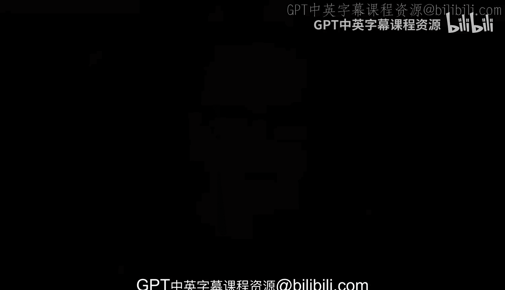

# 杜克大学《大型语言模型实践（生成式AI简介、Azure的LLMs（1、2课，共6课）｜Large Language Model Operations》 - P135：58_03_07_总结_3.zh_en - GPT中英字幕课程资源 - BV1Ef421m7zD

Al right， so we were able to create functions， we were able to create this actual native function as it's known in the semantic kernel and what does that look like and we saw some of the the secret pieces that we have there so that we can actually consume some arguments and we're using behind the scenes the large language model to help us identify what are those arguments so that we can pass them on the function and we can use those to talk to an external microservice having a microservice an external microservice API and an HtTP API it's a very common practice and a very common pattern so that we can delegate responsibilities of information to a separate service This is one of the main reasons I decided to make it part of the course so that you can see what else is out there in what else is possible as you try to。

putut these services together and what are some of the possibilities of extending the services and definitely native functions or Python functions in this case that are able to receive arguments from a user so that you can retrieve information it's a very solid pattern that you can actually implement。

