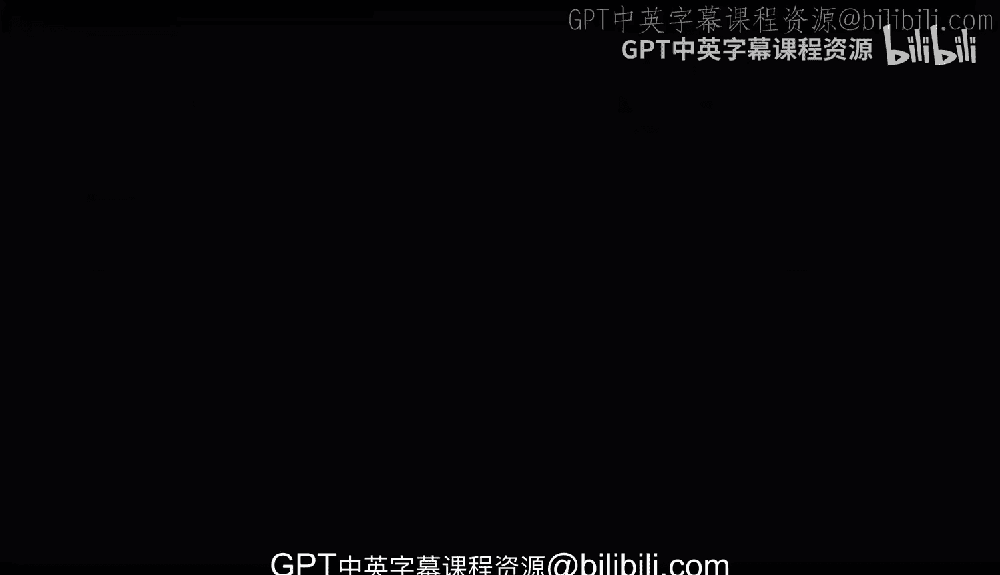
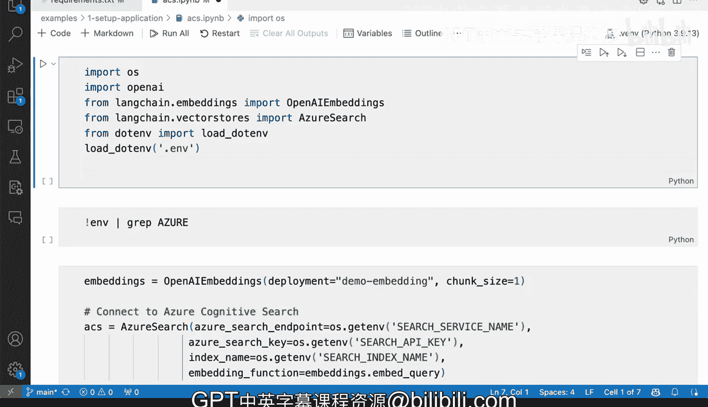

# 杜克大学《大型语言模型实践（生成式AI简介、Azure的LLMs（1、2课，共6课）｜Large Language Model Operations》 - P143：66_04_02_创建Azure资源.zh_en - GPT中英字幕课程资源 - BV1Ef421m7zD

For the application for what we're trying to do with Azure and create the vector database。

 the index and everything related for our application we'll have to create some some resources we've already already created the demoredo search right here which is the search service now let's go and make sure that we create an open AI and we're going to go ahead and quickly go through our way of creating that open AI so when I create a new one called demoredo and we can call it like that and it's actually the same resource group as we had before is US2 is US sounds correct to me and we can say demoredo。

And I think that should be fine and we need to make sure that that's accurate and its also it's also unique so all of those things are good and we're going to make sure that I can click next and it's going to have access from everywhere I'm to click next here I'm not going to add any tags and finally I'm going to go ahead and create so this is going to take a second。

Okay so before I actually go to the code I want to show you something that the research was finished but I'm going to click refresh and now now I'm in these these service that I just created so the one thing that we need to create is the embeddings service so or one of the endpoints actually so I'm going to go to the Azure Open AI studio and now that this has loaded I'm going to look at the models and then I am going to look at the embedding so you can see here that I have embedding options for the model names and I'm going to go ahead and choose and deploy one so the one that I'm going to choose is these one the text embedding Ada and I actually need to go ahead and deploy these so that I can make it available for my search so I'm going to say demo search。

As the deployment name you'll have to make sure that this is actually captured later and this is what's going to help us produce the embeddings produce to vectorize our data so we're gonna to have some data and we're going to be able to do that so you can also poke around the advanced options we're not going touch any of these ones and click create As you know this is pretty pretty fast successful create deployment we're going to verify that that's available demo search is right there so that is how I get to those and next I'm going to show you what are some of the requirements that we're going need to install now with the code All right so here have the requirements and in here when to show you a couple of different things you will need to have these very specific versions for everything to work we will require azure search documents but one thing that I wanted to show you specifically is we're going to use Lcha Lcha is similar to semantic kernel。

That we've seen before it is a framework for dealing with large language models and it will make our interaction easy。

 we will also be using openaiI the library so that we can interact with Azure seamlessly while we're using Laangcha as well finally will have some application later and so that's why we have fast API here antitick token is actually a requirements so that we can do the embeddings with Azure search documents Finally very quickly I'm going to show you the notebook and how we're going to why we need openaiI when we need a Laangcha and vector stores so Laangcha will provide us the ability to connect to Azure search and from Laangcha will also have the open AI embeddings the embeddings is what will help us try to produce exactly what we need in order to populate。

the indexes that we've seen before， those are all the requirements to get started once you finish installing the libraries in your Python environment and you've created the Azure services。

 you will be good to go to start working with your data。

