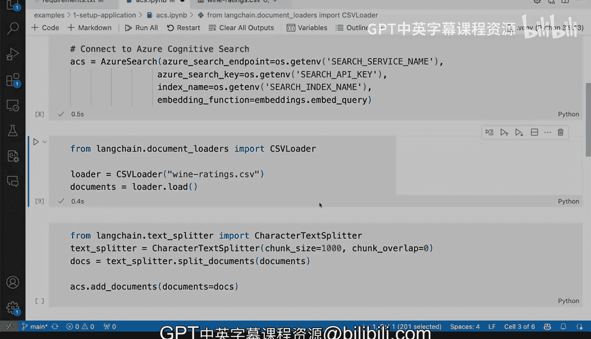

# 杜克大学《大型语言模型实践（生成式AI简介、Azure的LLMs（1、2课，共6课）｜Large Language Model Operations》 - P144：67_04_04_创建嵌入向量.zh_en - GPT中英字幕课程资源 - BV1Ef421m7zD

Now we're ready to create the embeddings。 We're ready to split our text and start uploading our data into Azure AI search previously known as Azure cognitive services search。

 So what we're going do is what we're going use our notebook here。

 but instead of just hitting the play button right here and for each cell and just show you how these things execute let me show you what we're gonna be doing。

 we are going to be doing， we're going to be looking at some wine ratings and the wine ratings actually come from a repository that I've previously downloaded and I want to show you what that looks like。

 It is a wine dash ratings that CSB。 So we have an index column We have we have name， we have the。

Cpe， the region， the variety， the rating and the notes。

 so this is an interesting way of interacting with something that we want to extend we want to make it easier。

 we want to make it easier for the service to be able to provide us from information。

 but one of the problems with retrieval augmented generation is that when we're creating。

 when we're splitting when we're chunking documents into bits and pieces。

Sometimes it's not entirely clear how we can do that with something like these that essentially it's a dataset is is a CSB a comma separated value data so what is it that we need to do here well line chain the framework will allow us to get these get all of these contents right here and chunk them into pieces and be able to embed them into the database so this is wind ratings that CSB I'm going to go I'll scroll all the way to the top and start going one by one now note that I have a that EMV in that EMB file you will have to have your keys and your secrets for your 4D application so actually if I show you very quickly the readme you will see that this is very well explained right here so if I'm going。

I'm gonna scroll here these key in a very nicely well- renderndered way how it should look like Not that I'm using search service name。

 search API key and search index name and I'm using Azure cognitive search or Azure AI search I'm calling them like these because you will later see that when I deploy this will become problematic if these are more if these keys are more than 20 characters in length so you'll have to have all of these keys。

 these keys are not right now these are made up keys but this is kind of like how it should look like so make sure that you have all of that data ready in your EMV or the data will not load so I'm going to closer with me go back to the Jupyter notebook and I'm going to start executing here so things uploaded I have my Azure my my keys。

 everythings ready to go and I'm going to use the open AI embeddings this class comes from。

Langchain and is's going to do the embeddings from it's going to be able allow me to chunk and split the text and then I am going to create create the allow the embeddings instant that I' when I say chunk size and what the deployment is for open AI。

 that's the demo search or demo embedding， whatever you name your deployment。

 this is where it comes crucial。Now connect to Azure cognitive search。

 this is what we're going to do right here and is' going to be using the endpoints。

 the right endpoints， the API key， the search index name which we created when we created the Azure AI search that index name becomes crucial there and embedding functions is going to be the embed query that comes from right here so that's all taken care of for us and how do we process how do we chunk how do we get that CSB what we're gonna to use another helper from Lcha and it's document loaders and there's a CSB very convenience CSv loader that we will be used all we need to do is passing the path and do a loader that load so we' gonna do that we're gonna to run that and that only took about half a second。

So right now we've been able to use a CSB file， we've been able to gather the information and we've been able to do the loading what next we'll actually be able to slurb those in and we'll see that later。

