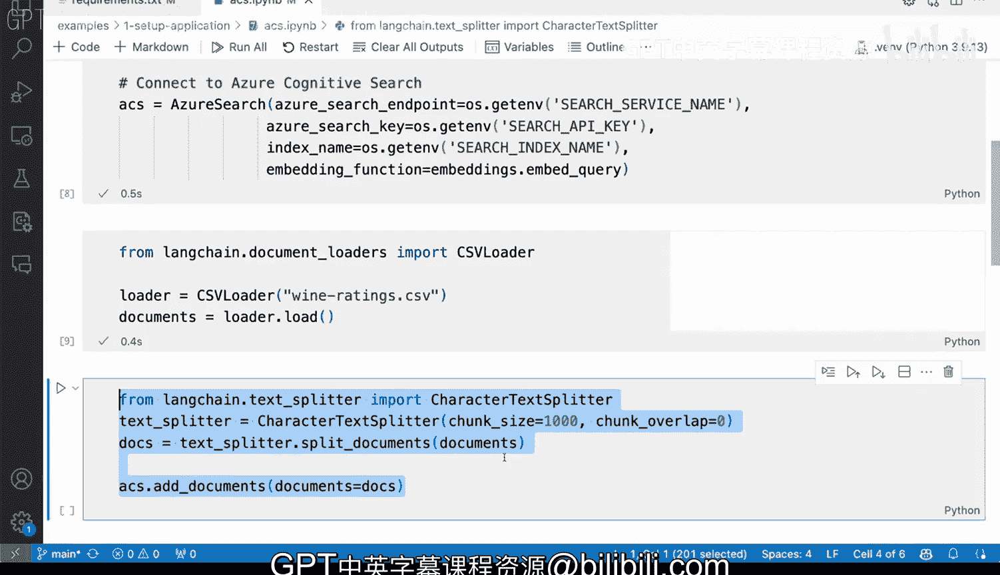

# 杜克大学《大型语言模型实践（生成式AI简介、Azure的LLMs（1、2课，共6课）｜Large Language Model Operations》 - P145：68_04_05_创建并上传索引.zh_en - GPT中英字幕课程资源 - BV1Ef421m7zD

All right back to the Jupyter notebook once again， what we've done a quick recap。

 we've connected to Azure cognitive search and we have loaded our CSB file our wine dash ratings that CSB file which has tons of information that we want to interact with a larger language model so next what we're going to do is we are going to use another yet another useful feature from Lachain which is the text splitter and this is going to be the characters splitter and it's going to allow us to produce these chunks and we're going to be able to split the text which is required so that we can we can produce that so actually one last thing is that once we do that we're going to be able to add these right here using the ACS and ACS。

 where is that coming from， well this ones coming from the Azure search。

The variable that we created in the beginning。 So not only we are splitting the documents and in chunks。

 but we are also going to add the documents。 Now， remember when I created the service I used the free tier and this is going to produce way。

 way more way more than my free tier will allow。 So if I run this I' will get to a point where it no longer runs。

 I'm not going to hit play because I've already done it and this has already produced a very a very good index for me Sos that's all good。

 I'm not going to run this again， you might get into travel。

 if you're trying to add the documents again， if your indexes if your threshold for the tier where you're at is at its max。

 So something to keep in mind and this process by the way。

 will also take a very long while because you will be able。

You will essentially have to connect these services together and process in chunks all of that text。

 the bigger the documents， larger the documents， the longer it will take。

