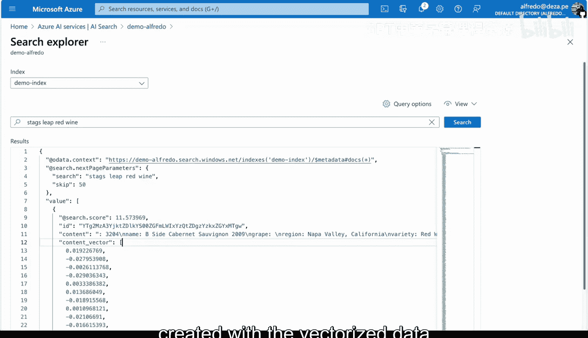

# 杜克大学《大型语言模型实践（生成式AI简介、Azure的LLMs（1、2课，共6课）｜Large Language Model Operations》 - P146：69_04_06_验证嵌入向量.zh_en - GPT中英字幕课程资源 - BV1Ef421m7zD

Let's verify our index now that we have produced our embeddings and we're back here on the Microsoft Azure portal and I've created oh I've gone through my AI search that I previously created so I'm going to go to the search Explorer for what I have I'm going to click here and remember I had a CSP about wine。

 the wine had regions， node， ratings and grape so it had a fewer columns but we'll start playing around with what we have here so we can say for example Oregon and I know there were some ones that were from Oregon when I click search and right away the search term was Oregon and we got the content here so do you see how this is a split this is a split into new lines if you remember I had an index then I have a name the grape。

 the regions， the variety。This is actually sparkling and champagne。

 and so not exactly what I had in mind。 So let's try to tweak around and we're going to say。

 well how about stack sleep and red wine。So we will get let's see if our search term here is saying change。

 so stackly br wine perfect and we have carbonnetuon from Napa Valley perfect。

 so we are able to get something， let's see if we can find actually wheres this if it's actually coming from。

From Stalip， which is a very well known small region within an Apa Valley so I can't because this is kind of tricky。

 it doesn't let me go bit by bit but let me see if I can change it right here so I'm going to scroll all the way here and there we go so source from Rur for and stacklip so what I'm trying to do here and what I'm trying to demonstrate is that。

The search capabilities of Azure AI search allows you to have a terms like like what I'm having right here and it will process all of those chunks that I had in my CSB file and you will able to source those and get me what I need Now the interesting part for the large language model is do you see all of these right here all of these green that green。

 those are the embeddings that we created the chunks that we created before and those are the vectors That is why sometimes these are also referred to as vector databases because the vectors is what the model will understand and those are all numerical values for the text that was produced So there you go that is how you would verify that your index was probably created with the vectorized data needed for a large language model。

