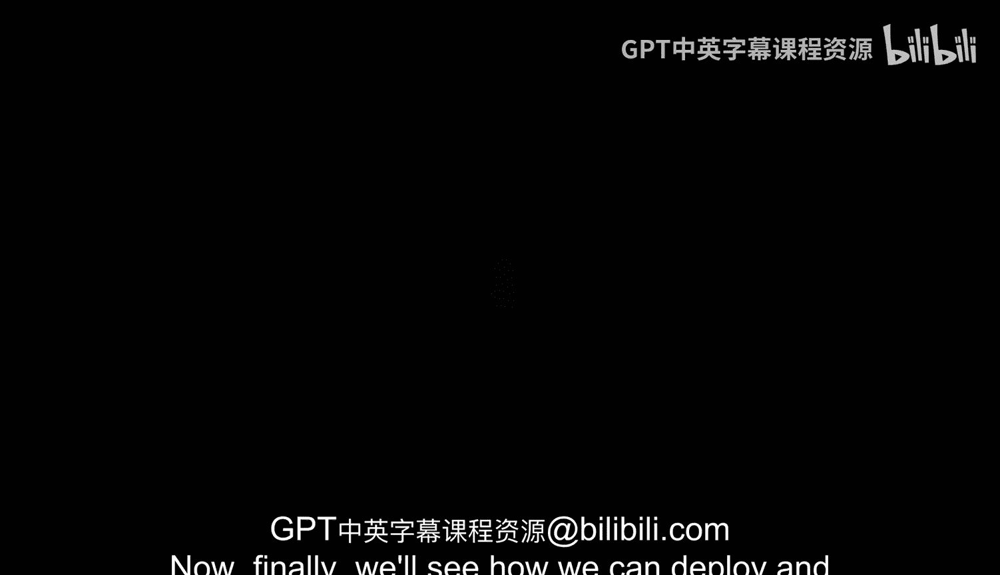

# 杜克大学《大型语言模型实践（生成式AI简介、Azure的LLMs（1、2课，共6课）｜Large Language Model Operations》 - P149：72_04_01_引言_12.zh_en - GPT中英字幕课程资源 - BV1Ef421m7zD

Now finally we'll see how we can deploy and scale our application on the Azure cloud using GiHub actions we'll take a look at the application overview some of the components that will be involved will set up some of the Azure components required for everything to work specifically on the containerization part of it。

 we won't be using Kubernetes for this， but it is certainly an option like if you want to actually mix some of these components and some of these patterns that I'm going show you it is very possible that you can actually choose a different type of deployment I will pick one of these containerization services within Azure and we'll see how we can make a work and not only deploy it but we'll also verify and troubleshoot the deployment and we'll see what are some of the things that you need to keep in mind as。

You tryry to deploy these applications to the cloud and you want to interact with them。

