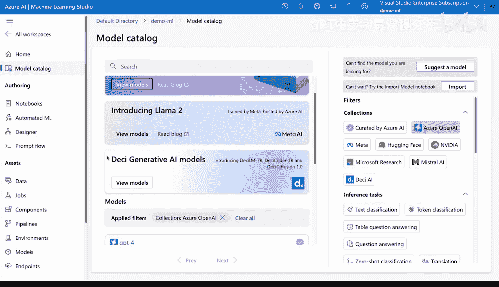
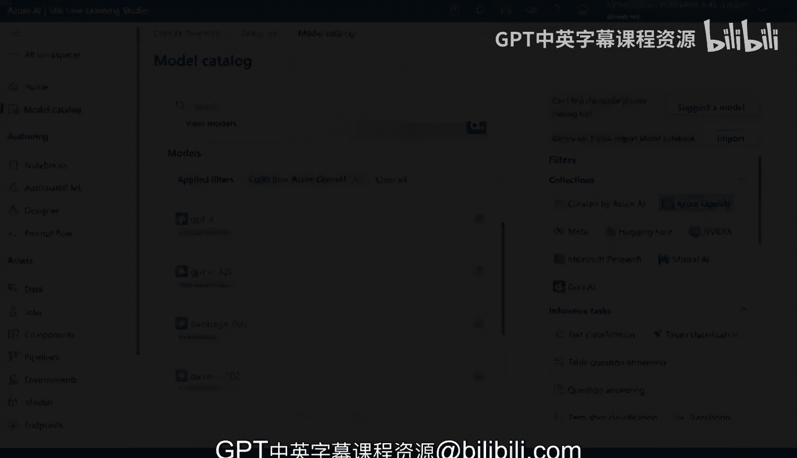

# 杜克大学《大型语言模型实践（生成式AI简介、Azure的LLMs（1、2课，共6课）｜Large Language Model Operations》 - P17：17_01_03_OpenAI与ChatGPT.zh_en - GPT中英字幕课程资源 - BV1Ef421m7zD

The landscape of geneative AI can be a little bit overwhelming today。

 but let's start where everything started， which is with Chad GptT and open AI。

 Now you are going to see some confusing terms and some terms that are being used that might help to get confused really there's a lot of AI and AI generated companies and services that sometimes they are reus in some some of these words and might get a little bit confusing。

 so let's start here with Chad GPT， which is what launched like first as a geneative AI and kind of like started are pioneered a little bit of these revolution。

 So righter here at the top on left we have the actual model this is us interacting with a large language model which in this case is。

Chat GT 3。5 as you will see when you start go spunking with some of these models you will be able to find some other options in this case you have G4 and but right now like the free version allows you for G 3。

5 so this is where everything started as you know this is this is kind of like the beginning of generative AI and kind of like what started everything so in here well you can interact directly by using the chat right there and one thing to note which you will see in most of these services that you will get this warning at the very bottom chat GT can make mistakes consider making or checking important information this is crucial and you will see me repeating this overall throughout this course this is not a fact machine。

Is not something that will process or provide data coming from a database。

 it will generate stuff based on probability， so we could say something like， for example。

 I am writing a readme file or a hood project and I want to expand information all myself。

My name is Ferdesa， provide me。A short description。

So you will see that some of the generated things will。

Not necessarily be completely accurate and it is up to you to actually fact check these things so we're not going to dive more into what this is and how it works but will be exploring about the landscape what are some of the things although chat GPT and OpenaiI was one of the first services to start with this there are others in this case I'm going to show you Anropropic that came that showed us that there's also the ability of having others this is like the actual welcome screen there's a few details and this is again going into the same thing that we've seen for Cha GPT it is my display incorrect or harmful information because again it is not a fact machine Open beta is not intended to give professional advice legal financial medical advice you cannot rely on it at all。

So once you do that and once you accept everything。

You can actually finish and have a very similar interface to start a chat。

So just like Open AI and ChaGPT， you will see that there's many services that are very。

 very similar to the beginning of everything with ChaGPT in addition。

 cloud services like for example， Azure， which I'm going to show you next。

 have the ability to interact with those models directly， not through a third service party。

 so what you will although this might look very overwhelming。

 I'm going to concentrate in actually showing you some of the models I'm going to go right here to the model catalog。

And in here you will see that there is something called Azure Open AI language models available exclusively on Azure and the reason why this is I wanted to bring this on for the landscape is because。

You might get confused because it might be like is why is there an open AI language model。

 but also like an azure open like what's the relationship？

The fact is that you can actually interact with the open AI large language models within Azure with a page subscription。

 and when you have like a sort of like deployment and an account on Azure。

So when you go here and when you look at these models， you will be able to and I'm going scroll here。

 you will be able to see GT4 and a lot more a lot of others like like we were seen before GT 3。

5 well you have those capabilities here and you can create your own environments where you are interacting with these models as you can see these are not the only models we have a lot of other models available and some of these capabilities will be will be available in our cloud service providers so it is just useful to understand that not everything is ChaGPT Open AI is a separate entity。

 there are others like it providing similar services in cloud providers like Azure Microsoft's Azure the Azure Cloud will allow you to have a specific interaction with some of these models。

