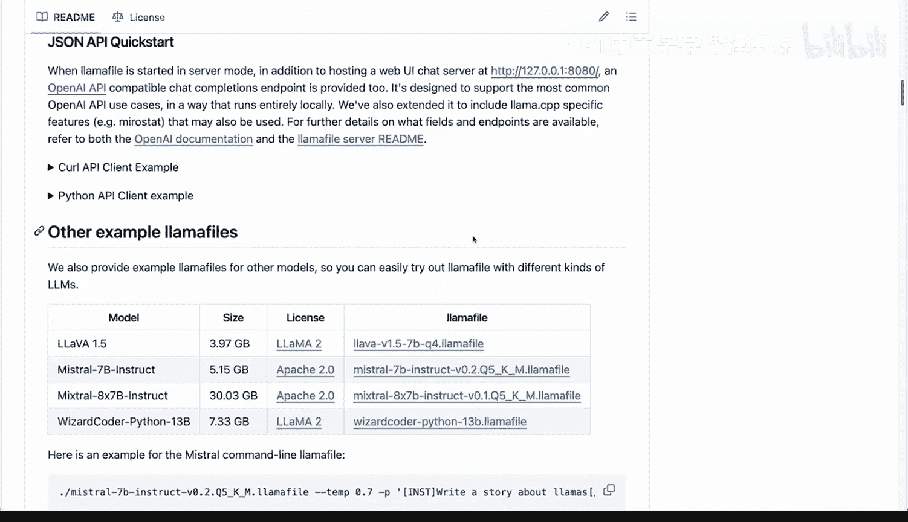
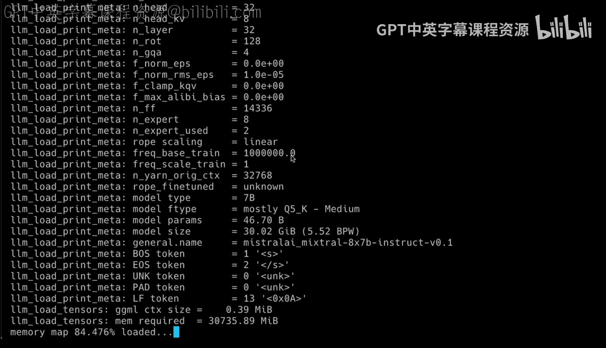
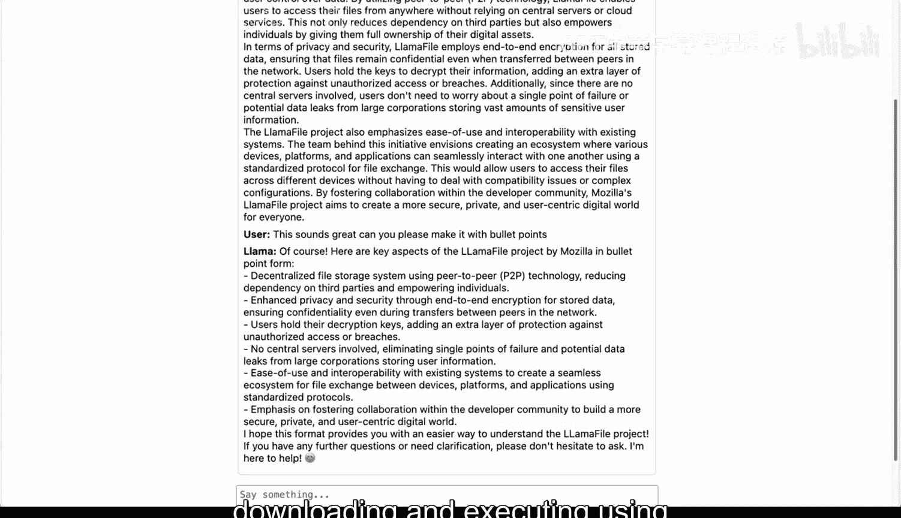

# 杜克大学《大型语言模型实践（生成式AI简介、Azure的LLMs（1、2课，共6课）｜Large Language Model Operations》 - P19：19_01_06_使用本地模型.zh_en - GPT中英字幕课程资源 - BV1Ef421m7zD

Using local large language models with。Your environment。

 your computer is entirely possible and more and more we're seeing that this is quite possible and today I want to show you specifically Lama file。

 which is a project from Mozilla like let's see if I can get here so Mosilla has these org in here called Mozilla Ocho and has this project called Lama file and what it is it is a project almost like a framework where it allows you to download several different types of files so let me scroll here and let me show you why I think this is interesting in something that not only you can try it out you should definitely 100% consider trying something out like this that the quick start is actually pretty good I really like projects when theyre straightforward and with just a single few steps you can have something running on your own operating system depending on the system that you have how much。

Ram what type of GPU do you have in your local system this might run might run slightly faster or slightly slower。

 The other thing I want to point out is that you have the ability to run on OS1 or Mac computer Linux BD or even Windows so you can see here that it will run on Windows no problem So all of these options that you see here will definitely run no problem on your system and then finally what happens once you download these and run it is that it will open your browser and you open these special local host address and you can interact track with it So let's actually do that I've already previously downloaded one of these files not specifically this one I think I downloaded something else。

I downloaded I think the Mitro 8x7b， you can see it's 30 gigabtes， so pretty large。

 it has an Apache 2。0 license。And yeah sos let's see how that works。

 again I've previously downloaded that on my system。

 I'm using OS 10 so I'm gonna to switch very quickly to my terminal and in my terminal I want to show you have a temporary directory where I have Mi row88x77 that's the one that we saw and that was the one that was actually pretty big so how do I run it well I don't really need to do much I'm going to say Mitro and then that's it so it's like just execute the file directly and it has the ability of passing in some threads but I can actually do dash dash help and it will provide me like a very good solid context here of what are all the possibility and all of the things that I have in order to run this I can't even have the ability to split through multiple GPUus but we're not gonna go into specifics we are just。

Going to run run these and see what we can do。 So I'm gonna to run it with2 threads。

 I think that's good。 We're gonna to get a lot of output and then it is going to run on my browser。

 it's going to actually load my browser so let's wait until it finishes and go back to the browser so like this was able to load actually very quickly and here you have some some system system requirements some system configurations rather and you can do the prompts you can do the chat history if you just want to try it out。

 you do not need to touch anything here， you can just scroll over and start right at the bottom So let's say for example let's say something simple say and you please provide me a short summary of what。

，A lamoophile project from Mosilla。He's about。Make it three paragraphs。 Sure。

 and this will take a second。 But， you know， already we are getting a little bit of output。 Now。

 I think， yeah， so I think。This is not quite correct。

 and it's talking about storing managing and sharing files。 And the problem is this。

 this is fairly new。 So this， this model is not very good for accuracy for recent events。

 but we can definitely say other kinds of things。 It it's like this sounds great， can we please。

 can you please。Make it with bullets， bullet points。

And and then again you're interacting just like as if you were interacting with other other systems and it will work very good。

 so again entirely possible to run a system like cloud。

 not a cloud based bed like a local large language model locally by downloading and executing using the amazing Lamaophil project by Mozilla。

