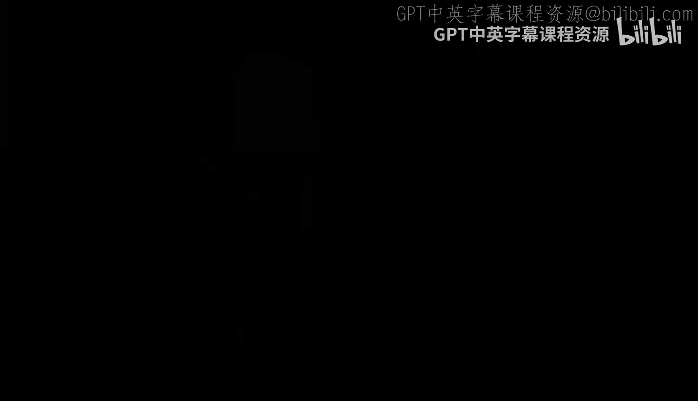

# 杜克大学《大型语言模型实践（生成式AI简介、Azure的LLMs（1、2课，共6课）｜Large Language Model Operations》 - P1：01_01_01_认识你的课程讲师阿尔弗雷多·德萨.zh_en - GPT中英字幕课程资源 - BV1Ef421m7zD

Hi， my name is Alre Asa and I am very happy to bring you this course on introduction to GenedFAI to anything and everything regarding GenedFAI and how does it work and what does it really mean to have or interact with Gened FAAI and Gen FAAI applications？

My background is in programming， I was a software engineer for many years。

 I started as a system administrator and then transitioned over to do a little bit of DevOs。

 applying software engineering to DevOs and operations， principles and concepts。

 I've been a release manager， I've been working in many different types of engineering groups。

 throughout my experience。I really have a passion for teaching and not only teaching but also sharing my knowledge and I hope you find kind of like these foundational aspects of gene FAI and my experience as a soer as well as someone in operations as well as someone that teaches even today as anjunct professor at Duke University where you will find some of these things。

 well in a digestible easier way to understand， I think this course has lots of different aspects and concepts and hopefully you find that foundational knowledge useful so that you can take a next step in your learning journey and try to apply some of these concepts as you discover more ways。

 more potential ways where you can make use of Gene FAI。

