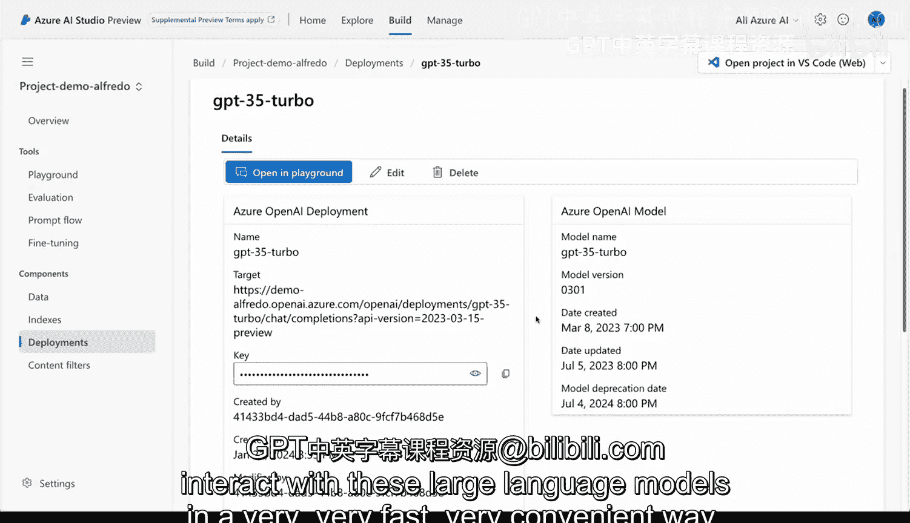

# 杜克大学《大型语言模型实践（生成式AI简介、Azure的LLMs（1、2课，共6课）｜Large Language Model Operations》 - P20：20_01_07_基于云的解决方案.zh_en - GPT中英字幕课程资源 - BV1Ef421m7zD

Cloudbasedase systems and in this case I'm using Azure has the ability of deploying and managing your large language models。

 not only that， but you can also have interactive APIs I'm going to show you the Azure AI studio now this by the time that you watch these video these might or might not be available or might not available but what I mean is that it might not be preview。

 it might be already released and good to go so what I'm going to do I'm just gonna click here it's going to open these it's going to welcome you to Azure AI Studio I already have these opened and created so I'm going skip these it's all good and I have several different projects here and I am going to click on one and the one I'm going create is this one or click on that one you have many different projects the details don't matter I just want to show you a little bit of the functionality。

NowThe first thing I need to do is create a deployment， I've already done a deployment。

 I'm going to click here on deployment so you can see I have GT35 Trbo it's one of the many models available。

 I've deployed that it is very easy and straightforward to create a deployment deployment is nothing else other than selecting a one of the models from a very large list of model deployments you can even see that there is hugging face available and all of those are available to get deployed and you're good to go with an API so if I click on these one which is the GPT3 Trbo。

 not only I have the ability to interact with that with an open with an open API that is exposed to the web to the web like I can reach these from anywhere using my special key here that is hidden for security purposes。

 but I can also use it in the playground so if I click the open in playground button。

This will take me to this page where I can actually say a system message and set some specifics and I can start actually chatting so I can even actually speak my input which I don't want to do right now and I close these and I can enter a query。

 So say， for example， I want to understand what the whether is。In Lisbon， Portugal， in February。

I want to stop by， and。Don't know what clothes to wear。 So what's appropriate。

 So let's let's see if we can get something here。And immediately I get a response back。

 I am consuming， I am using that model deployed to the web so perfectly perfect whether I would say 61 Frenheit。

 which is around 16 degrees centigrade that sounds pretty mild to me and pretty good and I have again the option to actually do this I even have the ability to open the project in ambitious Studio code desktop or the web。

Again， many different options。 So why is this compelling。

 Why is this interesting Well instead of like whenever you don't want to have local models running。

 you can have them in the cloud and you can see it took only a couple of clicks granted I had done my deployments beforehand。

 which is why we were having these already deployed。

 So not a big deal and pretty pretty straightforward so you can do you can have the playground。

 you can evaluate， you can do promptm flow where you manage your prompts and you have different things that you can do any drag with your large language model So that's a very nice quick way to demonstrate how different cloud systems and cloud providers like Azure in this case will allow you to have the ability to run these models with。

With a deployment that is accessible from anywhere in the internet so that you can actually run these。

 create your own applications and interact interact with these large language models in a very。

 very fast， very convenient way。

