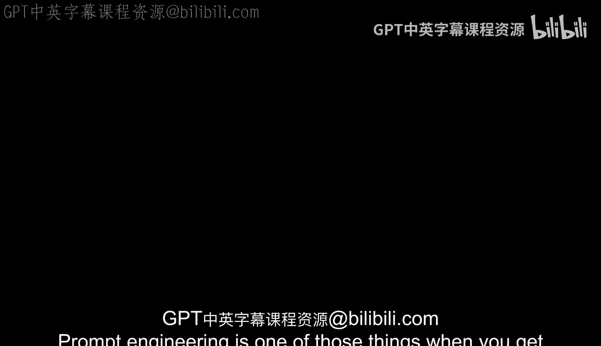

# 杜克大学《大型语言模型实践（生成式AI简介、Azure的LLMs（1、2课，共6课）｜Large Language Model Operations》 - P22：22_02_02_引言_4.zh_en - GPT中英字幕课程资源 - BV1Ef421m7zD

Prompt engineering is one of those things that when you get started with interaction with large language models through a chatbased interface。

 its one of those things that you don't tend to think about much but there are techniques there are things that we can do to make things better to make that interaction more effective to get better responses and to make the whole thing more useful to you so we'll take a little bit like a deeper look into not only better prompting but the basics of what we call prompt engineering and we'll see things like what is zero shot prompting or few shot prompting as well we'll get to see some of those examples and how we can improve the responses with providing better context and giving more concise more direct questions when we're creating these prompts so we'll take a look at how we can make that happen and we。

Also， evaluate the responses that we're getting back。

