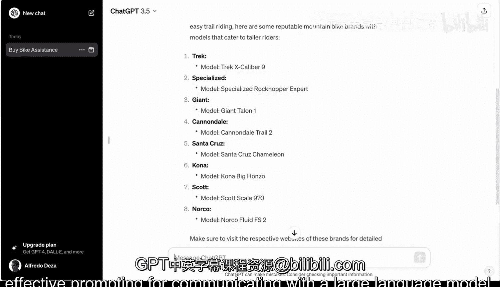

# 杜克大学《大型语言模型实践（生成式AI简介、Azure的LLMs（1、2课，共6课）｜Large Language Model Operations》 - P23：23_02_03_什么是提示工程.zh_en - GPT中英字幕课程资源 - BV1Ef421m7zD

What is prompt engineering and prompt engineering might sound like a lot of marketing bluff or a lot of buzzwords put together that don't really mean much Now if you ever hear prompt engineer or prompting in general what I would say is how to be an effective communicator so here we have chat GT I'm just using the free version and here you have a couple of ideas these are prompts。

 this is how we're going to interact with large language model with the AI application so。

See how this is highlighted in bold so that is just one part of the prompt right Plan itinerary for a fashion focusedcus exploration of Paris now prompt engineering is the ability to make this prompt provide you a an effective response and the only way that we can do that is by providing context and context that the large language model can understand and can act upon it so if we say something that lacks context and we'll see just a very simple example here。

So say for example， I'm interested in buying a bike， I know what type of bike I want。

 I know exactly the size I'm at the characteristics I'm going to use it for mountain biking but the AI the large language model in this case doesn't know anything so what would be a not a very effective。

 not a very good prompt so we can say for example。And。Let's just do that。

 And so right away the large language model will identify that it's missing information right Spec information is missing from here。

 you know what are you looking for are you looking for recommendations guidance on where to purchase one So doesn't know anything So what would be prompt engineering is my ability to provide more context in a way that the large the large language model can understand so it can provide me accurate useful and actionable information。

 so let's change these prompt a little bit。 we haven't gotten into the specifics of what prompt what useful prompts are but will make it a little bit better So I can say I am six feet for。

Inches tall。 I need a mountain bike。For EC trail writing。

And I need to have recommendations of brands that I can go ahead and investigate。

 investigate and look at some some of their characteristics。 How about that characteristics。Yes。

 and how about we say， hey， like list them out， list。

 list brands and the models that would be sort of。And so now what we're going to have is something that makes more sense in this case we've managed to interact with a large language model in such a way that the information that is being provided here is immediately useful for someone that is trying to look for something rather specific。

 it's kind of like going to a supermarket and asking for someone like need I need to cook some food。

And you're not providing any details like I mean that's going to that's not going to work right the large language model。

 the AI application is not going to magically understand what you want and in this case we were able to provide some input and get very。

 very good output that was able to kind of like summarize exactly what I needed these information right here is actionable it is useful for me and I can go and start looking at each of these options and make my mind perhaps in looking at some of these very interesting brands and models of bicycles for the type of application that I want So this is a very simple introduction as to what prompt engineering is or effective prompting for communicating with the large language model。

