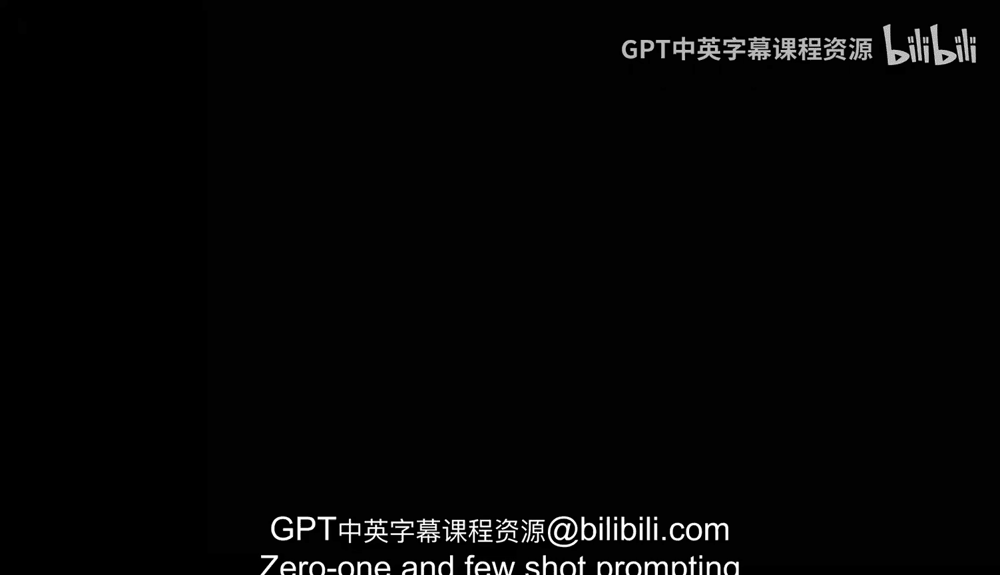
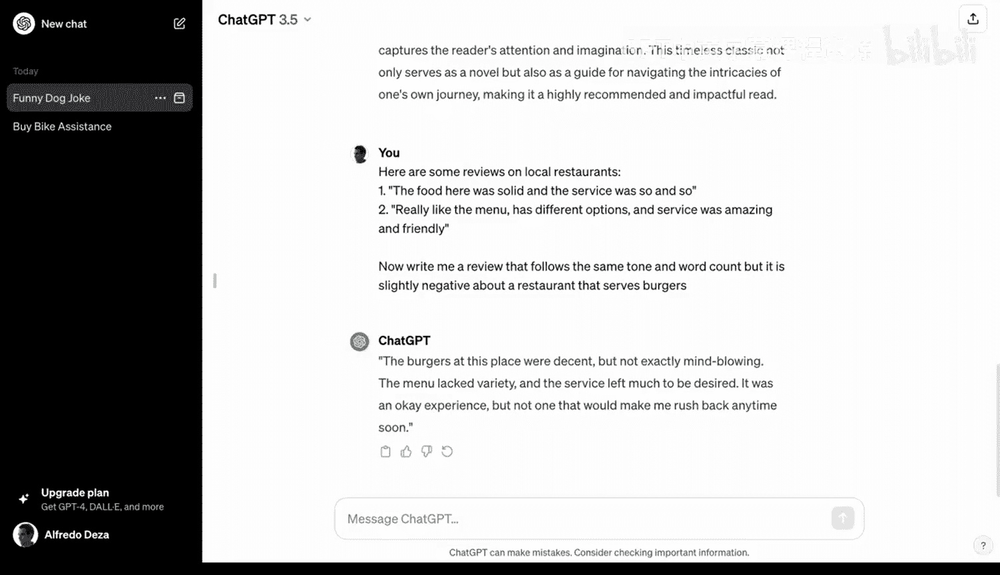
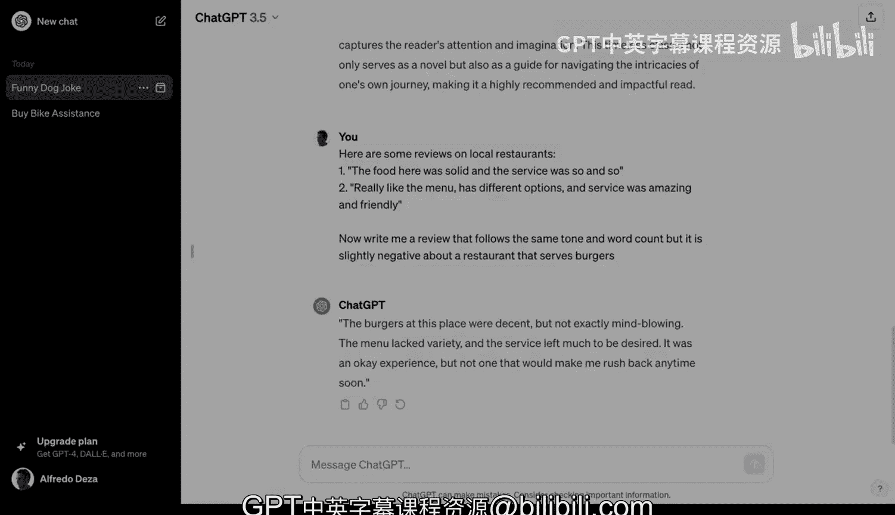

# 杜克大学《大型语言模型实践（生成式AI简介、Azure的LLMs（1、2课，共6课）｜Large Language Model Operations》 - P24：24_02_04_零样本、单样本与少样本提示.zh_en - GPT中英字幕课程资源 - BV1Ef421m7zD

01 and few shot prompting is or art terms that you might hear when you are trying to get better prompting and what is prompting。

 So it's like a good characteristic of different types of prompts。

 So let's start with0 shot prompting。 and I'm going to give you an example。

 So the example is going to be right a funny joke about dogs。 So I am not giving any examples。

 I am actually giving a single direction here to the large language model。

 and I'm I am going to get a single response very straightforward and nothing else。

 So what is this about well。This is it doesn't require any examples so I don't need to provide any extra context in the assistant large language model generates a good enough response based only on the instructions that I gave it so why will be one shot prompting well that will be giving an example so for example I have to say I want to say。

How about？m doinging something like here is a a book review on testing in Python。

 which is something that I wrote a while ago。And this is a book that is a solid introduction to Python testing。

 which is good for software engineering in particular。By sentence， so I think that's pretty good。

And so now I can actually say now write me a book review。In the same tone and language。4。

 let's say something like something pretty popular， how about the alchemist， the alchemist。

The alchemist is a very good book， so I'm going to say， let's see if this can actually do that。

There you go， so the alchemist is a captivating journey。

 so this actually didn't use exactly my example。But we gave it an example。

 and this is what we came up with。So let's say， for example， if we change that。

 if we change what we actually said。And we give it some more specifics。

How about this is a book and I will rate it9，9 of 10。And in the same tone and language tone。

 how about we can use format format。And language for the alchemist。Make sure to follow my example。

And so perhaps we'll see a little bit of that， and we will also you know see a little bit of that it includes the testing in Python。

Which is kind kind of interesting。 So not exactly what I was looking for there。 But it does。

 this is actually hilarious because you's saying the alchemist is stellareller 9，10。

 So it actually used the 9，10 on the rating Co storytelling。

 much like the clarity found in Python syntax， which is very funny。 Alright， So that's one shot。

 So why would be few shot。 Well， how about I give few shots。 So we're gonna do examples on reviews。

 So here are some reviews on local restaurants。😊，嗯。And I'm going to say review number one。

 the food here was solid and the service was was so and so。 and we can do a N1 and we can say。

Really like the menu。Has different options。Options and service was amazing and friendly So now what I can say is now write me a a review。

That follows the same tone and character count or work count， work count work count。

 but it is slightly negative about a restaurant。serves， let's say， brokers for something。

Something kind of generic。 So what I'm doing here。 and this is few shots。

 it means that I'm giving two exam more than one example。 That's why few shots。

 I'm gonna to say that。 I'm gonna do that。 And I get you know burgers at this place where decent not exactly my blowing menu lack variety。

 So can you see that I'm talking about the food。 I'm talking about the menu and the service as well。

 So this is kind of what I was providing before。 So this is a good example on how you're interacting and providing that context。

 Now these is。This is good enough and will allow you to have like that difference right between one shot。

 single shot or a few shots， so now you understand the difference pretty basic examples here。

 but it will give you good a good foundation so that you can move ahead with better prompting。

