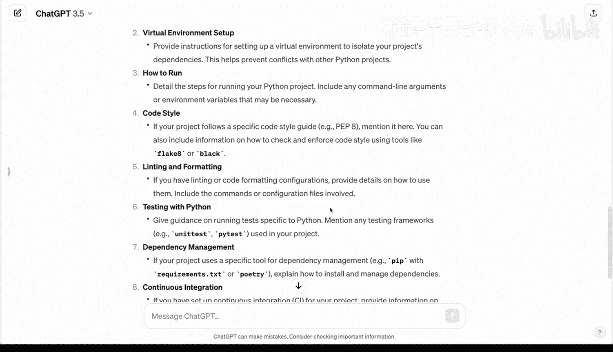

# 杜克大学《大型语言模型实践（生成式AI简介、Azure的LLMs（1、2课，共6课）｜Large Language Model Operations》 - P25：25_02_05_基于上下文的基础提示.zh_en - GPT中英字幕课程资源 - BV1Ef421m7zD

Providing basic context when we are interacting with a large language model。

 like in this case with chat GT is essential to start getting good and accurate results that can help us get the answers that we need。

 So in this case I am going to provide。I'm going to provide a prompt I'm going to give some instructions where I'm going to say I need to have a readmi file。

 a readmi file is a special file on repositories and I'm going to paste in here what I need and I will give you a little bit a little bit of context of what's going on so let's let's start here by I need to write a readme that describes a project I'm working on that is written in Python please provide me basic structure of things that will resonate with a developer audience that can make sense for the readmi there's no need to make up things for sections so very goods that's good。

 that's exactly what we want and notice how I'm providing context so first off I'm saying that I need to write a readme file So instead of just saying something generic like hey I need to describe a project I'm saying a readme file and。

This is a project that I'm working that is reading in Python this is again more context。

 please provide me a basic structure this is useful。

 this is part of the instructions is not necessarily context。

Of things that will resonate with a developer audience。

 developer audience is considered context because then the large language model can understand that。

And then there's no need to make up things for sections that's in part of instruction and provide title so I can fill in with the project details so let's try that。

And there you go it gives me the structure。 so that looks good installation usage。

 contributing license credit。 So there's a lot of different things here and looks pretty。

 pretty good， however。This is although it's good， you can see that the context I provided was enough to make sure this was relevant to what I'm trying to do。

Although I said that I was doing Python， it didn't actually put much things related to Python。

 so let's actually refine， refine what we got and let's say we need to let's provide more context here。

 we need to have these readme， be relevant for Python developers。Suggest me。

A couple more sections that are related to Python， specifically。

So let's see what we can come up with so requirements in virtual environment setup up they all look very correct to me now change between this case went ahead and went overboard with eight different other sections but these are all relevant now providing context is very very crucial if we want to get actually answers that are meant to be for us to to consume the output in a way that is meaningful to us Python specific is related to the context I provided and you can see here that all of these things are even if you're not a Python developer these are all relevant for a Python developer audience so this is how we can very with very little context and you can see had to go twice about it we can get slightly better responses。

