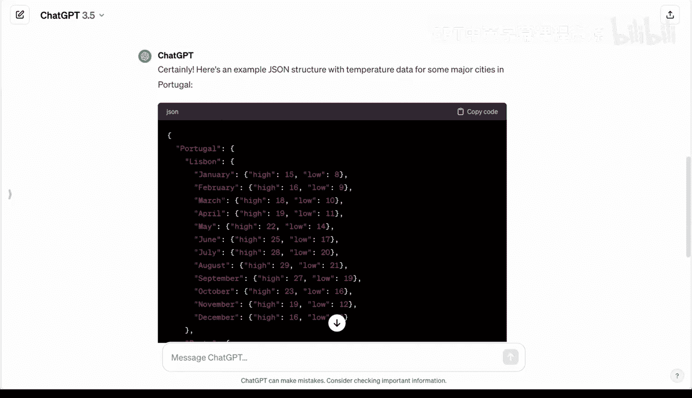

# 杜克大学《大型语言模型实践（生成式AI简介、Azure的LLMs（1、2课，共6课）｜Large Language Model Operations》 - P26：26_02_06_在提示中使用示例.zh_en - GPT中英字幕课程资源 - BV1Ef421m7zD

We've briefly seen before that you can actually use examples with one shot types of prompts or a few shot when we're providing different types of examples。

 but we can be very specific in the types of examples that we want in the past I've used I'm going show you an example of a prompt that I've used in the past rather where I was trying to actually build an API using Jason now API and Jason these are terms that might not be too familiar to you if you're not a developer。

 but let's go ahead and paste this in and walk through some of the components I'm going to add in our curly bracket there I'm going go all the way to the top and let's see what we have here so I'm building an example API that's basically an HtTP service。

 a programming API that's going to live on the web somewhere and uses Jason Jason is a type of data formatting。

Uses a J file to load historical data on different texture， values for cities and countries。

 I want to use the same but for different cities only in Portugal。

 this is context this is very useful and please generate the JON contents for me with as many major cities in Portugal as you can so I am also giving the large language model the possibility to expand on as many like giving them freedom to try to get as much as they can provide me。

And I'm going to say here's the example JO format， so I've pre formatted something for a different country in a different city in these cases England and this is although it's hard to see here because the JO is badly formatted there's a hierarchy here with England being the country and within England is going to be London and within London we're going to have January and you can see each month so we'm going to have high and low and we're going to have some numbers there and so I'm telling it to generate data for other countries NCTs and for having like a similar format to these or actually the same format so let's see what we can come up with。

And this is generating Portugal Lisbon now now it is nicely formatted。

 so you can see here because I provided a nice example。

 I am getting exactly what I need this Jason looks actually nicely formatted and looks like it added Lisbon and Porto which are two of the major cities in Portugal and the fact though is that it added it seems like Celsius instead of Fheit when before I was using I mean clearly 64 has to be。

Has to be Frenheit otherwise it would be pretty bad Now that was great and you can see how adding adding an example can give you exactly what you need for transforming something or converting something into a specific format or providing something that you know it's similar to what you're looking for。

 but not quite there in this case I have now a good good Json formatting。

 this is the formatting of the JO data format that I can use to start consuming this and make a part of my application。

 is this is very useful to start using an application。

 So there you go that is a very simple way where you can use examples。

 additional examples to the output that is going to be very useful。😊。

