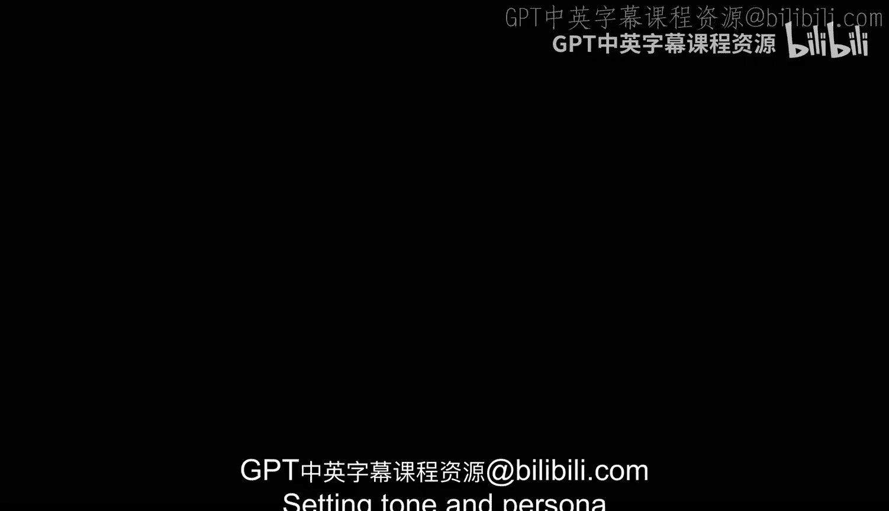
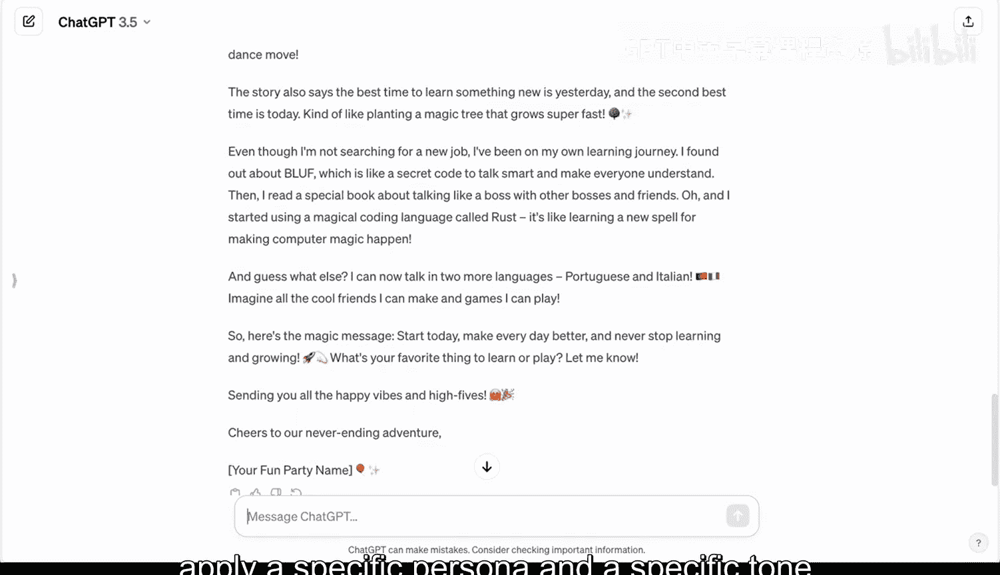

# 杜克大学《大型语言模型实践（生成式AI简介、Azure的LLMs（1、2课，共6课）｜Large Language Model Operations》 - P29：29_02_03_设定语气与角色.zh_en - GPT中英字幕课程资源 - BV1Ef421m7zD

Setting tone and persona when you're trying to interact with a large language model is a very solid strategy。

 especially when you want to make sure that the message in the output provided by the large language model is what you need in the way that you need it。

 So what I'm going to do is I'm going to ask chatgBT here to make some summarization。

 pretty straightforward task I'm going to say please summarize the following text。

 Now this text is a blog post that I did on LinkedIn a while ago talking about my learning experience and what are some things that are I think are important to me So I'm just not going to provide any other context or anything else other than hey just summarize the following text So lets let's overview here what we're trying to do talking about my granddad seeing mass layoffs happening。

Ukiing， you know what what are some of the things that I think are useful and and then that's good so i'm going to send a message and see what we're going to come up with。

Great， the author reflects under grand that of， they express concern about mass layoffs and so it's kind of like giving an opinion so that looks okay but let's give it a persona and give it a tone so a persona is telling the large language model that they need to act as they are someone specific so in this case let's make these large language model agent。

 let's make it be someone else in this case，You are a senior executive coach。

And so that's this is the persona right， the senior executive coach is going to be the persona and now let's talk about the tone So tone let's do and I need you to summarize the the blog post I shared。

With an executive level language and tone so let's。Let's do that and perhaps even say。

Something that I can email to。A about a board， full of executives。There we go。

 So now we've changed the tone and we've changed the persona。And there we go。

 we can see here that this has changed significantly。

 I trust this message finds you well I' reaching out to bring attention to a recent insightful blog post and of course the paramount significance of continuous learning So do you see that the tone has changed and now that the summarization has a different type of language。

 Now let's change this again you are。A， let's see a someone that goes to your're someone that animates。

嗯。Parties。For。childrenil。Children in elementary。And I need you to use the post in a happy language。

 I'm setting up the tone so that children。And understand。Understand the key takeaways。

So let's do that and change the tone again and change the persona so there we go hey amazing kiddos hope you're having a blast so can you tell that not only the tone changed but also we have the addition of emojis happening here with with the text that is being produced which is kind of kind of an interesting approach there。

 so doing that again we are changing the persona in the tone so the example might be slightly silly but definitely you can start thinking about interesting ways that you can achieve something similar for the things where you want to apply specific persona and a specific tone and you don't need to do both you can do either or as well。

