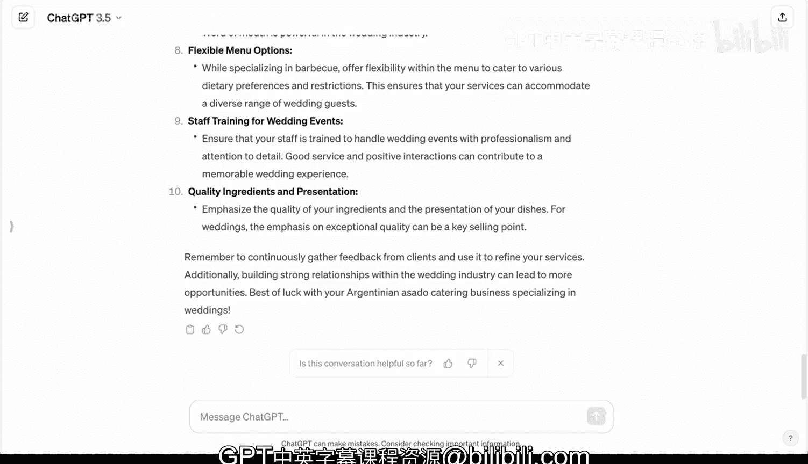

# 杜克大学《大型语言模型实践（生成式AI简介、Azure的LLMs（1、2课，共6课）｜Large Language Model Operations》 - P31：31_02_05_通过反馈优化指令.zh_en - GPT中英字幕课程资源 - BV1Ef421m7zD

Getting better prompts through feedback is a great technique that not many tend to apply in here。

 I have a very basic prompt that says I want to start a catering business specialized in Argentina asallo。

 provide me a business plan， Argentina aso is barbecueing in Argentina which is really good and so let's just assume that I want to start a catering business so I'm asking for a business plan like simple enough let's see what we got。

So starting Canadian business can be an exciting adventure， executive summary， market analysis。

 service and menu， and it provides me a lot of different things monitoring and evaluation great。

 remember to tailor each section to fit the specific details so that looks pretty good for business plan。

 here's a basic outline for a business plan to help you get started。So what do I mean by feedback。

 I am going to ask the large language model。A question so that I can understand better what prompts I might be missing。

 what are some of the things that I should be providing the large language model to improve on its answer？

So I'm going to say thank you and I'm going to say。

 can you please suggest me other things I haven't thought about starting my business？

That would be helpful for you to know in order to provide better， a better response。

List up to 10 items so that I can review and understand what I need to provide you。

Provide you as extra context。 So these are 10 additional aspects。 Let me see insurance。

 event logistics， customer service， marketing collateral。 So this is kind of kind of what I want。

 but not exactly。 let's let's ask again。And you can tell that because I'm not getting exactly what I need is because that non deterministic。

Behavior that we get with large language models so let's let's try to press on these and try to clarify better it's it might be because I'm not explaining myself correctly to the large language models so I'm going to say what are what is some information。

I can provide you so that you can give me a better guidance on my business。

 So let's see if to provide you with more specific guidance that we go。

 we need to actually understand what the pricing strategy might be long termm goals So very good。

 so we can say， okay， so long term goals are you looking to expand long termm goals are just having a single business。

Business and no expansion。 So let's just give in a couple a couple of things。 events are。

Up to 50 people。And let's scroll here and do how a menu that details menu menu details are just。

Specific。2 barbecue。And target market， let's say weddings is weddings on。

 So we gave gave a couple things and' like oh so there you go。

 you're gonna to have wedding packages and you're gonna have a little bit of referral programs So perfect it's giving me flexible menu options as well this is very good because it's telling me that I can ensure that services can accommodate the range of weddings so。

By asking the large language model， hey， what am I missing here。

 what are some things that I should consider when I'm or should provide you with the extreme information so that you can give me more accurate and this is great because like if I'm actually trying to start a business like this。

 then I'm obviously missing some context that the large language model would benefit from so that is getting better prompts based on feedback。

