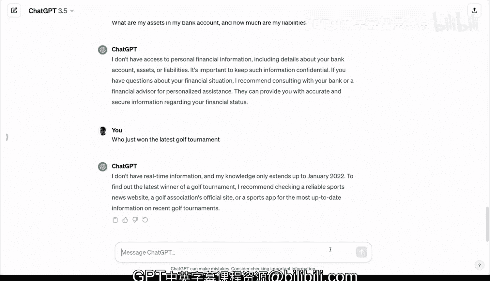

# 杜克大学《大型语言模型实践（生成式AI简介、Azure的LLMs（1、2课，共6课）｜Large Language Model Operations》 - P32：32_02_06_理解局限性.zh_en - GPT中英字幕课程资源 - BV1Ef421m7zD

When you want straight answers， you need to do straight questions if there are generic and they're not specific。

 it is going to be very hard and we've seen that already a little bit if I say bake me a cake it is going to be very wide open and now the model here is a little bit intelligent and it' saying it' like。

 hey， I'm not very sure what you want how about bake me a birthday cake sure。Let's see，s。

 let's keep present， Let's keep presenting， and show me how to bake a birthday cake。So there we go。

 but， you know that's not very specific。 So so the answer is going to be kind of broad and going to be kind of like very open ended as well。

 So limitations try to be very specific for specific answers。

 You can actually be more accurate as to what you want。 So you can say。

I want to bake a specific chocolate cake that has two layers。Yeah， sure of chocolate and。

A little bit of how about Duulce let， which is something that I really like and make these for。

For feeding a crowd of five people。So then I'm being very specific and now I'm getting something that might make it small enough for five people to go to go through that and it tells me a little bit about the frosting and doing a couple of layers put place a second gate layer on top you can you can see that right there so very good indeed okay so the other thing that I want to explore actually let you know is an actual limitation so I cannot ask for things that the model doesn't have access to or has no way of understanding remember this is a model train on historical data data that has already passed and there is a date on that so if I say let's ask for something that the model doesn't know how about let's say for example we are asking what was the weather today in。

Hererieta。Georgia and it might not have realtime information as you're getting here， for example。

 so so then let let's try an another one very silly。

 but we can say what are my assets and in my bank account and how much are my liabilities again。

 it doesn't have access to my personal information。 So this is rather silly， but again。

 you're starting to kind of like play around with some of the limitations in understanding that this doesn't have facts not even even current events。

 so for example， who just won。Latest golf。Tournament。

No realtime information again so up to January 2022 and that's been quite a while at the time this video was recorded so it's been a while and it doesn't have so you're getting into those limitations so understanding that there's limitations and understanding that there are some roadblocks here it's good enough now one thing that you can do in cases like this is that you can actually paste the context so that you can say hey like it seems like here's a very longwined article like just tell me who one or tell me like the highlight of who on and why is this important and then you can do that and get exactly what you want。

