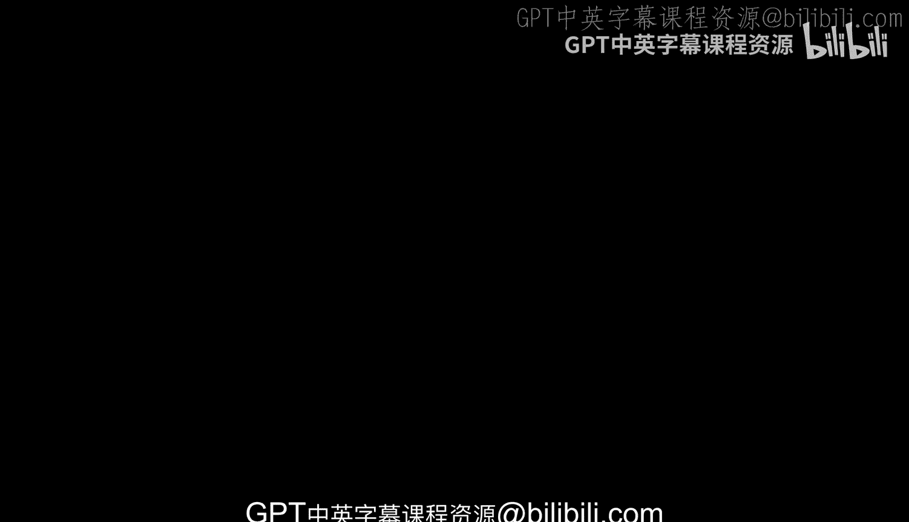

# 杜克大学《大型语言模型实践（生成式AI简介、Azure的LLMs（1、2课，共6课）｜Large Language Model Operations》 - P34：34_02_02_引言_6.zh_en - GPT中英字幕课程资源 - BV1Ef421m7zD

Now we're going to take a look at advanced prompt engineering techniques。

 we're going to make it take things a step further and try to apply well less common things and we're going to before we get into that we're going to take a look at what are the limitations of contact when we completely overload the large language model and things start falling apart for the model it can no longer answer what we're asking of the model and we'll see how that looks and how we can get there then we'll take a look at how we can work around some of the limitations like for example。

 breaking things into smaller tasks so that the large language model can respond better and more accurate by like simplifying the tasks we're going to get much better responses。

 we're going to also apply a couple of four things like using chain of thought and we'll look into what chain of thought means and how does that look like and also other。

Prompting techniques like saying things at the very beginning at the very end and or provide a list of things to do these are all very good techniques。

 some are more common than others， but by looking at these advanced and less common techniques you will be able to get even better at prompting and getting much much better responses。

