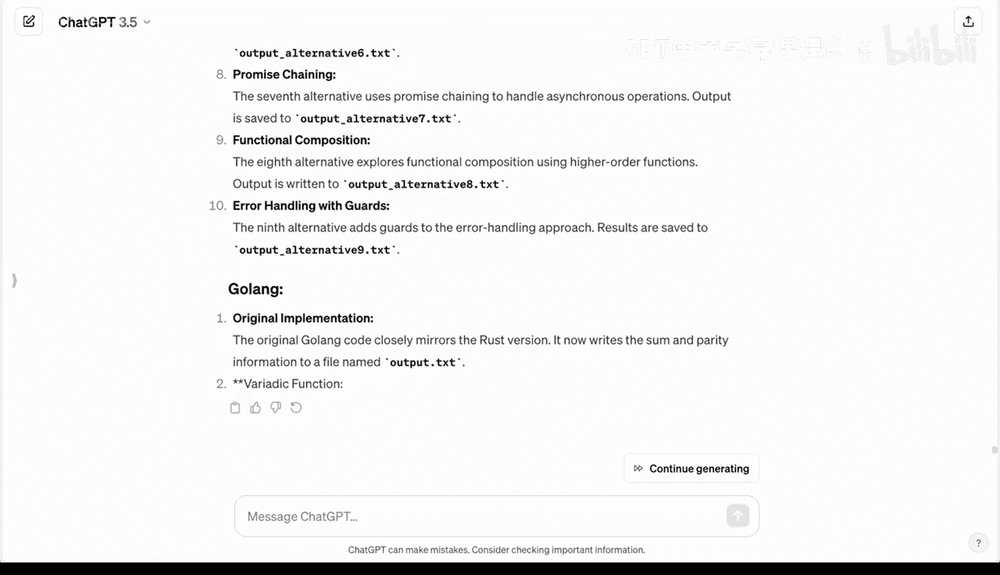

# 杜克大学《大型语言模型实践（生成式AI简介、Azure的LLMs（1、2课，共6课）｜Large Language Model Operations》 - P35：35_02_03_上下文的局限性.zh_en - GPT中英字幕课程资源 - BV1Ef421m7zD

There are limitations in context with large language models and it depends on the amount of information you're pasting。

 let's make it very absurd here and what I'm going to do and I've just pasted a ton of information here I'm going go scroll to the top I'm going to ask for a lot I'm going to say hey I'm going to provide you a piece of ra code this is some programming language I need you to pour it over to languages including Python Tscript。

 jascript Golan Sca Ruby and bash then I need you to create two paragraphs for each language describingibing the code then I need you to provide a test for it and finally three potential opportunities for the code to be updated in each language include a small setup instruction for each language and then I provide the code now there's not a lot of the context here。

But I am going to run this and try to see what I'm going to get。

 And what I'm going to get is it's going to go through each one。

Is going to add the test potential updates for Python and potential updates for TypeScr and it's going to go on and on and on and it's going to take a while so I'm going to wait here until finishes Great so the context has been built and this is very good and now we're going to do is I am going to I not have further questions or any more assistance。

 but I do want to really take these to the next level I'm going to ask for something ridiculous which is now that I have a few examples of the code I want you to provide me five different alternatives in the code for each of the languages that you provided I also need you to provide me with instructions。

For each。So this is going to take a second and we'll come back， we'll wait until it completes。

It finally completed and we have a lot of context and you can see that now it's getting into a problem here because some of it is not color coded anymore we have go。

 we have functional approach， we have JavaScript， Scala is pretty okay and we have a lot of different things。

 so let's make some updates and let's just assume that we want to now make this into an article and make a blog post so I want to make a blog post。

Out of these， please generate me。Let's say，8，9 paragraphs， you know。

 for for each language explaining。The different implementations。

And different pieces of code that we've done so now we're getting into the limitations on context you can see here that I get the continue generating I got stopped at Scala so let's see Scala with it go with a jascript with it Tpescript and with it a little bit of Python bash didn't make the list we have a ton of information here and what is happening here is that we're exhausting the capabilities of the large language model to provide the context because it remembers the history of the chat so because there's so much going on here then I am going to get into a problem if I want to start tweaking some things so if I go all the way to the top and I say I say say for example I don't want to。

I don't want to print， let's say， update。All of the examples so that they don't。Brint a message。

 and they write a file。To the file system。Update all the descriptions and all suggestions as well。

 Let's see what happens when I do that and I'm gonna click here and'm going to wait until it completes and let's see what are some of the limitations that we're going have Allright so we found our limitation we can see that we get the continue generating the model has stopped you can see it's not even it's not even rendering veryatic function was stopped。

 I'm going to scroll the way to the top so you can see the output and what happened here is that I said update all of the code examples right but I didn't get the code examples at all I got only the paragraphs that I had asked so I'm getting into the context limitations there's just too much going on and I'm asking too much from the model and the model is not able to cope if it had the capability of having the whole history that Ive produced then I would get into exactly。

What I need， but it's just too much and I'm getting into limitations。

 the same would happen if I had pasted too much information and the model would just give up and when it gives up。

 you can see it gets into this broken state where it doesn't complete the instruction or gives instructions that are lacking in what we're asking。

