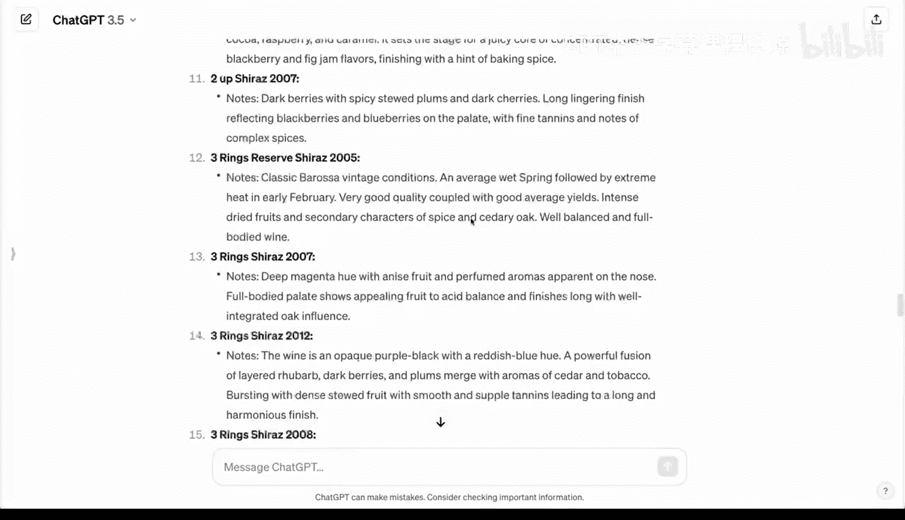
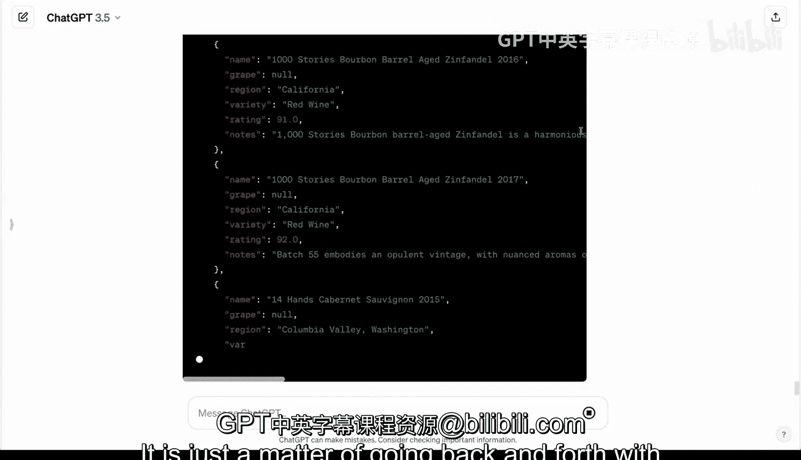

# 杜克大学《大型语言模型实践（生成式AI简介、Azure的LLMs（1、2课，共6课）｜Large Language Model Operations》 - P36：36_02_04_分解为更小的任务.zh_en - GPT中英字幕课程资源 - BV1Ef421m7zD

Breaking a large task into smaller chunks sounds straightforward until you have a non-s straightforwardfor piece of text or a thing that you want to accomplish I I'm going to paste a very big chunk of text which is CSB data and I'm going to ask for something where let's see if the large language can actually help us out I have large piece of CSB text and I need you to help me extract the notes portion what I'm going to paste is a portion of a CSB a comma separ value piece of text that has information about different wines from different parts of the world here is the CSB content。

So I've pasted a lot of stuff and you can see it barely makes any sense。

And let's see what ChaGPT gives us very good， so it was able to produce exactly what I was giving。

 so like you can see that there's a little bit of repetition but it's not quite repetitive because these are very similar similar wines if you need notes for more entries feel free to ask so so this is good however。

 what we can do is take it a step further So what I'm going to do here is I'm going to say。

Remember the data that I've pasted seems to be too much for it and I can actually reduce it and say。

 you know what what are some ways that I can reduce these。

 only produce nodes for wines that are are from 2015 and newer and do not provide more than 15 wines。

So this looks correct and you can see that now I'm getting 2016 and 17 and I'm able to get exactly what I want so this is great and again I am chunking。

 I am reducing my asks so that the large language model doesn't get overwhelmed by too many different asks at the same time for 15 once looks correct to me now what I can do is now update what you provided。

Into a Json formatting so that I can use it in an application。

 feel free to include any other extra data。From the original CSP data I pasted so by doing this。

 you can see that now it's going back to what I originally pasted and then finding just these specific things that I want in the JsonN formatting for what for I was looking for this way of asking very small or producing the amount of information that the large language model needs to process is a very good way of ensuring that I'm getting exactly what I want without overwhelming the large language model now this will continue and you can see here it's stop because now it's getting to very ver and sure I want this thing to continue generating because I'm very interested and now it's taken taking a toll because you can see here this is from 2008 and that is not good so I'm starting to get into trouble here because this is too much so what I could。

Do is actually go here。

And copy the code and say， remove any wines from。From this JSson file that is not from 2000 that is not from 2015 or newer。

 and I'm going to paste that， which is what they generated and wait until it completes。

 And of course， it goes through and starts pruning and giving me exactly what I want。

 It is just a matter of going back and forth with the model trying to get the right answer。

