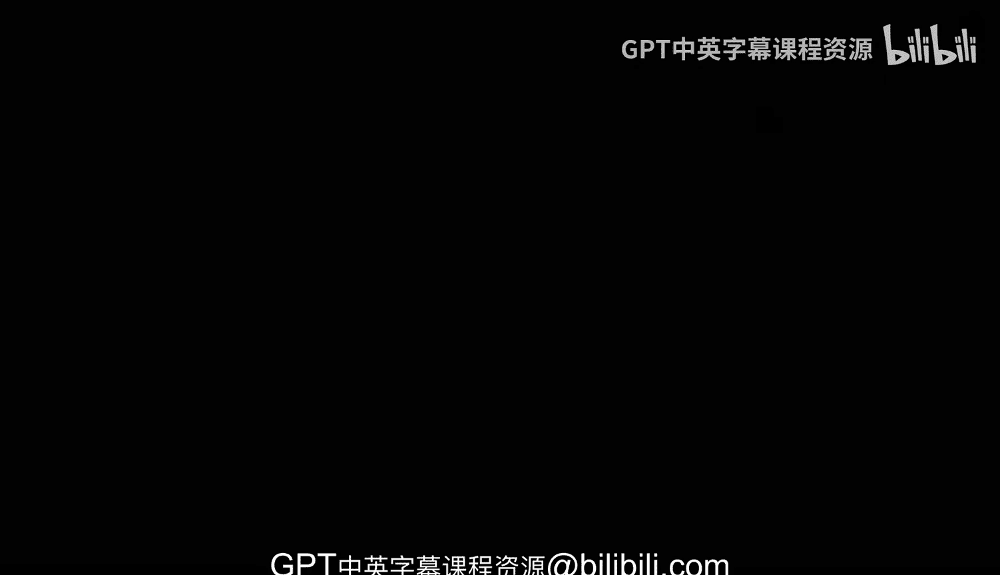
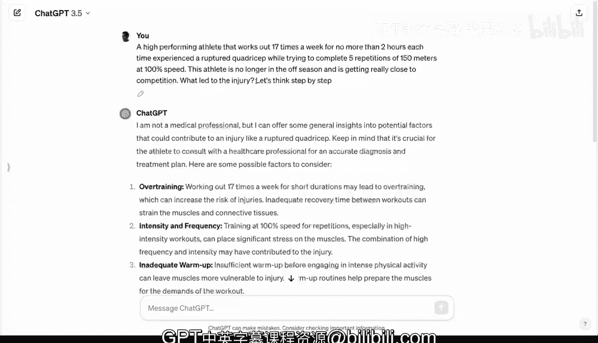

# 杜克大学《大型语言模型实践（生成式AI简介、Azure的LLMs（1、2课，共6课）｜Large Language Model Operations》 - P37：37_02_05_使用思维链.zh_en - GPT中英字幕课程资源 - BV1Ef421m7zD

Chain of thought is a technique when prompting that allows the large language model to try to respond in a step by step and trying to recount exactly the steps that led to a specific outcome in this case I am not using the usual chain of thought example。

 which is a math problem I'm using something more of a real life example。

 So I have a high performing athlete that works out 1717 times a week for no more than two hours each time has experienced a rupture quadriccept while trying to complete five repetitions of 150 meters at 100%1501100% speed。

 This athlete is no longer in the off and is's getting really close to competition what led to the injury So the response has a few bullets and says hey you know there are some some things that I think may have contributed So now let's do a chain of。

ThoughtAnd I'm going change here to a different prompt。

 And the only difference is this one right here。 I'm only adding only adding this。

 which is less's thing step by step。 So by adding that and of course these model says he I'm not a medical professional I can offer some general insights Keep in mind it's crucial for the athlete to consult with a healthcare professional of course。

 So it goes into enumerating overtraining， intensity and frequency， inadequate warmup。

 muscle imbalance and on and on and it's important for the athlete to seek professional medical advice。

 So although these two answers are similar by adding let's think about this step by step。

 which is chain of thought I'm able。to tell the model to reply。

 to respond in a way that it process the chain of thought that the large language model is using to get to a potential conclusion so I think this is something that you can consider especially when the types of answers that you are getting are not quite adequate and you want to try something else。

 especially when there are so many different facts in both and getting a breakdown is going to be very useful and that that can be achieved using using what I use here。

 which is less distinct step by step。

