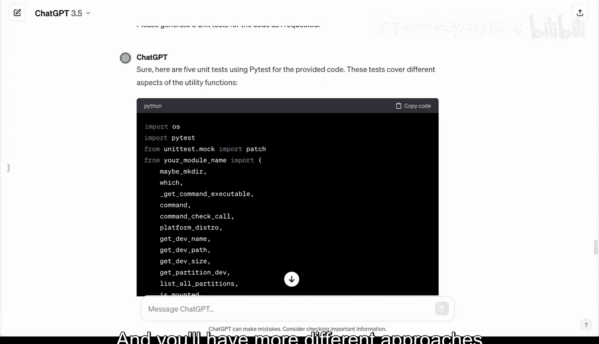

# 杜克大学《大型语言模型实践（生成式AI简介、Azure的LLMs（1、2课，共6课）｜Large Language Model Operations》 - P38：38_02_06_其他有用的提示技术.zh_en - GPT中英字幕课程资源 - BV1Ef421m7zD

There are two final recommendations that I have to improve your prompting and one is to actually give the prompt and not paste the thing that you want to talk about。

 So in this case I have a ginormous a large piece of text that I want to work with is code and what I'm going to say is going to give the instructions first。

 I need you to help me address several issues regarding a piece of code。

This is Python， I am not going to paste the code just yet。

 I need you to help me by providing by providing instructions。And recommendations。

On what to what to do to to improve。To improve the quality of the Python code。

So I haven't pasted the code。 of course the large language model doesn't know and what I get as a response is。

 hey， you know， this is great。 just share the Python code。

 the Python code All right so I'm going to paste the code and I'm going to send a message and let's see if it it works So let's see doc strings sure I can add some error handling use the width statement。

 great consistent naming So code more readable comments， constants avoid hard coding。

 so like really meaningful and useful thing。 So what I did here was basically get into a situation where I didn't do everything up front I give the prompt then I said I'm going to paste it next and this is useful especially if you have a lot of information that is going to come later another thing that I want to show you。

I basically tellinging the large language model things up front and then providing some context and then repeating the same thing at the very end。

 this is useful， especially when the large language model is not giving you exactly what you want and it's deviating from its answer so in this case when I say I want you to help me provide a few unit tests for let's basically be more specific actually and follow my own advice provides provide five five unit tests for the code I paste it。

Then let's give more context。 This code is going to。It's going to use a test framework called P test。

 assume dependencies。Are installed and available and the setup is good to go。

 the tests have to be granular， have to be granular and with accurate error responses when they fail。

Also need to have good comments on what the tests are for and then I'm going to say please generate five unit tests for the code as I request。

 So this technique allows me to say things up front and say things at the very end because sometimes especially in this case I'm not doing too much。

 but when this piece of context is too much and I'm providing too many instructions the large language model tends to do either the first or the last piece I'm going to hit submit and I am going to get kind of like what what I need it and you can see it's using P test which is something that I really like if you don't know coding that's fine this looks very accurate for me and it is able to complete exactly what I need it。

 So there you go those are two things that are。Pretty useful and will allow you to get responses from a large language model that are well more useful and you'll have more different approaches that you can try as you try to get accurate and useful information from a large language model。

