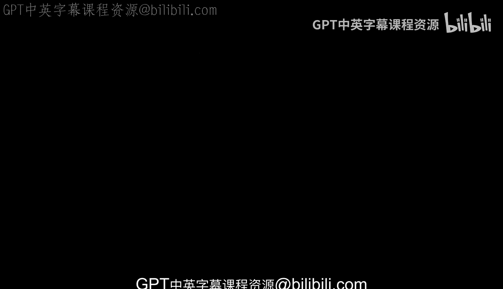

# 杜克大学《大型语言模型实践（生成式AI简介、Azure的LLMs（1、2课，共6课）｜Large Language Model Operations》 - P3：03_01_04_关于本课程.zh_en - GPT中英字幕课程资源 - BV1Ef421m7zD

So let's go through some of the things， some of the concepts。

 some of the subjects that we're going to be discussing and exploring in this course well first we'll start with the foundations of gene FAAI and how does that look like we're going to take a look at large language models and what does the current landscape in gene FAAI looks like then we'll look a little bit into prompt engineering prompt engineering is that which allows us to communicate with these large language models to get good responses sometimes it's tricky when you don have good techniques into the prompting aspect of interacting with the large language models so the responses become kind of poor so we'll see some solid techniques that you can use in order to apply them to your prompting as you're interacting with large language models so that you can get well better responses then we'll take a look at。

Building robust geneative AI systems， like say， for example。

 if we wanted to expand or augment responses in large language model applications。

 and we will explore a little bit what retrieval augmented generation is also referred to as RAG with its acronym and which is just a technique of expanding the ability of the large language model to use new information that wasn't available to the model when it was trained。

And then finally we'll move on to very handson applications like how would an application that you're building can be deployed to the cloud what would an API look like when it's been working with the retrieval augmented generation and the cloud and a large language model。

 how does all of these pieces are going to work together and how does deploying something to the cloud would look like and then finally being even more hands on consuming openAI and all APIs to build recipes and generate images and also doing a little bit of fine doing which is this ability of trying to get a little bit more extra behavior from a large language model based on new information。

And all of these things are。Meant to give you a good foundational point so that you can all of these concepts。

 all of these knowledge will give you this foundational step in the right direction so that you can get a better understanding what gene FAAI is。

 how all of these components can work together and perhaps give you a good solid next steps so you can continue your learning journey as you try to perhaps explore how you can apply these concepts into building gene FAAI applications。

