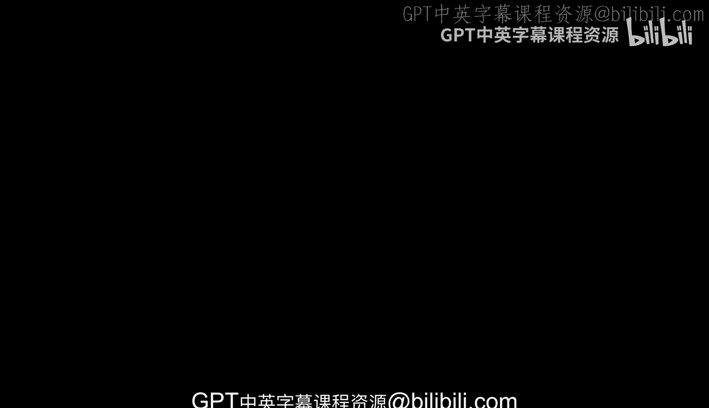

# 杜克大学《大型语言模型实践（生成式AI简介、Azure的LLMs（1、2课，共6课）｜Large Language Model Operations》 - P40：40_03_02_引言_7.zh_en - GPT中英字幕课程资源 - BV1Ef421m7zD

Let's dive deeper into generative AI applications。 We've already seen quite a little bit of large language models。

 but now let's get into actual applications that are going to connect to the large language model to do well different things that we're going to take a look at we're going to see some of the common types of generative AI applications that you can actually build how would like an API based application would work or how does that look。

 what are the components that we make an API based application will look at a similar application but we'll have an embedded model that means like a model within we'll see why is that and what are some of the benefits and the challenges with that will explore a little bit of multimodel applications as well and finally we'll see some of the challenges and highlights of AI application。

 what are some of the things that might be tricky to solve what are some of the things。

We might get into trouble when we're building applications。

