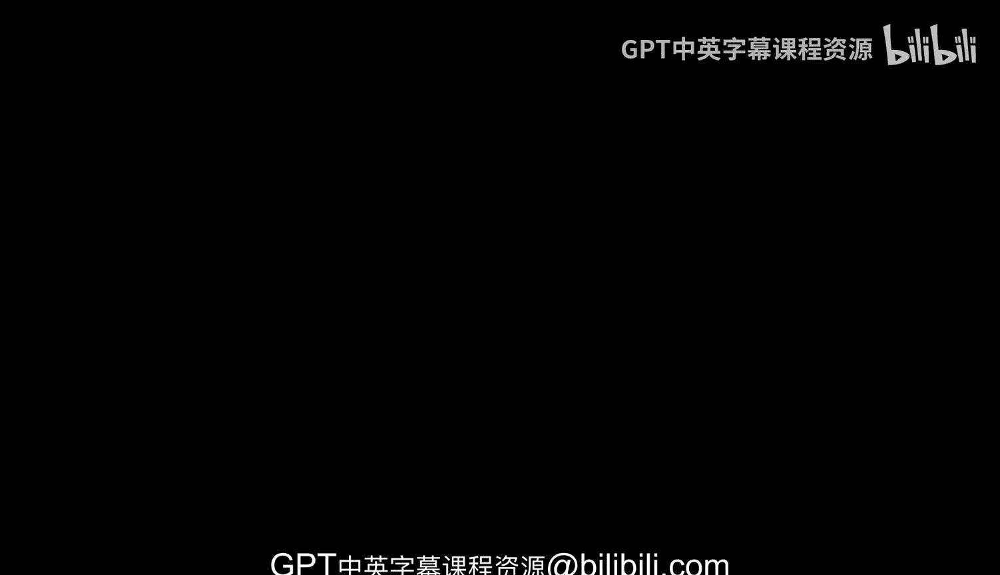
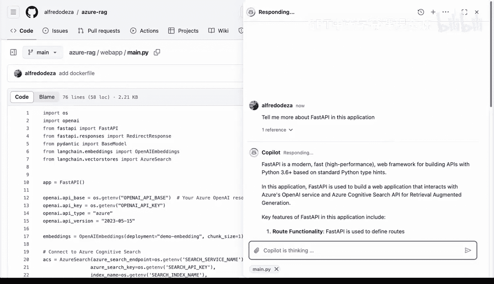

# 杜克大学《大型语言模型实践（生成式AI简介、Azure的LLMs（1、2课，共6课）｜Large Language Model Operations》 - P41：41_03_03_生成式人工智能应用的常见类型.zh_en - GPT中英字幕课程资源 - BV1Ef421m7zD

There are several types of different applications that you can see in real world use case scenarios for General FAI so a few of those and perhaps kind of like the most common ones and how everything kind of started to become popular was with textbased chatting kind of like what chat GT were exactly what chat GPT offers and how it started becoming so so popular nowadays we have several different types of chat interfaces and it is becoming more pervasive and more common to have applications。

 chat based applications where you can have some sort of like a conversational。

A type of feedback loop where you're interacting with large language models。

 Now there's several use cases beyond these and we're already seen how gene AI in large language models and chatbots are becoming more common in other types of applications that perhaps you've seen in the past when trying to create a customer service or interact with a customer service representative and youre greet with a chatbot that is asking you hey。

 what' what's going on today how can I help you out what problems are you facing and in the past it has been the experience has been very clunky where perhaps you're trying to say some things like I'm having problems with an order hasn't shaped or is's delayed and the chatbot says like well。

 it seems that you want to find a new product and it's nothing like it and you're having a problem and the chatbot。

Is useless trying to help you out to succeed in that problem that you have and that is a recipe for frustration and not very good customer experience。

Now beyond that and beyond the customer service and the chatbot experience。

 we're seeing how artists are trying to use to generate imagery and trying to create events videos as well。

 but beyond that if you start thinking about what are some of the other applications and potential applications of Gene FAI in all of its different types like text and image and audio is becoming more productive and we're seeing how generate FAI is now being kind of like attached to everyday tasks like creating emails or getting a summary after a meeting。

 we're going to be seeing more and more kind of like breakthroughs and trying to see some of these convergence of generate FAI into。

Daily tasks， especially those that require some sort of summarization， some sort of like hey。

' here's something that we need to create and we need to actually try to put it together based on all of these different sources so those are some examples of generative AI and perhaps you've seen those already and we should expect more and more daily interactions with our tools that are enhanced with generative AI。

