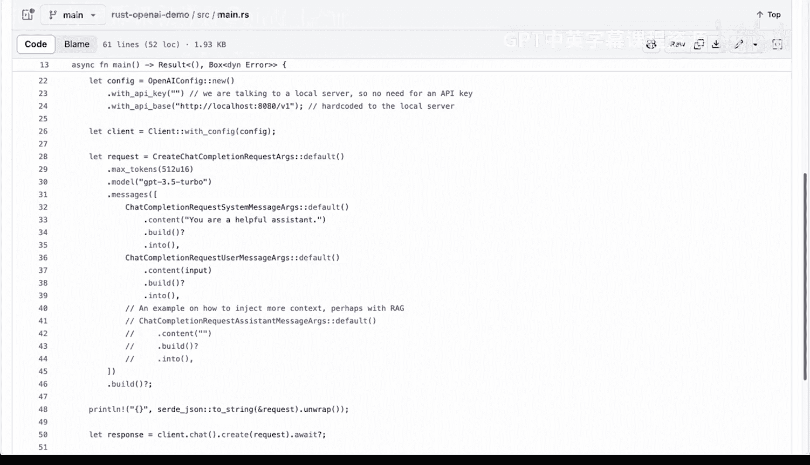
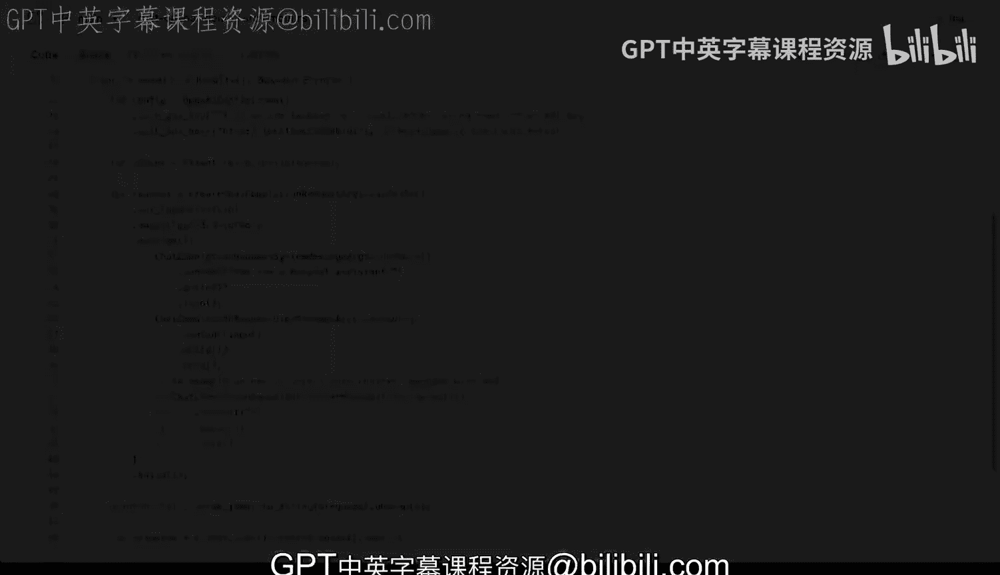

# 杜克大学《大型语言模型实践（生成式AI简介、Azure的LLMs（1、2课，共6课）｜Large Language Model Operations》 - P42：42_03_04_基于API的应用概览.zh_en - GPT中英字幕课程资源 - BV1Ef421m7zD

Let's see what is an API based application， especially when we're talking about General FAI。

 it is now becoming very common to have this API based type of applications not only from for the Ser portion the interactive portion of it but also on the back end and I'll explain what those mean in a second here we have an application that is going to be working over HtTP it's going to be an HttP API。

 that means that whenever anything or someone on our application。

 perhaps it' going to connect over HtTP using a URL going to send some information and going to retrieve some information and that is going to get enhanced by using large language models so let's take a quick look and here you can see what that means with a or open AI specifically you have。

The capabilities of trying to define kind of like where are your models and where those are coming from。

 and you can see here it's talking to Azure Open AI。And the openaiI API type is Azure。

 so these are minor details and it's okay that we haven't seen these in detail what but that exactly means。

 but in essence what we're talking about here is that this application this API is going to be talking is going to be sending some information to this URL right here that is what that means and it means that the model。

 the large language model does not live within this application。

 So let's take a look at the code is it is a single file and this is of course a highly simplified let's go not to this one let's go to even a simpler example here that I have which is this one right here perfect。

 So in this chat let's it is 42 lines of Python code。

Let's not get distracted by the specifics of the Python code。

 but here youll see what I mean like do you see a large language model defined anywhere in here。

 there's nothing defined anywhere like all of these are just loading kind of like the files。

 the things we're going to need for passing in the secrets we're going to try to connect remotely。

To an open AI instance， to some remote instance to another server that lifts elsewhere that is going to help us send some information and process it back。

So here we have some service， some helpers in Python that is going to help us connect and when I say where we're connecting。

 whats our key， we're going to be able to authenticate。

And here you can see that I need to understand what are the variables involved in making outstanding espresso besides a good machine。

 So I'm sending a prompt And then when I receive a response back。

 I'm going to print that back I'm going to provide that response back。

 This is an API type of interaction where we're sending things to to a remote server to some other place remotely and receiving a response back Now here's this is just acting like a command line tool。

 but this could very well be an HttP service another example that I want to show you is not a Python web application。

 but in this case this is going to be using rust and in here if I go to SRC and show you the code this will also be kind of rather simplified and you can see here that we are connecting。

We're connecting to locally to a large language model application so again we're using HtTP。

 we're using this specific URL to connect remotely to some other application that will have will serve that large language model There are other types of applications that do host the model within so like the model will be defined somewhere in here and then the application will be serving that and interacting with that this type of separation of concerns where you have a type of application in this case is rust and before it was Python this type of separation of concerns is great because it allows you to scale it allows you to have many different application talking to the large language models so those are two good examples on what you should be looking at when you're trying to see what ways can you interact with a large language model when you try to create an application that is going to be based on genetic。

FAI。

