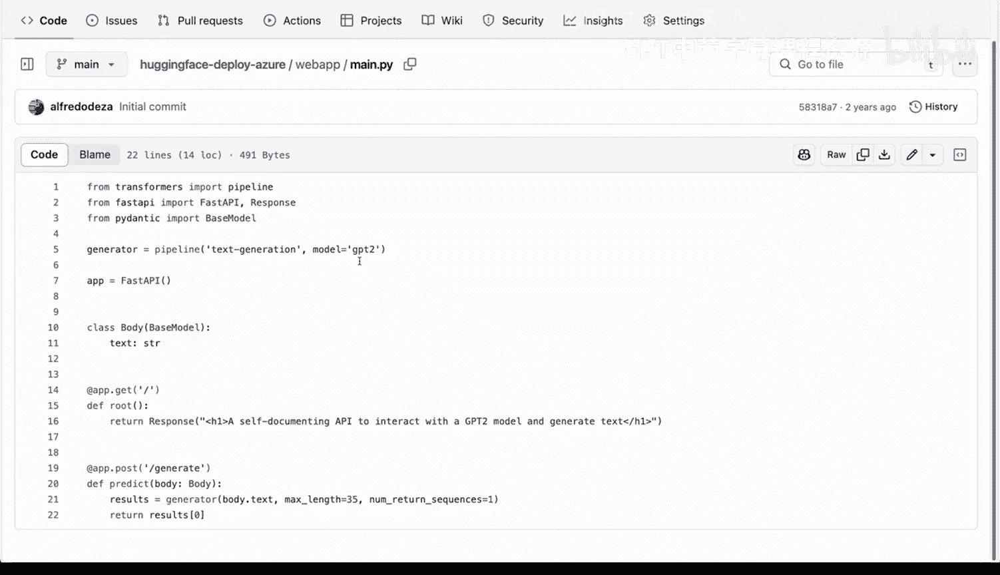
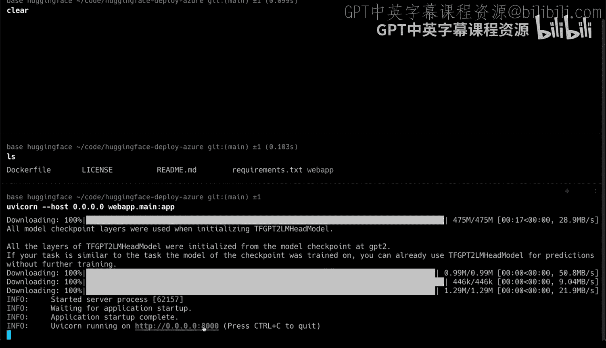
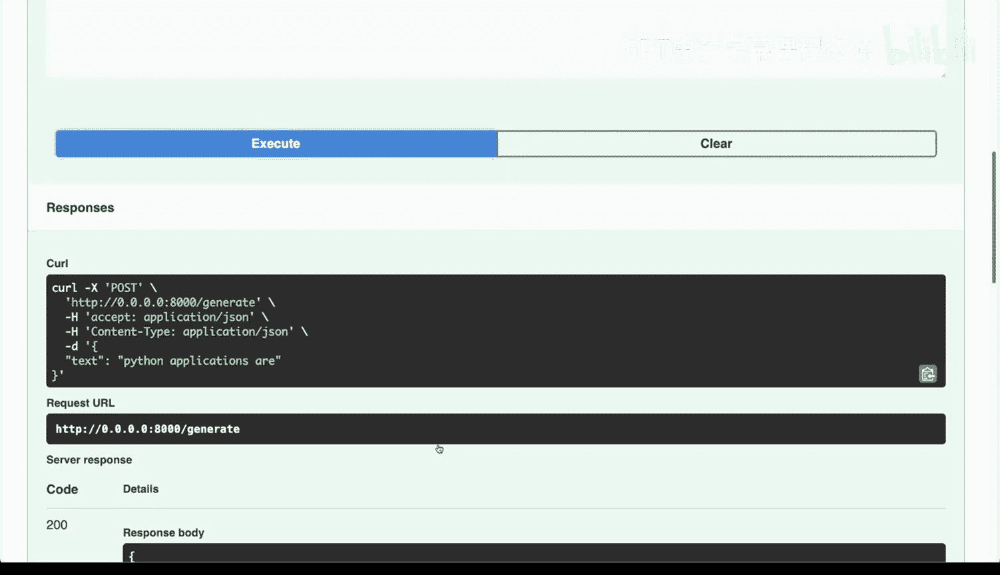
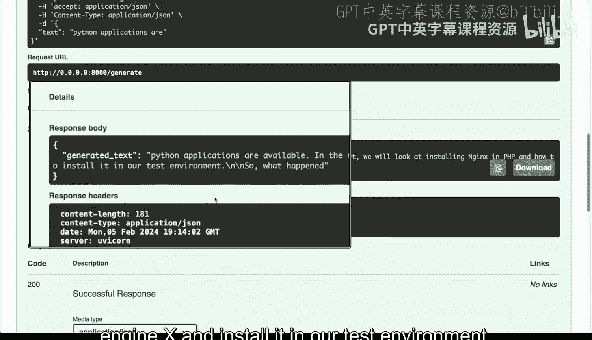
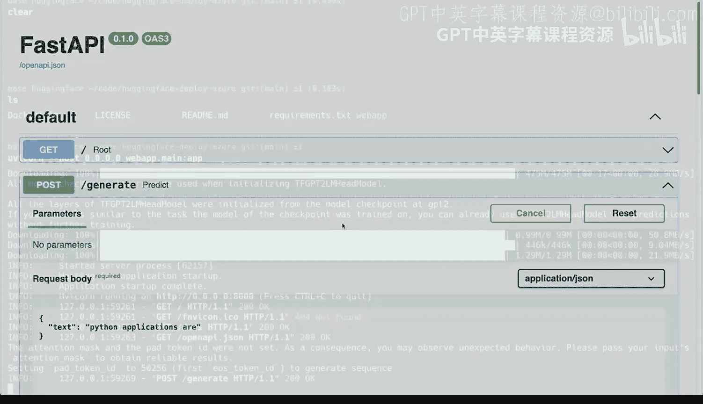
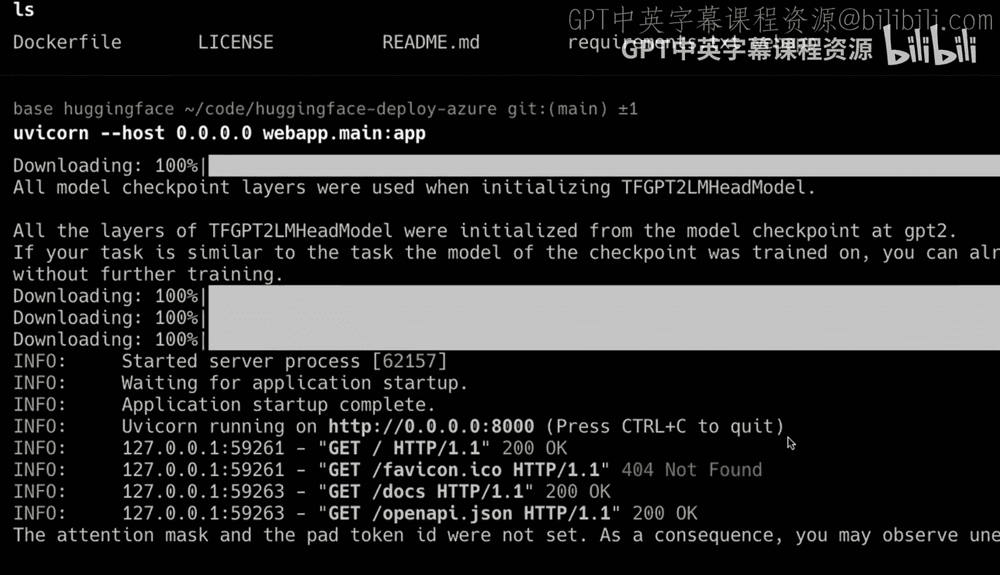
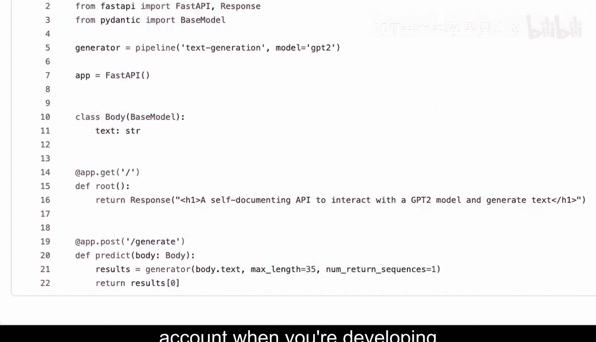
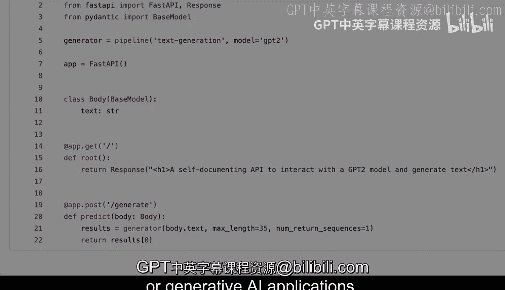

# 杜克大学《大型语言模型实践（生成式AI简介、Azure的LLMs（1、2课，共6课）｜Large Language Model Operations》 - P43：43_03_05_嵌入式模型应用概览.zh_en - GPT中英字幕课程资源 - BV1Ef421m7zD

Now， let's see what does it mean to have an embedded model， an application with an embedded model。

 that means that the model， the large language model it will be within the application。

 So I have an example repository here。 We have several different。Filees。

 it is Python I'm not going go into details as to what exactly these Python files are doing。

 but we're going to take a look and poke around the application and see what does it mean to have this model inside so we have a mainda by a Python file and I'm going to scroll here and the first most important thing is this line right here now this is a super super old model GT2 that means that this model is kind of like the great grandfather of GT4 which is kind of like whatre what we're seeing in modern chatbased applications like chat GT this is text generation and it means that this will dynamically grab that model and put it inside the application when we run it that's it like we are going to accept an input that is going to come over an HtTP API。

That URL is going to be slash generaterate and the input is going to be set at a maximum length of 35 and we're going return just a single sequence these are just particularities things that are unique to the model itself but this generator which is coming from right there it is in charge of talking to the model GT to in this case so that's it that's all that it is。

 it means that the model will live like I'm going to now to show you further like what does that really mean I'm going to download I'm going to run the code I've already clone the locally I'm going to switch over to my terminal al right so I'm in my terminal and this is the exact same application and I'm going to run it as it's supposed to run with this Uicorn executable Uicorn is a this guy right here it's。

The application that is going to run is going to serve my HTP application。

 So I'm going to run this and you're going to notice that is doing There's some downloading happening right here。

And that downloading this downloading is downloading the model is 475 megabytes total that is coming into my system and that is going to go inside the application。

And you can see here that now the application is actually running on port 8000。

 So if I were to click this， it would take me to the application and we can actually start poking around and see what that looks like so let me go to my browser and I've clicked and this is port 8000 we'm gonna go to s docs here and inside inside here I be able to interact with our API I'm going generate something I'm I can try it out I can say Python applications are and I'm going to leave it there hanging so that we can get some generation going so I'm going to execute this is going to talk back to the API that that I'm running what we're getting here is something that is not very useful Python applications are available in the next part we will look at installing engineX and install it in our test environment So that's fine this is good enough。

 let's go back to the terminal and in the terminal you can see that there's a lot of action happening right here and you can see we are。

We are getting some interaction， but this is all possible because the 44475 mebyte model was downloaded and it lives within the the application That is what it means when we're talking about model that is the list within the same application these type of application will not allow you to have separation of concerns This means that the model will live here and every time you want to bring out another instance it will also download these and it will become a very heavy type of machine that will have these files living in them so it's just one different type of considerations that you need to take into account when youre developing your large language applications or generative AI applications。

