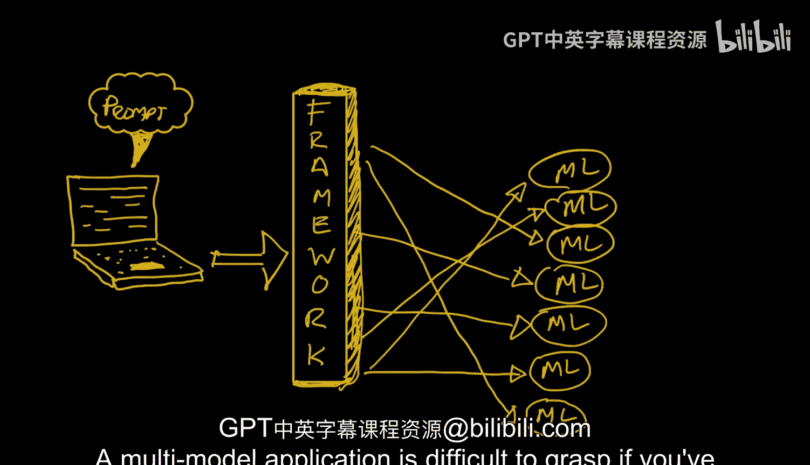
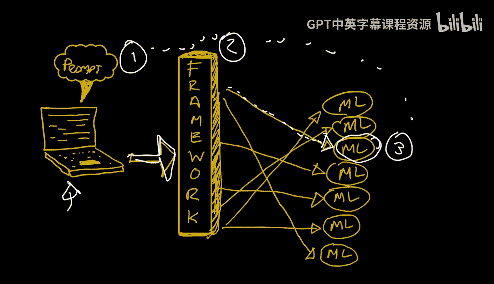
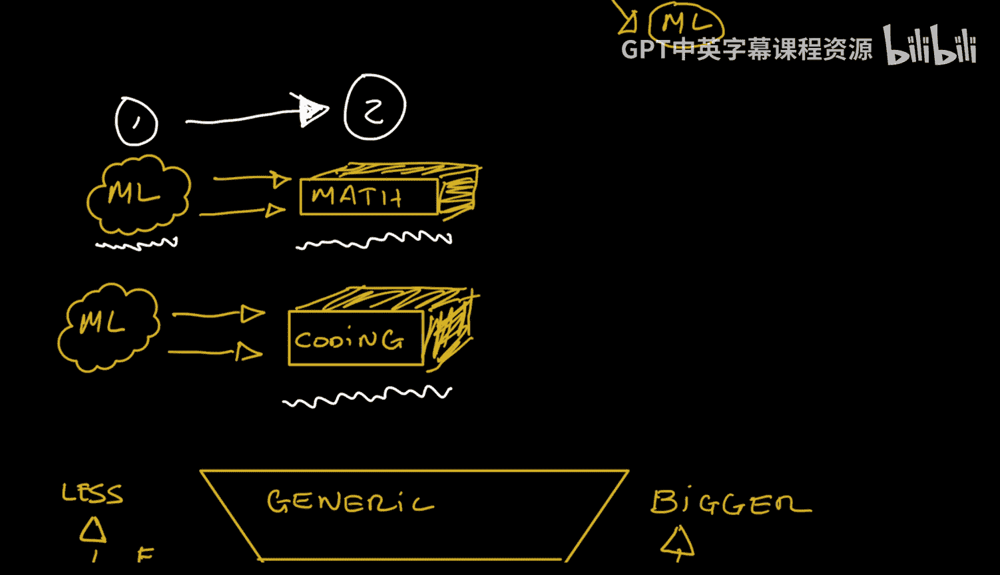
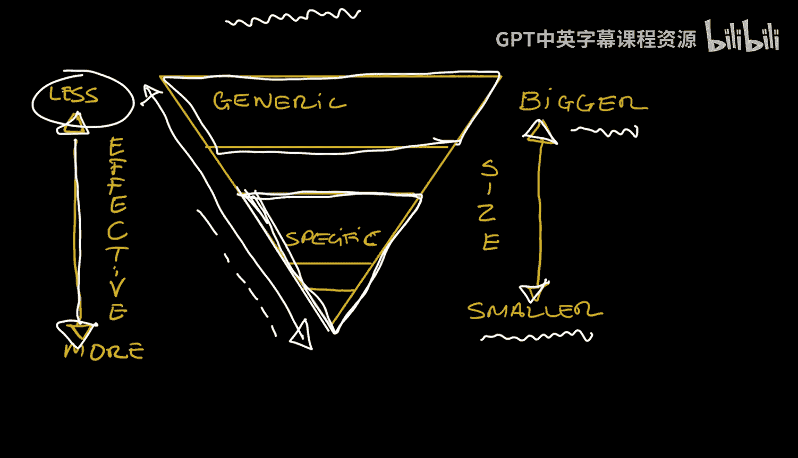
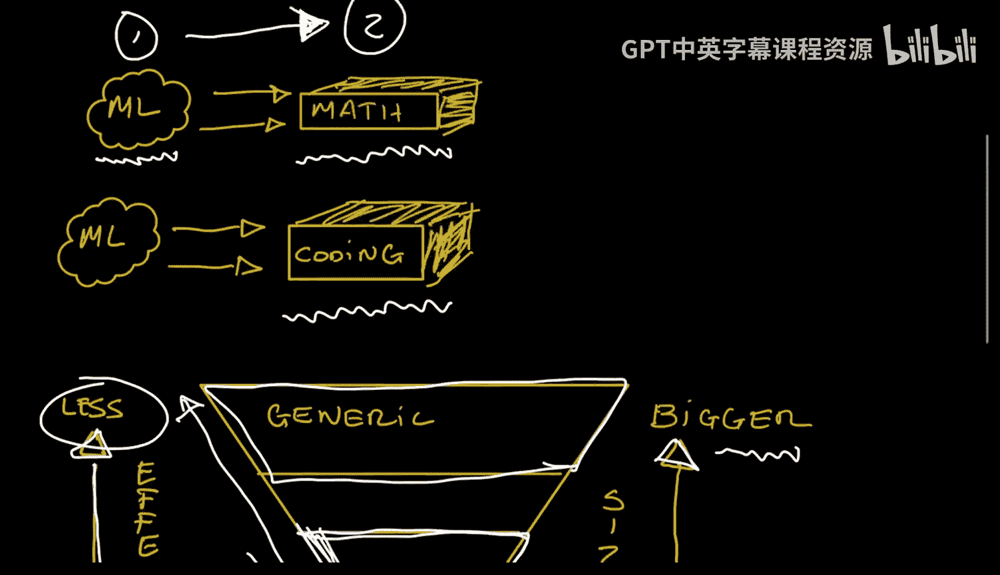
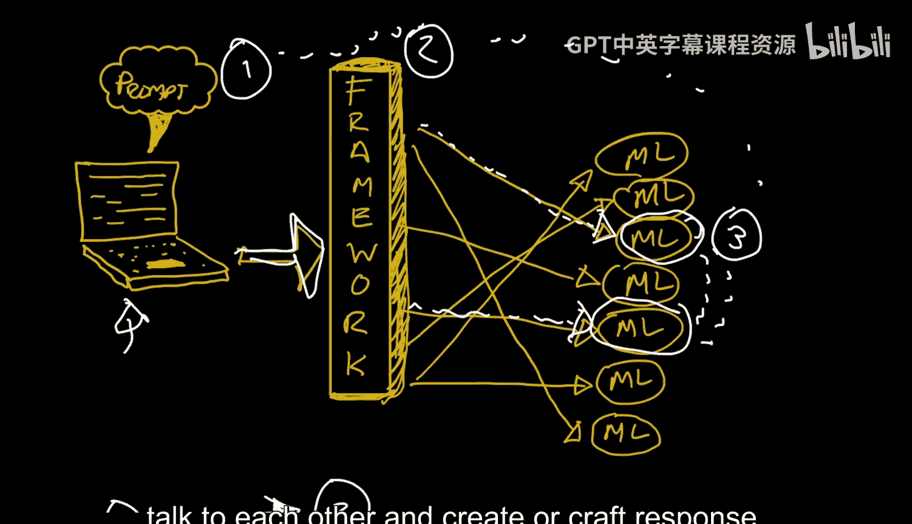
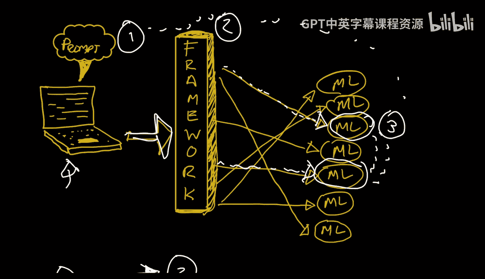
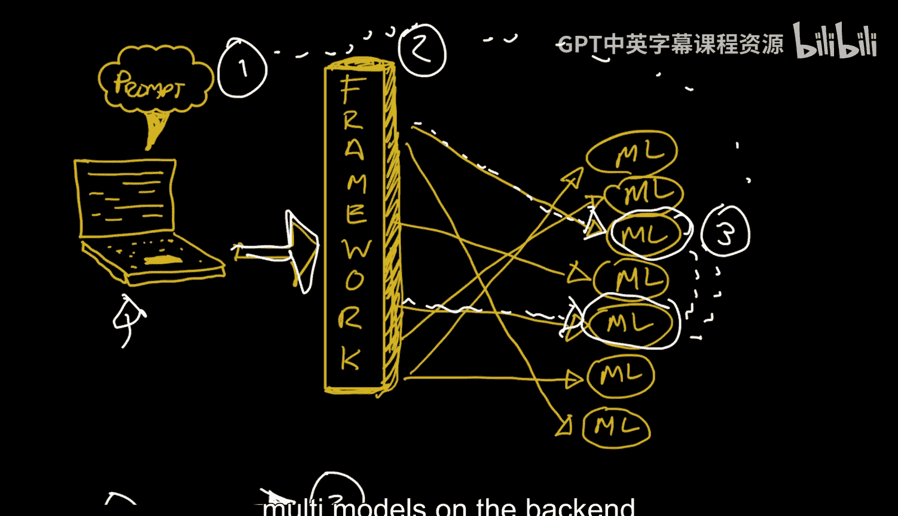
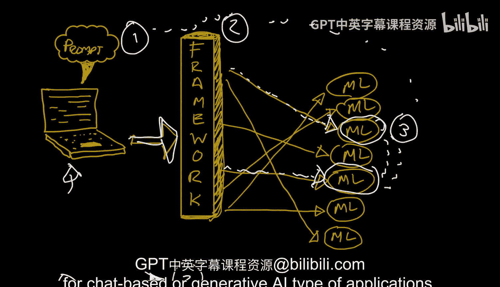

# 杜克大学《大型语言模型实践（生成式AI简介、Azure的LLMs（1、2课，共6课）｜Large Language Model Operations》 - P44：44_03_06_什么是多模型应用.zh_en - GPT中英字幕课程资源 - BV1Ef421m7zD

A multimod application is kind of difficult to grasp if you've never gone through。

Trying to scale or trying to figure out how to scale an application。

 but let's demystify how this works and let's start with a very basic here。

 number one where the prompt starts， the user will start a prompt and that will go over to the framework so the framework receives these this prompt and based on the prompt。

It will decide which machine learning model it will redirect that request towards so say for example。

 you have something something quite generic an application that can return either math or something some coding question or doing translations。

 translation actually be in a very good example of geneative AI。

And so the framework based on that input， it will decide which model to go towards。

 so in this case so say for example， if it's a coding question。

 it will decide to go to to this one model over here。

And this model over here will go and figure out what the right response is and we'll essentially go back and send the response all through the framework and back to the user number one now。

Sometimes questions can be not about coding， they can be about translations。

 we can have many different models specialized on translation。

 so why is this something that might be useful or something that might make sense to implement so。

The reason why these types of models are very good is because they're specialized and when they're specialized。

 you have several different things that may happen when when you're implementing something like this first off。

 the machine learning model will be or will become something that is much smaller and smaller is good。

 especially with machine learning models， youll spend less resources in trying to trying to make it work and scaling and improving what the responses are are going to be better if you have something specialized in this case math over here or coding over here then the benefits of the machine learning model are going to be much。

 much better you can actually have a better experience by having a specialized machine。

Nearning model。Think about this as someone that knows a lot about many different subjects。

 but so breadth， a breadth of knowledge， but there's no death into any of these specific knowledges so when someone knows a lot about many different things well're they're going to probably be lacking death and what I have here is something that might make sense as we grow from something that is generic to something that is very specific what we're getting is a couple of benefits or challenges so right here with a bigger and smaller depending on the science that generic model is going to be very。

 very big and it's going to be very large is going to try to via a specialist or sort of a specialist in many different subjects in many different things and that model is going to be way。

 way way bigger because it's going to account。

For all of those things。 But as he becomes more specific。

It is going to become much smaller because the specificity is going to allow this model to concentrate only on the parts that are important based on the domain that it is trying to work with so say for example math then you know training the model with other information regarding natural language based on novels or books or fantasy is not going to be useful。

 only math is useful， then the model is going to be highly specific。

Now on the effectiveness side of things。It is going to be much more effective when it is highly specific and less effective when it's less specific when it's more generic。

😊，So in the case of generating code， for example， that is a highly a highly specific model that will be able to assist you with programming languages。

 So it's going to be very effective at doing that。 But if you ask a machinery model that is specific to。

Coding problems or generating code and you ask a question that is not related to that Well the responses are not going to be very good。

 it's going to be well less effective So those are some of the things that we need to take into account when we're looking at these。

 but I especially like and I'm going go back here to the framework and the prompt and how would a machine learning framework can actually talk to very specific models in the back and to try to come up with responses now one last thing I want to mention is that in some cases we've seen implementations where certain models can talk to each other and create a craft response。

 but that's a more fairly more involved type of setup and architecture。

 but I think the very basic level having many different models depending on what you want to achieve。

I something that makes sense and I think something that is worth understanding so that whenever you're dealing with solving a problem at scale。

 you have the ability to perhaps explore a little bit this idea of having multimodels on the back end for chat based or generative AI type of applications。

