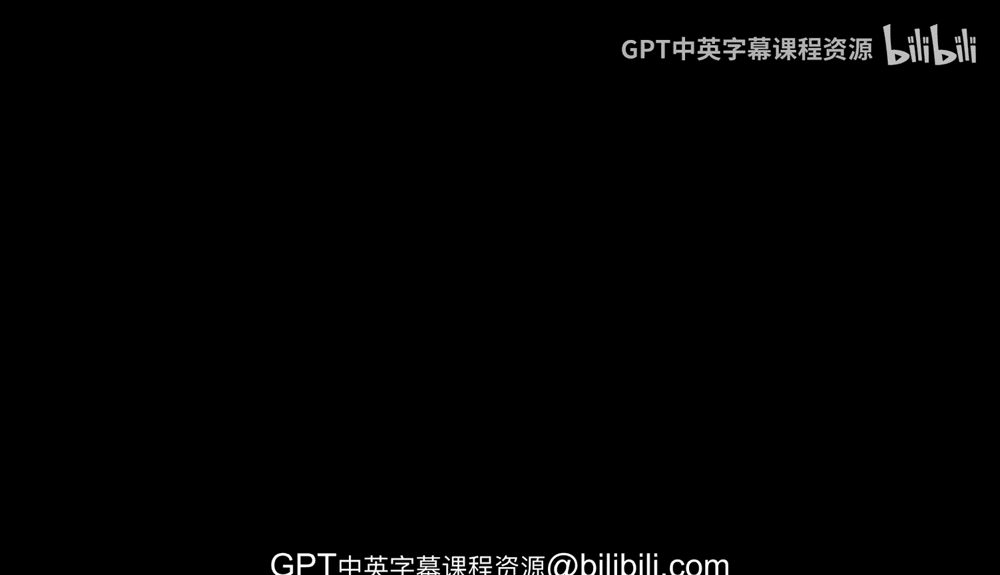

# 杜克大学《大型语言模型实践（生成式AI简介、Azure的LLMs（1、2课，共6课）｜Large Language Model Operations》 - P53：53_03_02_引言_9.zh_en - GPT中英字幕课程资源 - BV1Ef421m7zD

Let's explore a cloudbased Gene AI application is going to be an HTTP API。

 we'll see all of the components needed to try to make that work。

 we'll set up some of the cloud components the counterpart where these applications is going to go and live in this case we're going to use the Azure cloud。

 but similar procedures should work for other types of clouds as well we' take a look at the deployment。

 how does the deployment would look like， once the automation。

 what's in to get these application deployed all over to the cloud。

 and finally we'll verify that everything's working on Azure once it's deployed once it's publicly available and making all of these APIs and all of these connection。

 all these components working as one。

