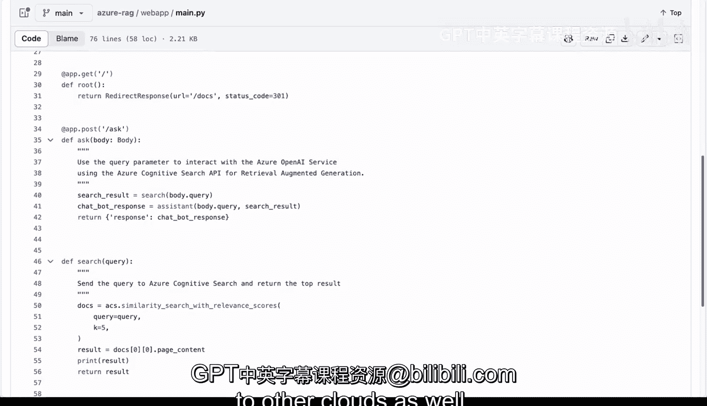

# 杜克大学《大型语言模型实践（生成式AI简介、Azure的LLMs（1、2课，共6课）｜Large Language Model Operations》 - P54：54_03_03_应用概览.zh_en - GPT中英字幕课程资源 - BV1Ef421m7zD

We have here an application that is applying the retrieval augmented generation pattern。

 the RA pattern for dealing with large language models but in this case it is an application that is going to work with Azure specifically the Azure Azure is the Microsoft Cloud and within Azure and here I want to show you a couple of the things that are interesting within Azure when you want to implement something like RaG you can also make use of the Azure openAI service and Azure cognitive search now this is similar in essence it's the same thing that of applying the RAG pattern is just using the tooling that is available within the cloud and we're going to take a look at what are some of the things that we' going to be using here now clickcom requirements that text so that you can see some of the things that we're going to be doing。

I use Azure identity Lnkcha， which is a framework to deal with trying to work with the prompts and talking with the APIs。

 Im going to use the Azure search documents which will allow us to get these embeddings into that vector database actually the search the search has the vector capabilities to store everything that we need。

 we'll also be using open AI so that we can get everything we need into talking to these APIs for Azure Open AI and Python。

M to load some of the secrets， fast API for the framework。

 you'llBcorn for running these application and TikTookken for helping to create the embeddings。

Alright， so that is those are the requirements。 What does the web application look like。

 It is a single file and it's not that very lengthy when I scroll it to the bottom and it's just 76 lines long but let's take it step by step and see what are some of the things that we can see here when we're dealing with an application like this this is a containerized application is going to be deployed to the cloud and right off the bat it will need the endpoints and the keys and where it needs to go to talk to the openaiI API if you have deployed something like the Az or OpenaiI service and or the Azure AI service and you have those APIs already available then you're good to go and you can just be passing those now note that I'm getting this from the environment an application deployed to the cloud we're probably being。

ing will be making this available as part of the environment I'm not hard coding any secreties or endpoints in my application。

Now the embeddings will allow me to create them right here。

 I'm going to chunk them and I'm going to be able to deal with that and I've previously uploaded all of the embeddings to the Azure cloud to the search service and here I am the finding the finding everything I need to connect to the Azure search the Azure search again provides me the vector database capabilities that this application will need and we will only expose a slash ask endpoint that means that wherever these is getting deployed。

 this slash ask will be the endpoint that consumers of this API will be will be using so what is going on here will get will get in post request with a body and that body will have the prompt and then that prompt will be used to first。

Create the search so we will send that to aure search and then we will create interact with a large language problem with the chatbod response by calling the As helper function。

 and then finally we'll provide the response for for the API。

Alright so let's take a look at what search looks like again pretty straightforward I am even printing here for debugging the response。

 but I'm doing the Azure content the Azure cognitive search to do the similarity search with relevant scores that retrieves five results the most and send the query over and I return the actual response and the assistant you can see here assistance the chatboard helps you find the best one for your taste similar to what we've seen before and then we're going to use the query for the role of the user that's going to go to the large language model and then finally we are going to enhance the context with the response from the Azure search the vector database search based on our data from before。

So that's it， that's the whole application and this is a very simple very decoupled application why decoupled because like the database is not running within the application。

 it is connecting externally to both the openAI APIs and the vector databases and which allows you to have a very small。

 very lean very practical application that you can deploy to the cloud。

 in this case we're using Azure， but you could essentially apply the same patterns and the same techniques to other clouds as well。

