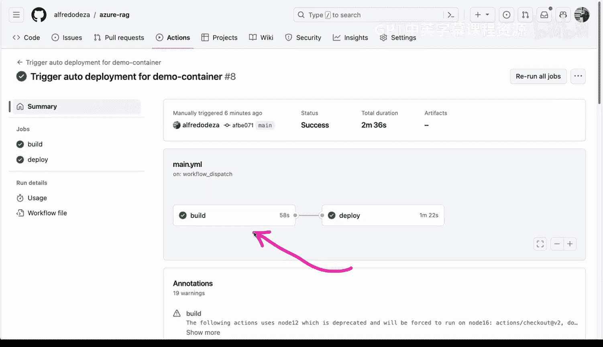
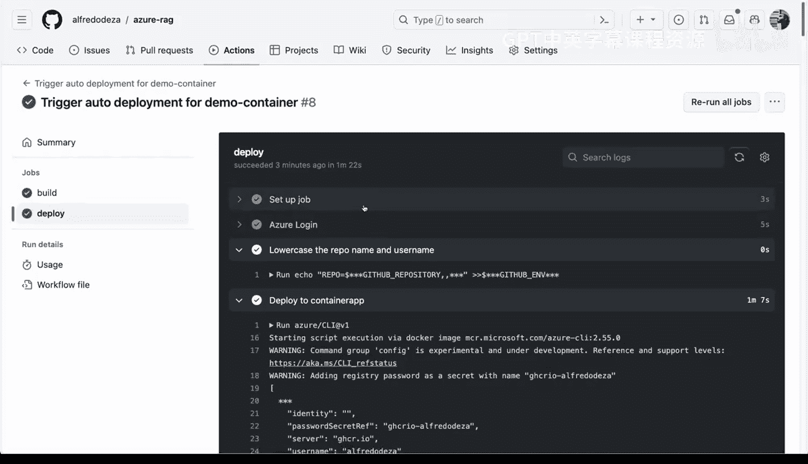
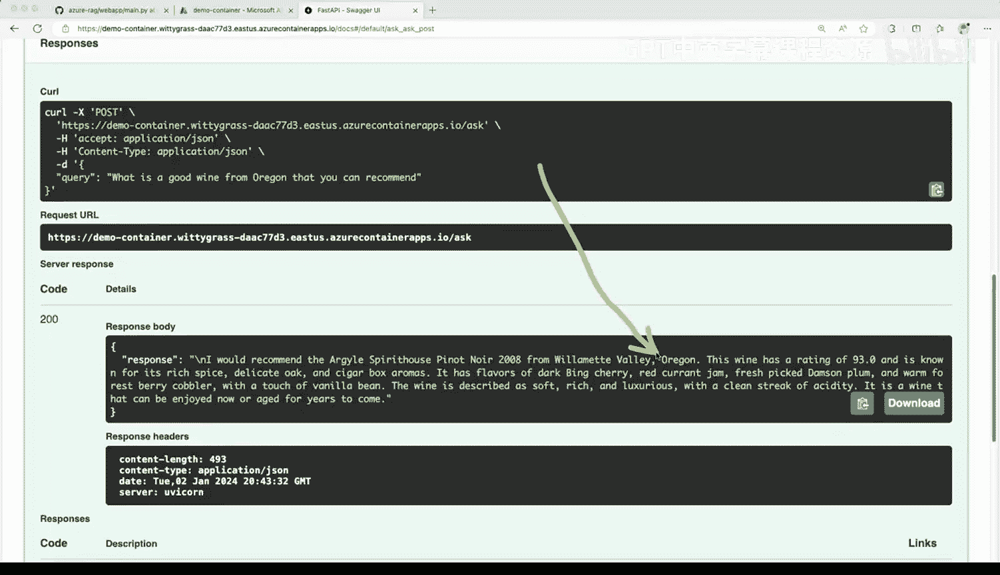
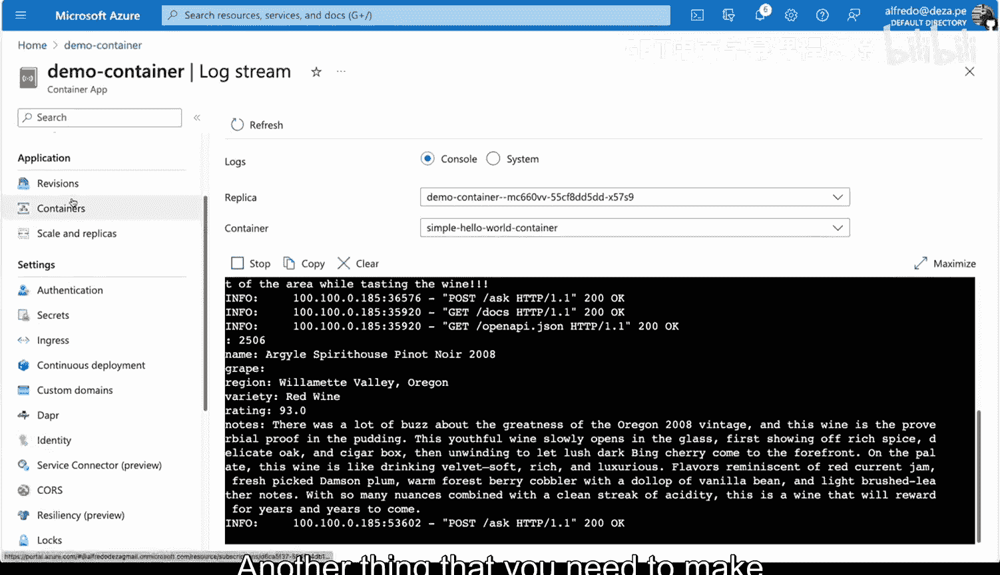
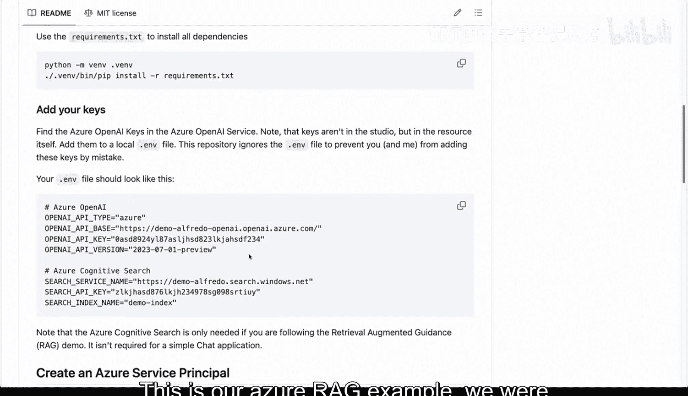
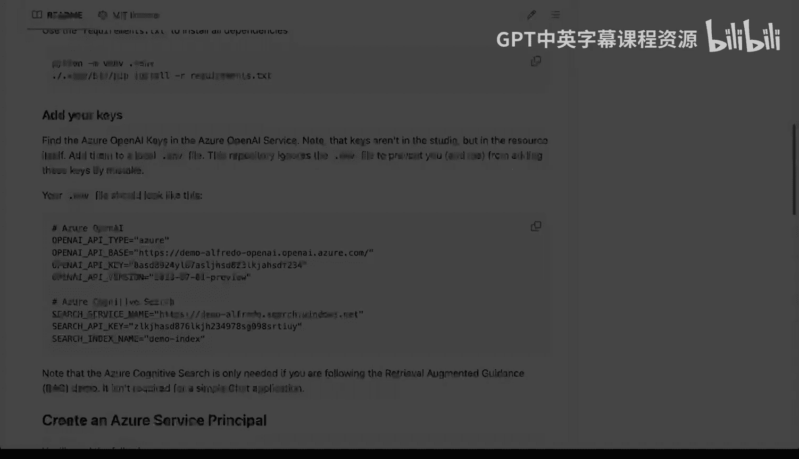

# 杜克大学《大型语言模型实践（生成式AI简介、Azure的LLMs（1、2课，共6课）｜Large Language Model Operations》 - P57：57_03_06_使用Azure云进行部署.zh_en - GPT中英字幕课程资源 - BV1Ef421m7zD

So now we're ready to deploy our application finally our final step is here and we have our demo container application that we've previously deployed when we were creating the resources necessary for application to be good to go and now we need to head over to a repository and to the action step here and triggered that one now before I do that I want to show you some real hard truth about what happens when you're building automation I'm going to scroll here and you're going to see all of these failures。

 this is entirely normal you won't be able to get。

Or it's actually not very often where you get everything just right and everything works right from the getgo and you will see that there's lots of things you will miss some variables。

 you will have some typos and youll have to see some failures in order to get where you need to be so this is already have in trigger but let me show you how that looks when you get started and we'll look at some of the components so we're going click here and trigger auto of deployment and then the run workflow button is the manual triggers I'm going to click here and running that workflow from the branch main is what gets everything trigger so I've already done that and instead of waiting well five minutes or five minutes ago instead of waiting those two minutes and 30 seconds what we're gonna do is take a look at what happened here so we're gonna have remember we have the build step and then the deploy step so building creates the container puts everything together in the container installs the dependencies and the deployment talks to ahes if I click one of these you will see the log output setting out the doc。

Build， post log into Github container registry。And the deploy one。

You will see that does' the Azure login， lower casing the repo and deploy to the container application。

Some of some of the settings here will be with stars to prevent some secrets from getting out。

 Alright， so that is completed。 it's all good。 What happens on the container side of things in the cloud so I'm going go back to the Azure portal I'm in the container app portal part of the Azure portal and then in the overview section I'll have the application URL So what happens if I click this one So I'm going to click this one and open up in the new tab and then head over to that Appstream connect air or disconnect reset before headers what's going on first problem that we' to have is because our container by the fold uses port 8000 and this is trying to use port 80 So we're gonna to head back here and we're gonna check Ingress and Ingress is part of the settings is gonna be here when I click there。

And I need to scroll here all the way down and target port is the port inside the container。

 So this for us is port 8000。 So I'm gonna save that wait a second until the ingress is updated and we will be able to check that this is finally now actually working correctly。

 So this is going to take a second and there we go successfully updated ingress。

 So this is the same end point this is the same address as before and we're gonna able to switch tabs reload these and there we go。

 we have our application。 So this is our fast APIpi。 this is our application。

 it is running on Azure you can see here Azure container apps So let's try it out。

 So I'm gonna go here I'm going to click on try it out just like we did before。

 I'm gonna to say what is a good one from Oregon。You can recommend。

 so let's try that out when to execute this and it's going to contact our index。

 is's going to contact the open AI database。 the open AI service， actually the Azure Open AI service。

 I'm gonna to get a response from Oregon perfect so we can see here that everything is working and actually this is publicly available。

 So very good。 I' going to go back to the Azure portal in one last thing I'm gonna to show you is take a look at some of the potential errors that you might find going to the log stream is a good way of seeing something that might potentially be problematic。

 So you will see here that things are going well and I'm going to scroll this a little bit going up。

 and things are pretty good and we can see that it is printing some of the responses which is pretty good Now when there are problems here this is actually terminal output you will。

able to see some errors as well as things that might not be quite quite right and this is something that you need to verify another thing that you need to make sure is that you go to containers and you see that your properties。

 your environment variables。

Are all correct and finally the scale and replicas， if you are scaling。

 you can see here that you have 0 to 10， you can scale these to have more more bandwidth to with withstand requests so that's it Our application has been successfully deployed This is our Azure Ra example。

 we were able to put everything together with Github actions automate these and deployed to Azure。

