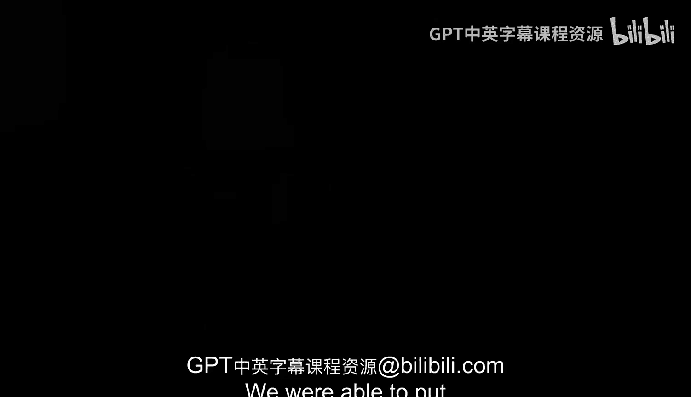

# 杜克大学《大型语言模型实践（生成式AI简介、Azure的LLMs（1、2课，共6课）｜Large Language Model Operations》 - P58：58_03_08_总结_5.zh_en - GPT中英字幕课程资源 - BV1Ef421m7zD

So we were able to put together all of the pieces necessary to create an HTTP API based General FAI application we deployed it to the cloud we use best practices like automation we use a little bit of GiHub actions we saw what that means and we set up also the components on the Azure Cloud for the deployment this is very exciting。

 it is the final step or on putting all of these things together to work with something like the Azure Cloud now granted I didn't go into a ton of detail of exactly all of the steps that you need to take because this is a lesson that just tries to give you a quick overview of what that would look like now if you want to explore more there's definitely more lessons that you can take to dive deeper into that but for this lesson we chose to kind of like give you a quick overview very quickly。

What the components you need， how is that going to look like and once it's deployed。

 how can we verify that deployment， So hopefully that was give you gives you a pretty good idea on how would that happen。

