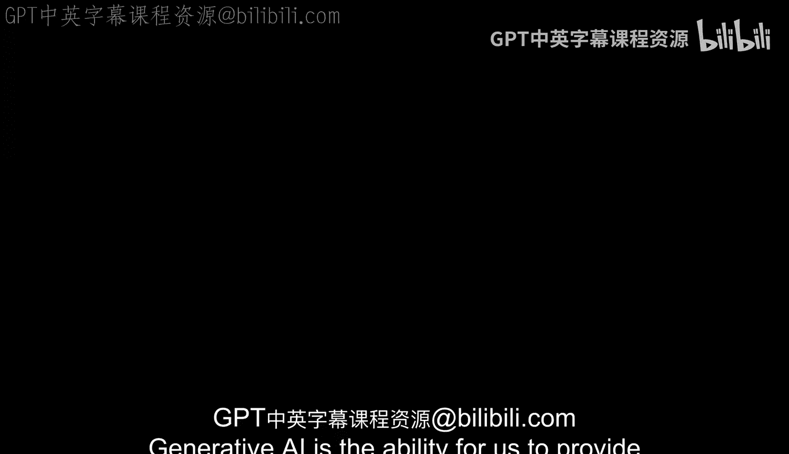
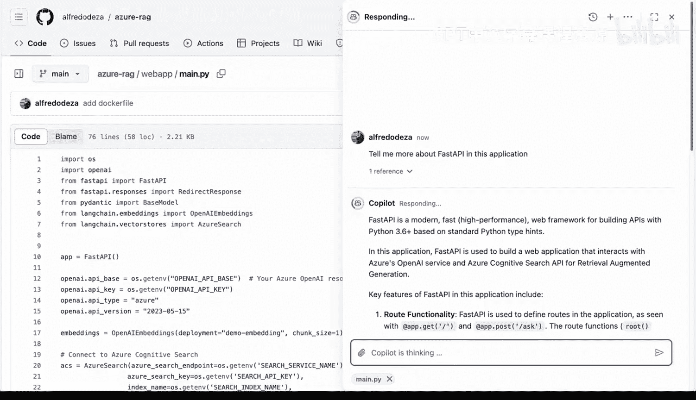

# 杜克大学《大型语言模型实践（生成式AI简介、Azure的LLMs（1、2课，共6课）｜Large Language Model Operations》 - P5：05_01_03_什么是生成式人工智能.zh_en - GPT中英字幕课程资源 - BV1Ef421m7zD

Geneneative FAI is the ability for us to provide an input。

To artificial intelligence and to get a response back， to get an output。

 that output will be generated。 artificial intelligence will be able to generate and produce。

Text or images or sound or video based on our input is the capacity that we have now to generate based on some input。

 Now， what I want to make perfectly clear is that this is a probability machine。

It is not a fact based machinech， specifically with text。

Some may think that when interacting with AI because the answers come back。

 so in a such a credible way that one tends to think well this might be this might be true this sounds correct this sounds like a fact and even when it does it does corroborate as a fact it is the truth it is not always so and it is up to you to verify these answers。

 these responses， these generated text or generated output and verify by yourself and make sure that what you're getting is accurate is correct and is actually something that you can use so having that the base of your knowledge on how we we're supposed to be interacting with this probability machines as I like to call them is again。

Foundational is very important。It is very easy to get into a pattern or get used to the responses that we're getting back and just assume that whatever we're getting back。

 it is the fact it's a fact is a truth and we've seen already many different cases like for example in the news where there's been situations where people have trusted blindly whatever came out of the large language models of the output of chatbased interface and taken that as truth and being repurposed as something that was a fact this is not a database。

 it is not based on real on real facts that are verifiable Now there are some nuances there are some things that we can change there are some things that can make these large language models be a little bit smarter and we'll see those throughout the course however。

The most important thing is that geneative AI is the ability of artificial intelligence to produce to generate based on probability some output in most cases。

 natural language processing。Text based responses， but also anything that looks like video。

 for example， or images or even sound in some cases。

