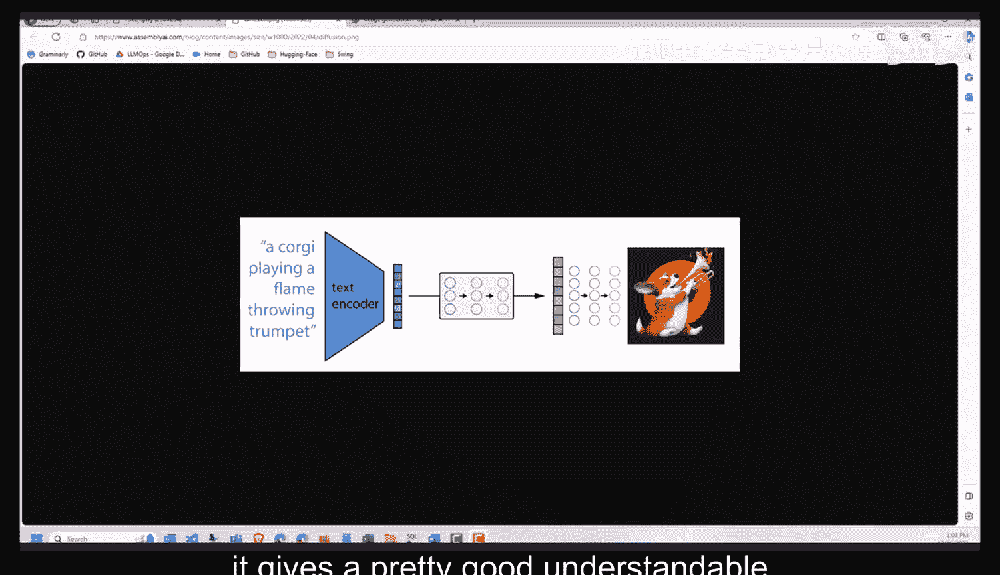
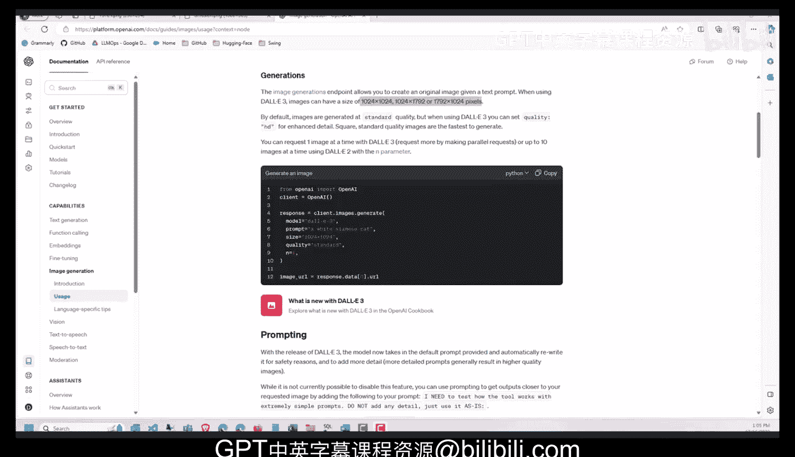

# 杜克大学《大型语言模型实践（生成式AI简介、Azure的LLMs（1、2课，共6课）｜Large Language Model Operations》 - P60：60_04_02_DALL-E概览.zh_en - GPT中英字幕课程资源 - BV1Ef421m7zD

Okay， before we go into the actual environment and setting up code spaces and doing some of the dolly implementation。

 I just wanted to give a very quick overview of what it is and how it works。 So Dolly is a。

Image generation， AI that takes in text， the short version of how it works。

 and I'll include much more documentation。 there's a good bit of scientific research on this as well is it has some sort of text encoder。

 takes the text text prompt。Maps that。Use the model to map that corresponding image encoding and then uses an image decoder to finally generate the image at the end。

 so here's kind of the full pipeline acc playing a flame throwing trumpet and this is from a really good website called assemblyly AI that explains this nicely This one's related to Dolly2 but works the same way as Dolly3 and then it goes into some of the improvements and it gives a pretty good understandable breakdown of how these things work so I'll be sure to include that and this is the this is the documentation from open AI so we'll just go into the parameters real quick kind of similar to the standard open AI text generation API calls you call out the model you pass the prompt。

 the only difference with this is a lot of the parameters our imagebased。

text base so you call out the size which is listed up here that I've highlighted。

 there's only three sizes that it can generate and then the quality is either standard or HD for now again this is changing very quickly and typically it defaults to one and the amount of images you get back so that's the n equals1 it comes back in。

It comes back in like a JSON format and that command at the bottom that you see here that I highlighted is how you print out the URL。

 which will click and show the image。 Alright， let's let's jump over to the environment。

