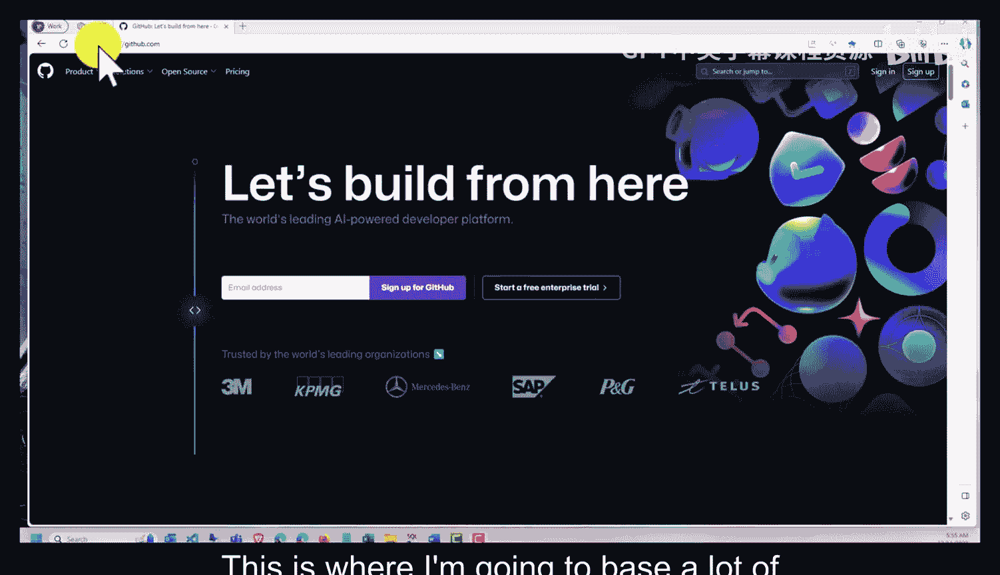
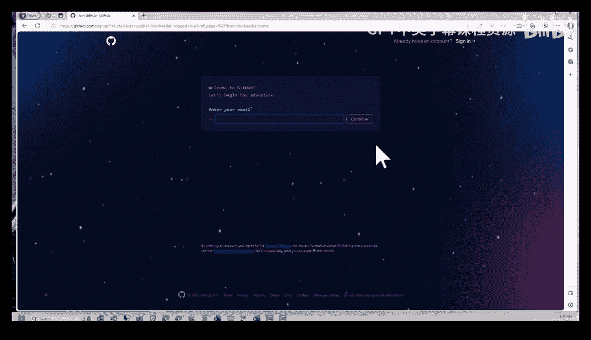
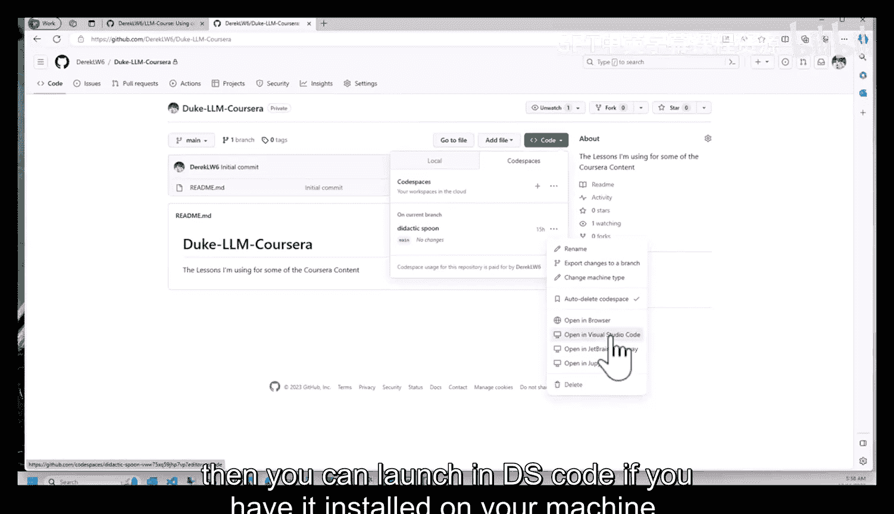
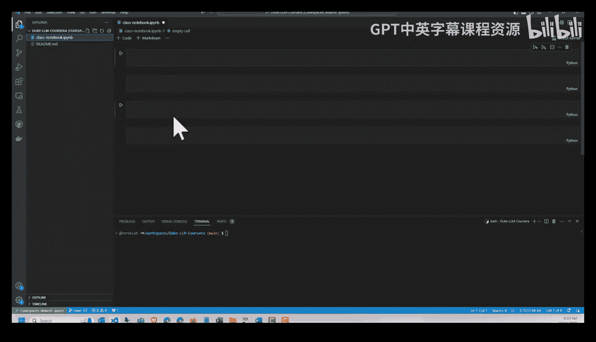

# 杜克大学《大型语言模型实践（生成式AI简介、Azure的LLMs（1、2课，共6课）｜Large Language Model Operations》 - P61：61_04_06_演示环境设置.zh_en - GPT中英字幕课程资源 - BV1Ef421m7zD

All right， this is Github。com this is where I'm going to base a lot of my development environment off of so if you have not signed up for GitHub you'll need to click the sign up button and you'll be asked to enter a series of information and sign up for an account I'm going to skip to I have a GitthHub account so I'm going to skip past this and go to what it's going to look like when you log in。

Okay， I'm sure most of you probably know what GitHub is， but this is what it'll look like。

 It is a online code repository， but the reason I like it is it has these great development machines called code spaces。

 So you won't be able to see the repository I'm using for this course because it is private。

 but I've created the Readme and all you need to do is click this tab， click codespaces。

 and then you can launch in DS code if you have it installed on your machine。

And。嗯。Okay， so this is what code space is on your local machine is gonna to look like。

 I am using something called Jupyter notebooks。 That's why the file extension here is different。

 I think it just makes it a lot easier to see as I'm going through each one of the cells and this is one of the things I really like about codespaces is the moment you enter some file name with the right file extension。

 whether it's not Py IPy and B for an i Python notebook or whatever the case would be。

 it will already start prompting you to install the right libraries view terminal and this is where you can do your PP install。

 etc ceter， and it plays very nicely with Gi so created。Glaasss。A bug。You just commit。

I'll ask you to sync and that will go right up to GitHub so it makes it very easy to can constantly commit。

 stay up to date on your work， etc ceter， so I'm going to do some work here。

 kind of set this up for use of Dolly and then we'll go into the first project。

