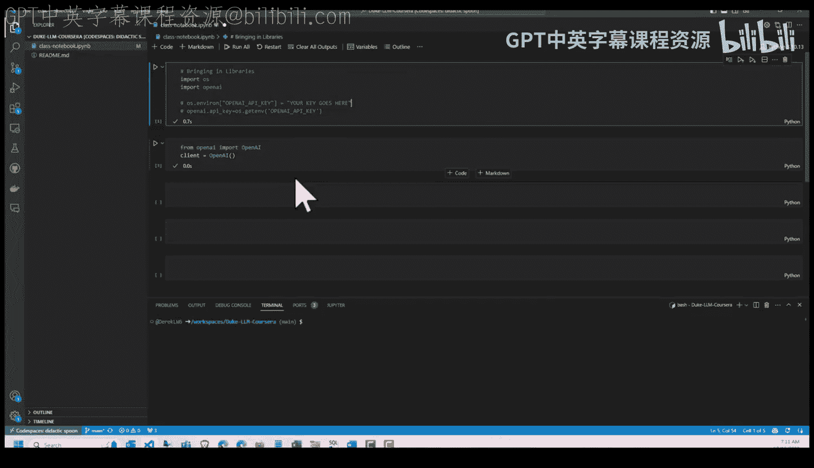
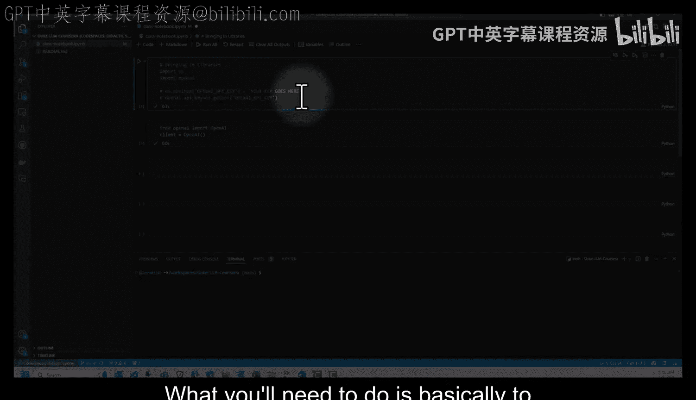
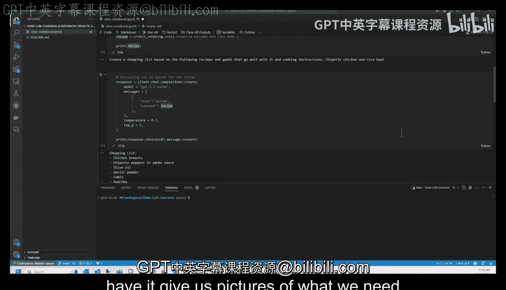

# 杜克大学《大型语言模型实践（生成式AI简介、Azure的LLMs（1、2课，共6课）｜Large Language Model Operations》 - P62：62_04_07_演示OpenAI API生成购物清单.zh_en - GPT中英字幕课程资源 - BV1Ef421m7zD

Okay， everybody， welcome back。 Derek again。 Here's my cheaperter notebook。

 What I'm gonna be doing is I'm gonna be sending a recipe over to open AI。

 Then it's going take that recipe。 and it's basically going to help me create a shopping list。

 And then we're gonna send that shopping list over to Dolly。

 and get some images of what we need to pick up back。 So that's the gist of this。

 I have already imported open AI and OS and started session。

 What you'll need to do is basically to create it as an environment variable。 your open AI API key。

 will need to be run right here。 and basically I run it as a separate cell。

 and then I delete it So it's saved in the environment。 but I'm not sharing my key everywhere。

 All right so the first thing we're gonna do is we're going create a function。 that basically。

Gives the prompt to open AI。You're inde。This is my TV。Shopping list。Cre。A game。Blesss and recipe。

Ouction。行。Fine。Create。This were shopping。P our list， as in the rest of the。

And this is where a lot of the。We just want to pro the bag。

 so sometimes the coil can be very helpful。Other times， you know。

 it's not the best it gets into it just kind of bad stuff。T want to create a shopping。我。Based。

On the following。Recipe。And foods。That go well。With it。 And cooking。Instructions。

 so this is going to be sent over to open AI。That will'll pass in。I need an extra recipe。

That looks good， right there。嗯 turn。呃。Okay。Okay。Looks like it worked， let's just do a quick。

Fction test， I'll add another cell here， maybe one or two more。嗯。Yes。The recipee。createreate。

It worthre shopping。Yes。LetGo with Chipotle。That's good to be。Chicken。And rice over。

And you can play around with this， whatever， whatever suits your fancy。

 but youpot sounds really good to me。And then well front it just to make sure it worked。Right。

 recipe。Yep， looks like looks like it passed in correctly。 All right。

 so now we're going to do an open AI API call。Reaching。Oh。去。Open AI。Yeah。Or the answer。Sponse。

And we're going to use the client dot chat。Dot completion。Create。啊。Okay。各位姨妈喽。あ。

And I believe this is one of the more。Re ones，3。5。Turbo and if you look at the documentation。

 there's a lot of different options。This one。Start with messages and there's basically a rule and then content。

Exions。But that was just in my keyboard。Leave this as passed in， as a dictionary。然后呢。Yeah。Systems。

Constent is going to be that recipe from earlier。Whereer。哦。Take spell。s this out。Close this out。

 here is where you'd start to enter the various parameters like temperature。Let'Just go with seven。

 which is how much you are willing to have it。P and top P will just set that up1 for now。

And then print statements sometimes letters on basiss here。

Sometimes the print statements can look a little funny。嗯。But basically it comes back as an object。

Response， diet choices。It be a older version of how to print the X message。

The content is the correct response。 All right， let's see if this works。Right， let's try this again。

Yep， had a typo。 It needs to be completion shuns， not completion shun。

It's reaching out to Open AI now I'm going to pause it and see what it comes backward with。Okay。

 it just popped up and it gave me the shopping list some pretty thorough instructions。

 and there's things you could do。 You could limit the max tokens or increase them or whatever you felt was necessary。

 But this is a pretty good shopping list and set up instructions。

 Then we're going to take this shopping list and send parts of it over to Dolly to have it give us pictures of what we need to go you to go get in the next video。

 Thank you。

