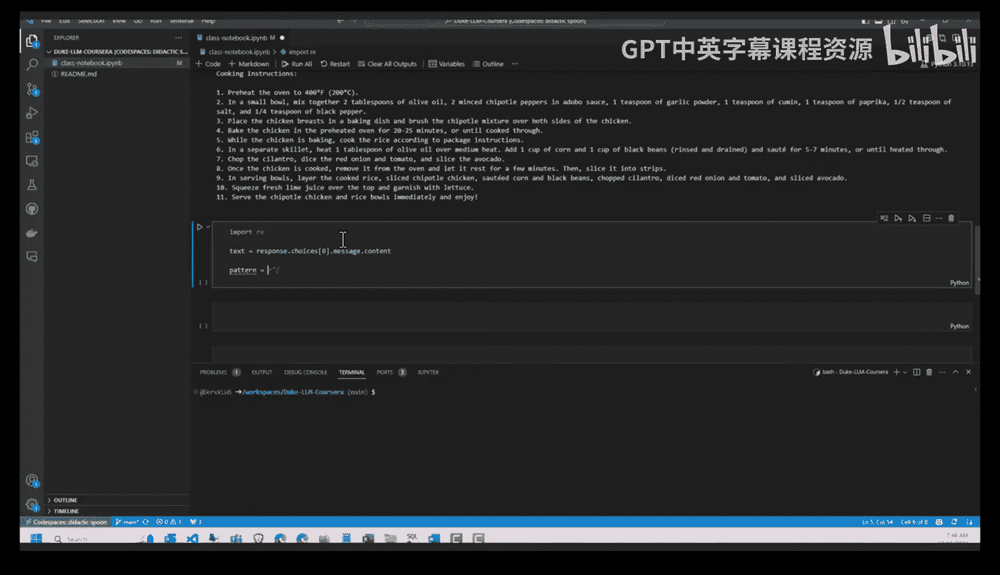
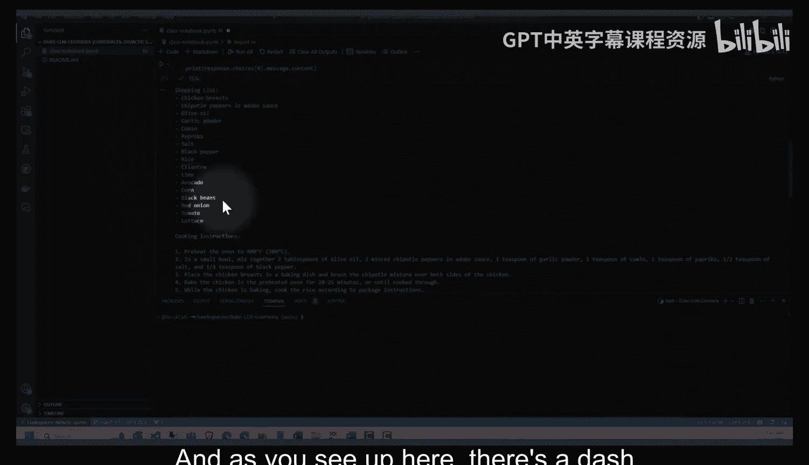
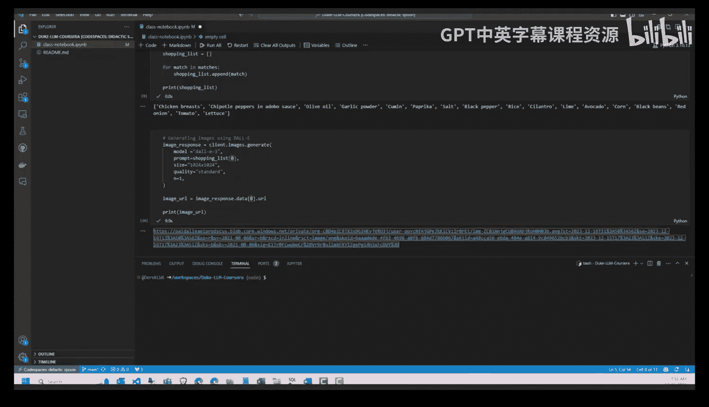

# 杜克大学《大型语言模型实践（生成式AI简介、Azure的LLMs（1、2课，共6课）｜Large Language Model Operations》 - P63：63_04_08_演示DALL-E生成图像.zh_en - GPT中英字幕课程资源 - BV1Ef421m7zD

Okay， now that we have our shopping list and recipe。

 we're going to first do a regular expression to get the shopping list out of the response from Open AI and then we're going to take that shopping list and we're going to run it through Dolly。

To get pictures of what we need to shop for。So first thing I'm going to do。Or。Regular expressions。Tt。

Response。Dot choices， dot message， do content， this is where some of the copi stuff can be very helpful。

And I'm going to be looking on the dasht。

And as you see up here， there's a dash in a space for each of the ingredients。

 so that's what I'm going to be looking for。

Well。question。Close that books。 Good to me。Matched。Cottern and we want to find。哦。And from the text。

 so that looks pretty good thinking gopi it。And then we're going to create have that saved as a shopping underscore list。

 we're going to make a list variable。And then for。We're just going to do four loop here and four matches in shopping list Im going match All right。

 we'll see if this works， we're going to do a quick statement here front。The shopping。

List and see what happens。All right， looks like it got it pretty good。

 so this list is going to be what's used with Dolly to generate some of those images we're going to add some more cells down here。

Allい。行。一。Images。Golly and this one is changing really fast。

 So please be sure to check the documentation and while image underscore response。

 That's kind of be what we get back。ItClient。Images。Generate。Moel。不是。301。D 3。

We'll just start for the purposes of this。Start with the prompt shopping list。

And we're just going to grab the first part of that。Size， again， another parameter， you have to pass。

 and we're just going to go standard to 24 by 10。WithFor。What's currency， comea。

And quality and all of these can be adjusted， you can you can look at the documentation you kind of see and tweak for whatever use case so just standard quality。

And。Rys clothes。So that looks pretty good and it does give you the chance to generate these as an image URL。

So image。Sure。你玩了，一给。😔，Image。Response。Got data。う。就。And the URL。pe you are。Space。It just print。

Image URLs that we get。All right， hold on。Almost if you spell generator， right？Generate， alright。

 let's try it again。Everything else looks right。And it's going and it should be poppedping out a URL in a moment here。

 so let'm going to pause and let it do that。Okay， URL just popped up， let's see what we get here。

And that looks pretty tasty， so if completely AI generated。

 but that is pretty darn good and that is a picture of what you get need to go pick up from the store。

All right， so that's you could loop through this and if you wanted to and print out each individual URL just kind of in the interest of time。

 I just did the first one， but from the basis of this。

 you could very easily see an app being built around this you import open AI， you pass a recipe。

 it creates the shopping list or creates the prompt for the shopping list sends that over to openAI。

 which gave you not only the shopping list， but how to prepare it。

 and then if you needed to with some combination of regular expressions and the Deli API you can get pictures of each one of the ingredients All right。

 thank you。

