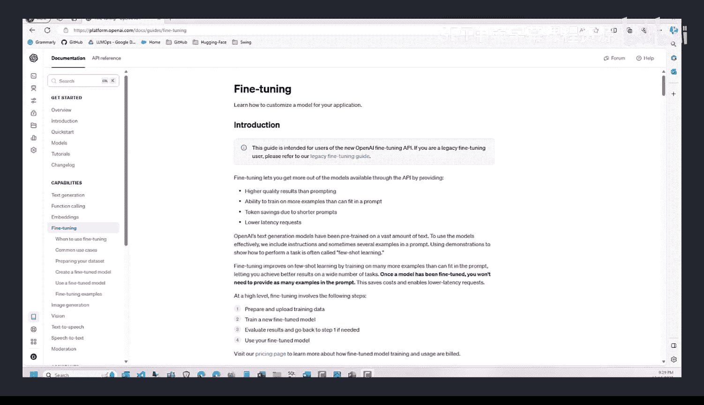
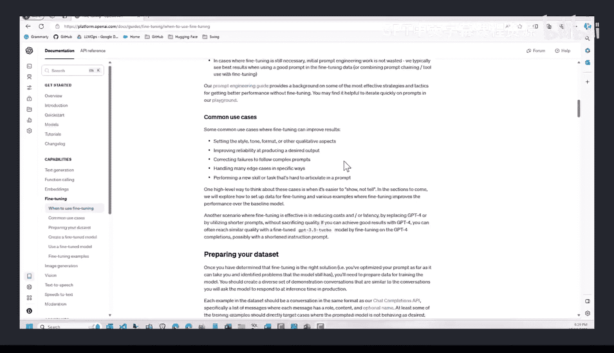
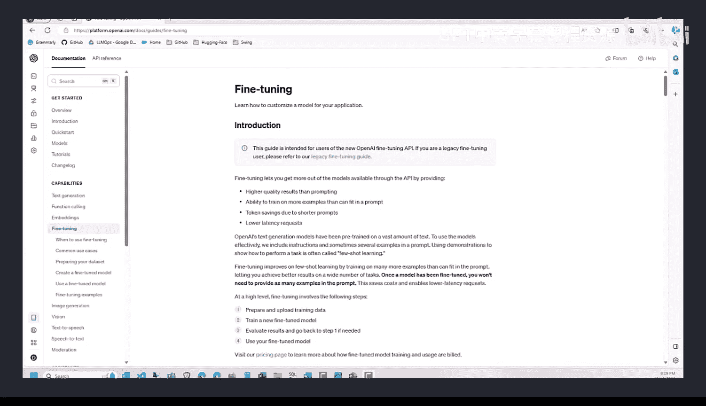
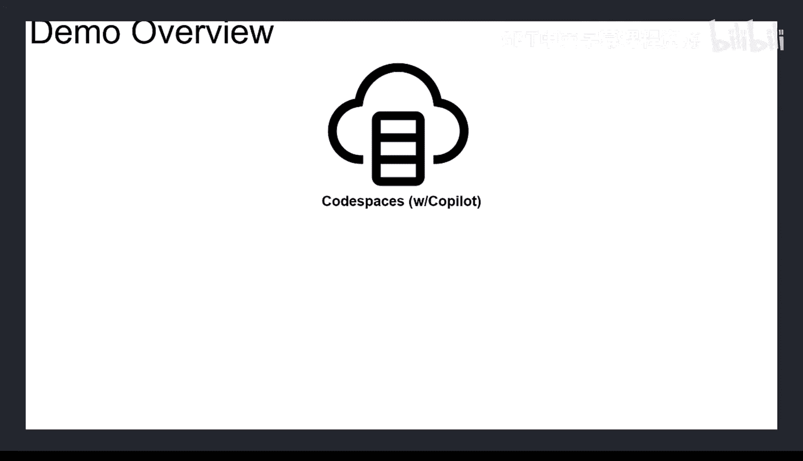
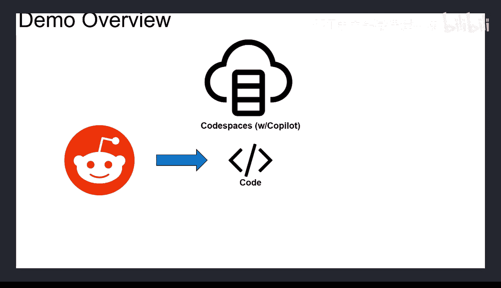
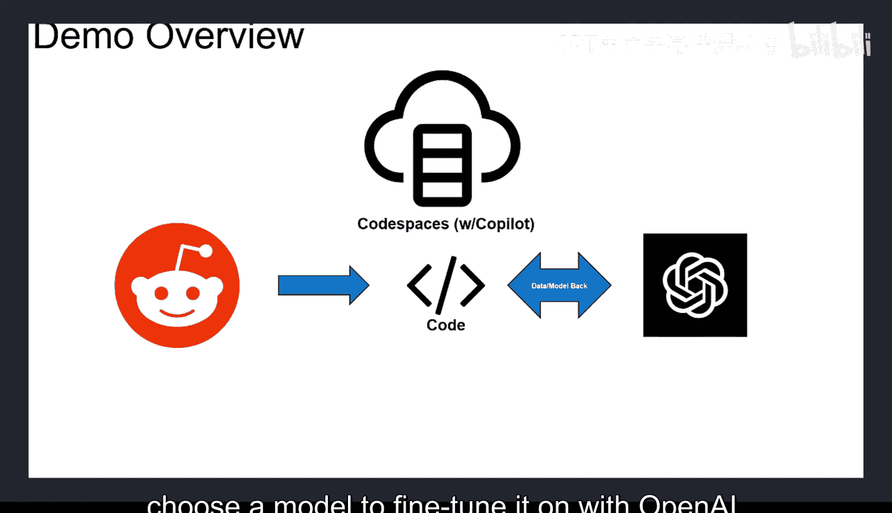
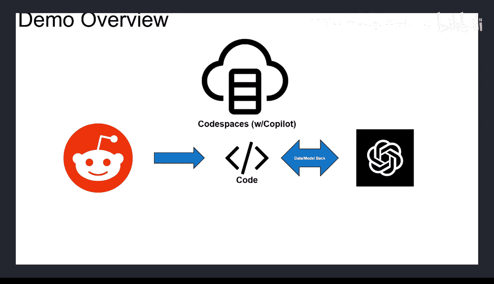
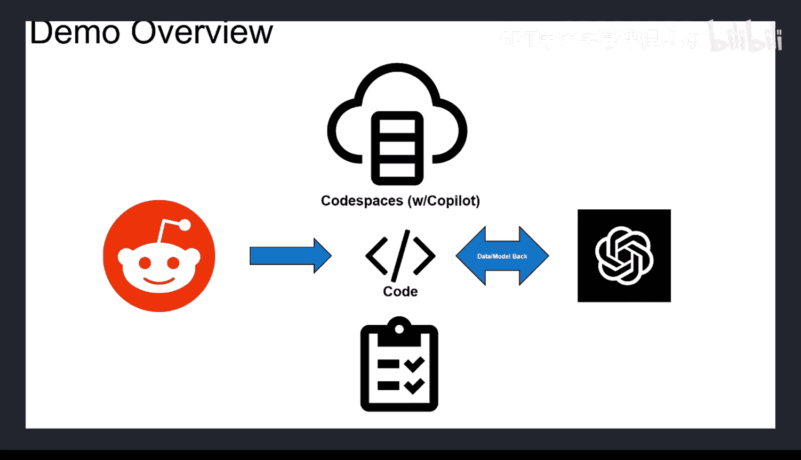

# 杜克大学《大型语言模型实践（生成式AI简介、Azure的LLMs（1、2课，共6课）｜Large Language Model Operations》 - P65：65_04_01_OpenAI微调与项目介绍.zh_en - GPT中英字幕课程资源 - BV1Ef421m7zD

Hello， everyone， Derek again。 And in this section we're going to go over fine tuning or what's sometimes referred to as transfer learning。

 which is the process of takinging an AI model， like one of these LLms and customizing it to your application。

 So whether that's medical data in our case we're going to use some stuff from Reddit。

 So I'm going to do a quick overview of some of the documentation and a diagram of the project and we'll jump into codespaces。

 Okay， so here's some of the open A API documentation on fine tuning this will be included in your course notes。

 but does kind of give a very good introduction as well as code examples。

 etc that we'll get into later real quickly I'm just going to go over the overview of the demo So we're going be back in codespaces with Copilot。

You're going to get some Reddit kind of question and answer data。

 you're going to import that into your environment， run some code。

 and then you're going to send that data and choose a model to fine tune it on with open AI。

 and then you're going to get a customized model back。

And then we're going to do some testing on that model we just sent over Okay。

 so that's what we're going to do and let's jump into code spaces。

