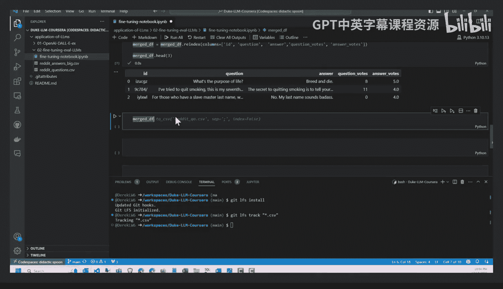
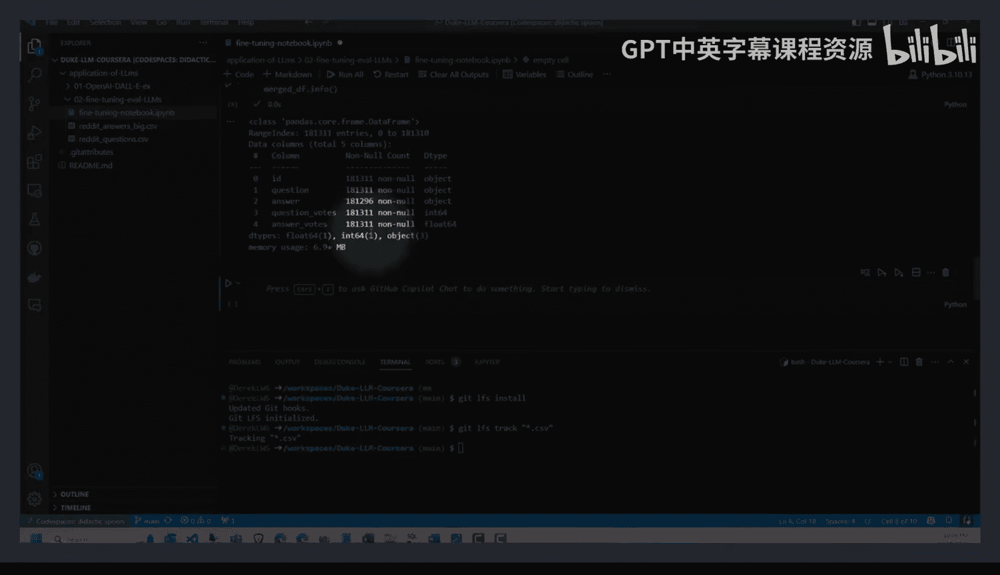
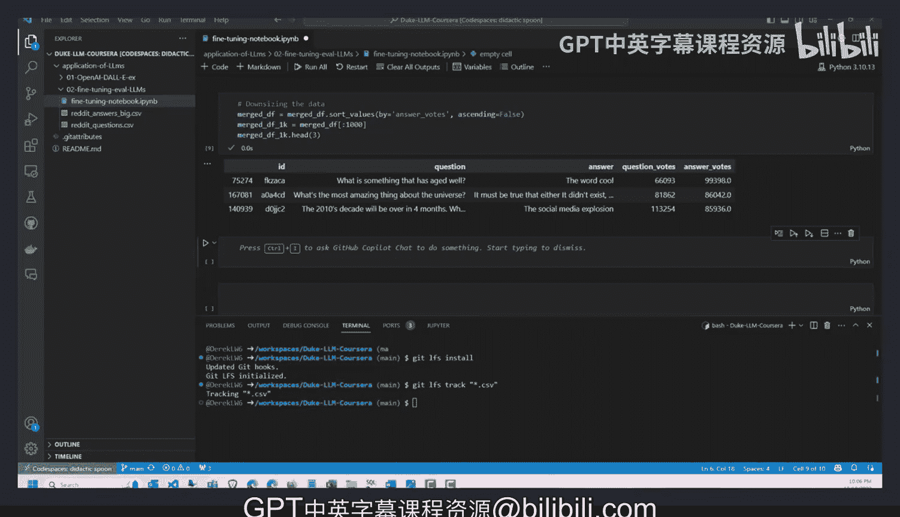

# 杜克大学《大型语言模型实践（生成式AI简介、Azure的LLMs（1、2课，共6课）｜Large Language Model Operations》 - P66：66_04_03_微调项目第一部分：环境与数据准备.zh_en - GPT中英字幕课程资源 - BV1Ef421m7zD

Okay， back over to our environment。 I'm going to start bringing。In the necessary libraries。Oh。

 that is what we want。Import JO， we're going to need this later。Import pandas as。ほらな。All right。

 now before before。Before the next steps of the project。

 we're going to actually need to bring in the question and answers from Reddit and some of these files are a little bit larger。

 so what you actually have to do is set up Git LFS So if you see me typing down here in internal Git LFs install。

Looks like we're good and get。Elefa， track and then。Everything。That is a dot CSV file。

And looks like we're tracking yep CSBs， so I'm going to drag and drop some of these larger Reddit files I'm going to pause the video and they should be in the same directory I'm working with。

 but you got to set that up first because one of them is a little larger。Okay。

 it looks like they finished uploading this the L test。Actually files。咩。Think。

Could bring it thus far。All right， back to the notebook。Okay。

 so we're going to read in one of these files。Or with the answers。And answers。Sureore。E and support。

Answers。PD dot v。I for CSV。R at， excuse me， right。Big answer is not a CSV。 One thing to keep in mind。

The separator here is a semicolon。And we'll just take a take a look。At the first brief。

 this Prince out。can， Is that。All right， just finish loading what you notice is it's not explicitly labeled answer and then basically they've taken every question ID and then they've listed every answer with it with the number of upvos so what we're going do is we're just going to kind of sort it by the highest vote and then we're going do some data engineering and grab some of the key answers just because when you send this over to open AI。

 they're going to charge you by the token so if you wanted to do more likes that's but just for purposes of example we're just going to grab the top top answer so。

Grabing。Yeah answers。S。Yes， underscore underscore loads。Inquals。

That actually looks pretty darn close。Answers， the。Groed by。You underscore I。Number of。Votes。

And I D X X。Don't we just want the IDX max。Great。Very square top。There's one answers。

We' pass that in here。And then we're going to rename some of the columns for。

That make a little bit more sense later if。Talop answers。ThatRenaming。Columns， and we want to。

Takes a dictionary here。We want the next column。To be renamed。

Answer just to make this easier when we pass it in。And then put this in place and went that true。

 And we're actually going to do and review these。 So when you see the results， you print。

 you if you printed this out the top Df top answers here。

 you would see a number of these that kind of need to be redeemed。 So we're going。Re name Q， I D。

Just ID and this will make it easier to join this on the questions later。Take the votes。

Because the other one has the questions have votes as well。

 I're going to change that to answer underscore votes。And we'll see what we're looking with。

 take a look at the top three， and let me run this。See what we get。Put IQ instead ID。

 So I think that was the only error。I'm just going to run this one more time， deposit real quick。

Okay， looks pretty good now let's start reading in the questions。

And then we're just going to match on this key， and then we're going to have a question and answer data frame that we're going to send over to Open AI。

Questions equal。That is almost right， it is just reddit。Undersure questions。 No big here。

And it does have the same separator。If you look at this。

 you would kind of have the same problems as above。

 so we're just going to rename some of these columns。呃嗯。好我唔。Like it spell。

Do you have underscore questions？Rename， I believe。This one we're going to take He。 actually。

 it's not title。Okay， thanks for helping me out there。If， we want that in place。Copepit。

 I're going to grab that same one and what we're going to do。Place boths。With question。Voats。

 all right。Take a look at this， see where we're at。

A quick and then move on to merging the two of these。So pause it while that， oh。

 popped in pretty quick。 That's right。Yeah， the question one is much smaller because there's only one question。

 We'll add a few more cells here below。 Al right， let's let's work on joining these two and creating a merge data frame。

 okay。So joining questions and answers on ID。So。Burgged。Your score。Y。It was。Yeah。

 underscore questions。Got merged with。Yeah， we don't need to do a left join。

 we just want to merge it on the ID so Im taking the DF questions during it。Re on the ID。

And then we're going to be dropping some of the extra columns this creates， so merged。I for Df。

Dot drop。And there's。Be worth printing these out。Actually， we'll be that real quick。

 we'll print this out and then we'll do some data engineering after。

People at this we run this merge command and you see there's a lot of like timestamp and really what we want is the the question and the answer matched up together so move on to the next section and clean this data a little bit。

And get it in her。And an order that kind of makes a little bit more sense。

 merge underscored Df dot drop。And we want to drop。Timetout。This needs to be passed in as a list。

So we're going to drop time stamp up。De time。干嘛？And its funny。那你。Tan name。Coin space 0， I think。

Those are the main ones。Axis 1 implies equals true。And we'll do some reordering。

 So merge underscore EF。Equals urged。Underre Df。But reind。Colums。Id。Question。

That looks pretty darn good。 Copi。 So a question。Then't answer。Then answer。

And then the question goes and the answer votes。Alright， let's see what we're looking here。

 The you merged head。Alright， so we got the ID， the question。

 the answer and how popular each one of them was。 All， that's a pretty good stop actually。

 there's one more thing I want to do。 So let's let's just take a look at how big this is didn't really explore the data frame that much in the beginning。

So let's take a look at the yeah info。

And as you can see， it's 18。81000 entries， which if you this is all broken down into tokens。

 And I believe 750 words is roughly 1000 tokens。 So when that's sent over to open AI， that's。

 that's just entries。 That's just lines in the data frame。 So what we're going to do。

Once you're going to take the most popular answers， sort them and grab the top0 just for example。

 purposes and to keep this a little bit more reasonable in terms of cost in time， excuse me。

So all this downsizing the data。Merd or D F。Itals。M。Undercore， EF dot sort。Values。

And want I actually sort this by。Answer votes。 Be instead of question votes。Because those are。

 in theory， the most popular。And we want ascending let that fall。 So that's going to put the highest。

The best voted answers on top。 And then we're going to call this merged。Underscore Gf。

 underscore 1 k。And we're just going to grab the first thousand of。The data frame。

 and then we're going to see what we're looking at here。

And we'll just take the head and the first three and see what we got。 And as you can see。

 these answers are quite popular。 this question is quite popular。 So we got a pretty good， decent。

 or we got a decent sense of some common questions and answers that we can send to fine Tr model。

 Thank you。And I will see you in the next lecture。

