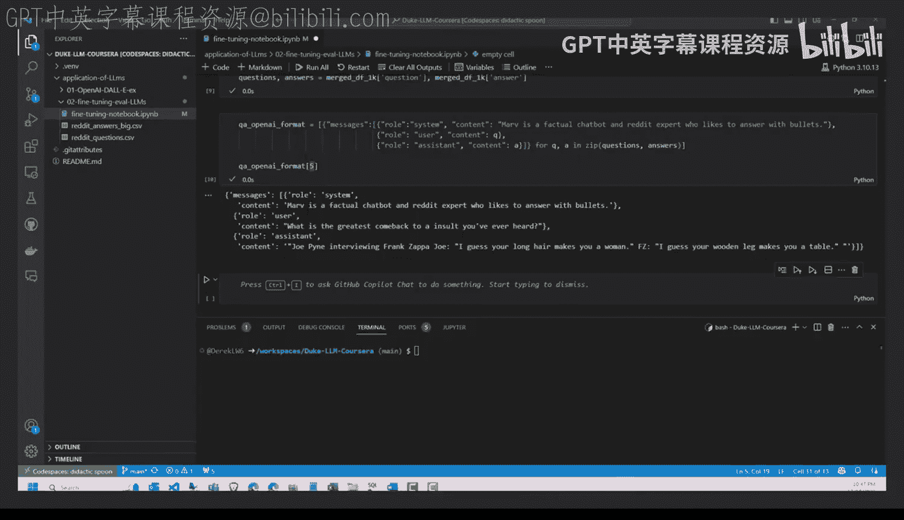
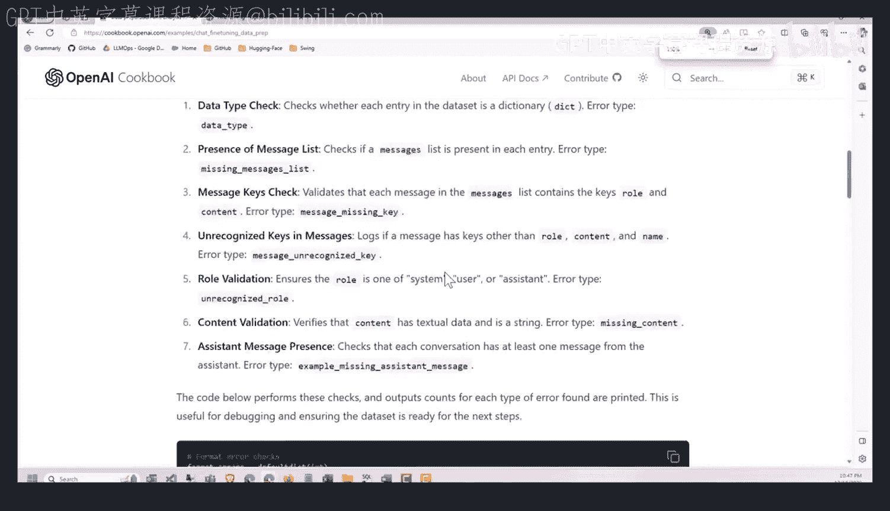
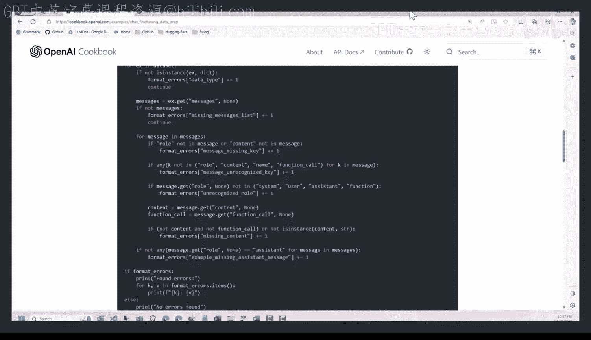
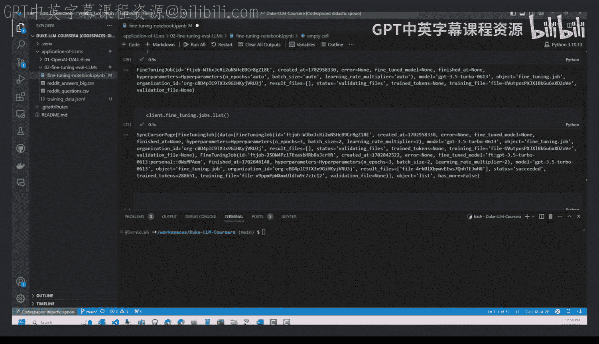

# 杜克大学《大型语言模型实践（生成式AI简介、Azure的LLMs（1、2课，共6课）｜Large Language Model Operations》 - P67：67_04_04_微调项目第二部分：开始微调.zh_en - GPT中英字幕课程资源 - BV1Ef421m7zD

Okay， welcome back so we have our shortened data set and then we're going to start getting it into the format needed to send it over to the open AI。

Fine tuning。我咩。And usually it's best it is in terms of questions。Answers equals merge。Yeah。

Question one。And answer， so it's smart enough to grab this two those Thank you Copilot。

 let's take this space out here。Looks like it worked。

And then were going to use some list comprehension and we're going to create basically the prompt and the answer column。

Yeah。QA AI underscore formats。Equals less。Esss。Call this is affection a dictionary。

He pass in the roll。System。Com on。Content。on， let's give it a prompt here， Mar a。Factual chat bo。

And read it。Expert。嗯。Likes to answer。With bullets， my favorite person。My favourite format of answer。

Comant enter。我。R。Yeah。It's time to just run out。roll。Its my colon user。Come on。穿起来。Q。

We're going to do something very similar here for the answer。Cool。Assisted。赚钱。This is really why。

Answer。Dictionary  for。Q。好了。MAA。4q。A in questions and answers， Thank you Co out the assist。

And we'll just make sure you got this right and we'll just putprint and why not another six？

All right， looks correct， so this is the format Open AI likes likes the data fed into it。

 and there is some really good documentation of how to do this so。

there's some really good documentation of how to do this and it allows you to check。

So this will all be included in your course notes， but here's kind of an example of the page here and I'll actually be using part of this later。

 I'm just going to kind of copy and paste their Python code to check to make sure you got the data in the right format prior to sending it to open AI okay。

So we're going to write this to a file real quick where we just did the data frame。With open。随你。

Score data。jsonN L。好。Right。And we'll just call this as actually F。In。现备。二咩。F done it， right。

We want JO got down entry。quiteite like that。Close the pra here。And F dot write a be one。

Let's see if that works， lookss like it worked。And then we're just going to snag the same code I was looking at and use that as our check。

So， all I'm doing。Tkking pacing this guy。And'm going throw it in here。

And then I'm actually going to put a little bit of additional code on top that kind of sets this up。

 and this is going to check my file to make sure it is in the right format to be sent。

Over to opening eyes， so we'll run that real quick。Looks good， no issues。

 and this will be made available to you guys as well。

 this kind of basically send it the file path and it goes through a series of checks to make sure it doesn't have it has all the right function or all the right parameters that open AI needs and no missing data etc。

It's add a few more cells here。Once to be made available to you guys as well。

 And there's a series of similar tech functions on the open AI cookbook。 Alright。

 so I'm going import some of the open AI。I'm going to import open AI and run my API key real quick and then I'll be right back。

Okay， just imported open AI。 So it's time to finally start fine tuning。Uing。

 first thing we're gonna do is。Sending the tracking data。In an open AI。quiet。Cha filess。Create。

And then。It's pretty close Copi it， but we'll just type this one out。 so file。

It is equal to open and then we do want to read that。And purpose。It's fine tune。 Okay。

 so that looks pretty good。 Let's run there。 see what we'll get。Like could smell。Again。

Ha an extra comment there， let's try to again。Sorry about that guys， this should be of dash。Okay。

 and here we go， we got the file ID。That's perfect。Now， we can look。The fine tip jobs client。

Got fine underscore tuning。Not jobs。 we're going to create a job。Training。

File is not this what it is actually。This file ID right here。 so I can snag that。Pe that right here。

And then we'll use the bottle。 We'll use the G dash 3 dash。5 dash。呃。Oh。Do not need that comma。

 and I believe you need to close this parentheesis。All right， looks like it's working， bam。

You got a fine tuning John。And there's a way to kind of list。 These do take a little while。 So it is。

 it is sent over to open AI， and you can actually pull up。

Soll just this is the right list the fine Tning jobs is this fine Ts that jobs that list。

 you can also set the limit。 I only had one。And also。

 you can look by specific jobs so you can do a retrieve and try and and grab this specific job。

 So this does take a little while to train。 One of the nice things is once it's done。

 you will get an email from open AI， I already do have a pretrain model for this purposes。

 So when I come back， it's actually going to be using one of the models I've I've trained earlier。

 So we'll get into that。

