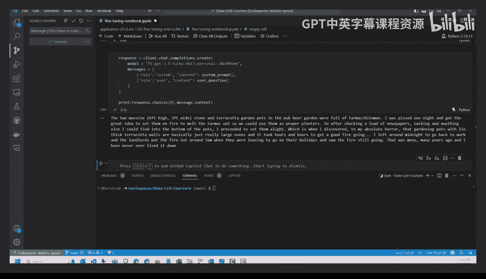
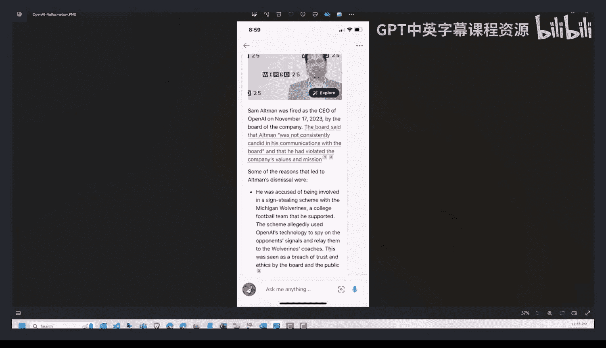
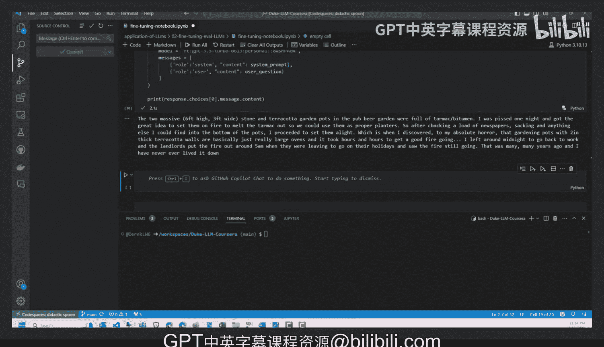

# 杜克大学《大型语言模型实践（生成式AI简介、Azure的LLMs（1、2课，共6课）｜Large Language Model Operations》 - P68：68_04_05_微调项目第三部分：模型评估.zh_en - GPT中英字幕课程资源 - BV1Ef421m7zD

Okay， we're back and our model has finished training or our fine tuning has finished。

And if you remember this was all on Reddit data so we're going to ask you a kind of like Reddit type question。

 see how it responds and this is a way to take a model that was kind of more generalized and applied to a specific use case。

 there's lots of things you could do this in like a hospital system or against technical documents or whatever so I'm going。

Basically give it a prompt， a user question and send those directly against my model and see see what kind of answer it gives and then we're going to talk about model hallucinations briefly。

All right。System。Undercore prompt。And we'll just go with R names a。

Official chat bot who likes to answer questions。Hes a Reddit expert and likes to answer with bullets。

 which was。Pretty close to what we had earlier。And we'll have the user question。Give me the dumbest。

Thank you。Ever done。 It sounds like a common Reddit post。All right。

 so let's see what we can get for a response。Response equals client。Check completiontions not create。

And then here's where it is a little different。 We are going to use the model。That I fine tunes。

 So let me grab that from another screen here。Yeah。Messages。That's right。And this is a dictionary。

 so we will pass in the role。And then this is the system。

That's probably actually pretty hardar to close， but I'll type it out。呃。看战。System prompt。咁嘛？Yep。

 that's user content user question。Close out this list。Close this out。

And then make sure you print that response。Would it be response。That choices。唔知啊。Don。Message。

Do context here。把钱见。It's client do。下大去。Ps。靠。Sure I got this spell right， sorry it's a little late。Ss。

C。Looks like it's。There we go， Yes Sha。Finally got it。 This was a。

I think I said context is set content。So it's running。2 master，6 foot high，3 point5。

Pots in a beer pub garden。 Yeah， this， this kind of sounds like a dumb thing someone would post on Redddit and it。

Clearly， we can see my model has has been trained to kind of prioritize the most。

 I guess youd say dumb responses， one thing you do have to be careful about whenever you retrain or use one of these models is something called hallucinations。

Its a little more difficult to generate one with this。

 but I do have a good example of the kind of output that you'll get when you're seeing one of these things hallucinane。

 and I know this covered a little bit earlier in the course。

 so it was right after Sam Altman had been fired and I was also watching college football at the same time before he came back to Open AI and I was chatting about some of the context and Jim Harbaugh。

 the coach of the Michigan Woolverineens was also suspended at the same time。

And you'll kind of get。This is a very good example。So it's talking about Sam Oman。TheB， let him go。

But then it starts talking it blended the two responses because it kind of keeps a history of what you're chatting with if it's in the same same session。

 so something to be mindful of whenever whenever you do use some of these models。

 especially if you tune your own， you're gonna make sure you validate the results for accuracy with some specific text cases All right。

 thank you and we'll head over to the summary。

