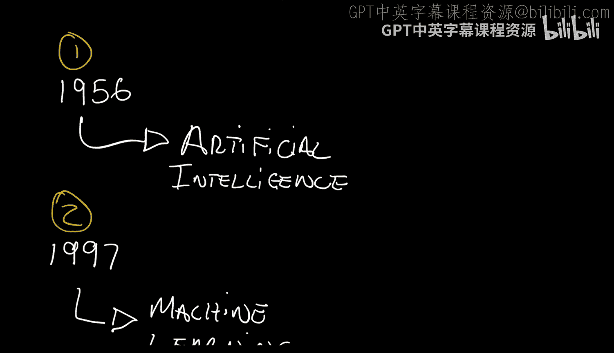
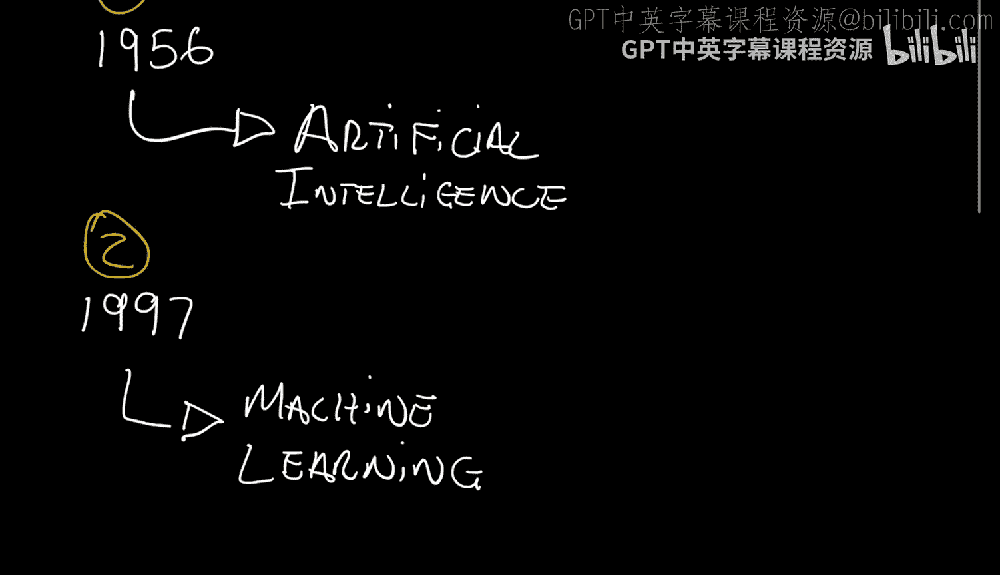
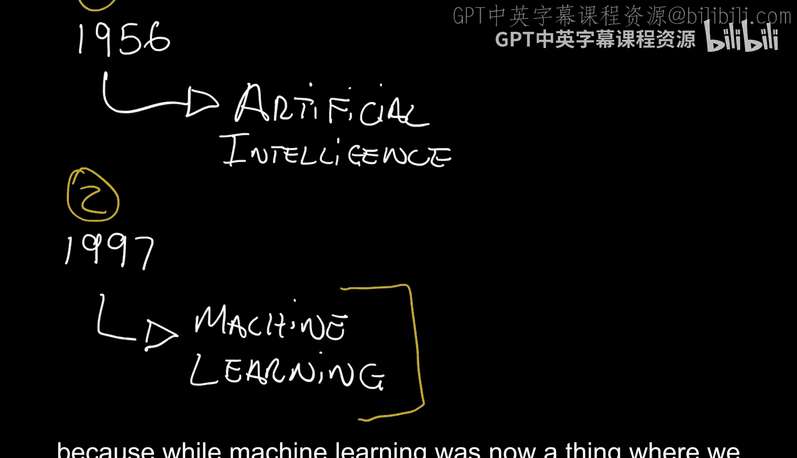
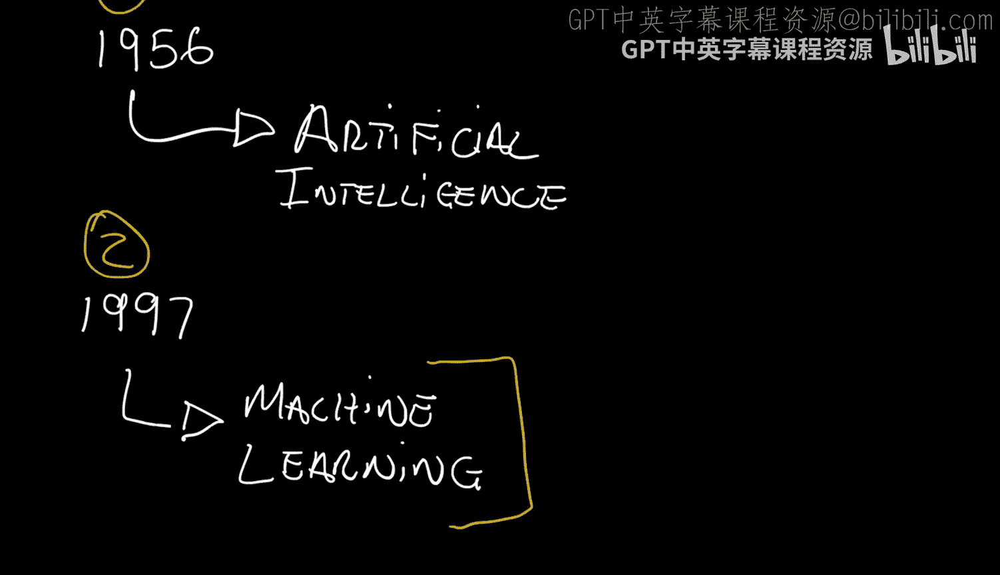
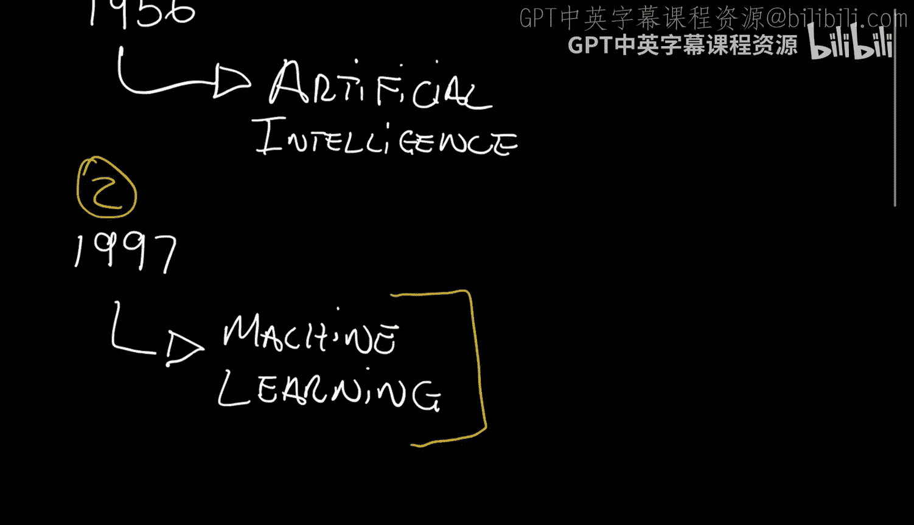
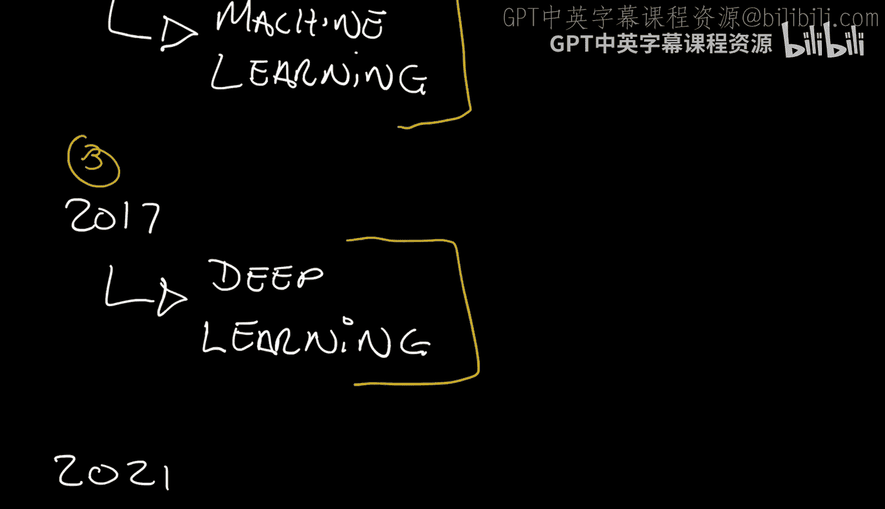
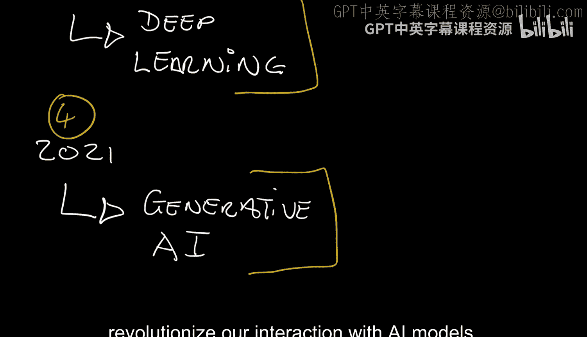
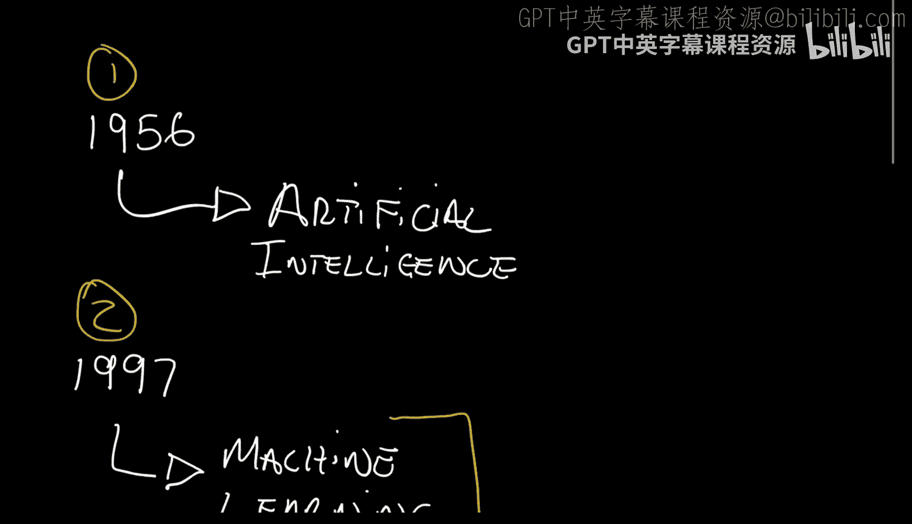
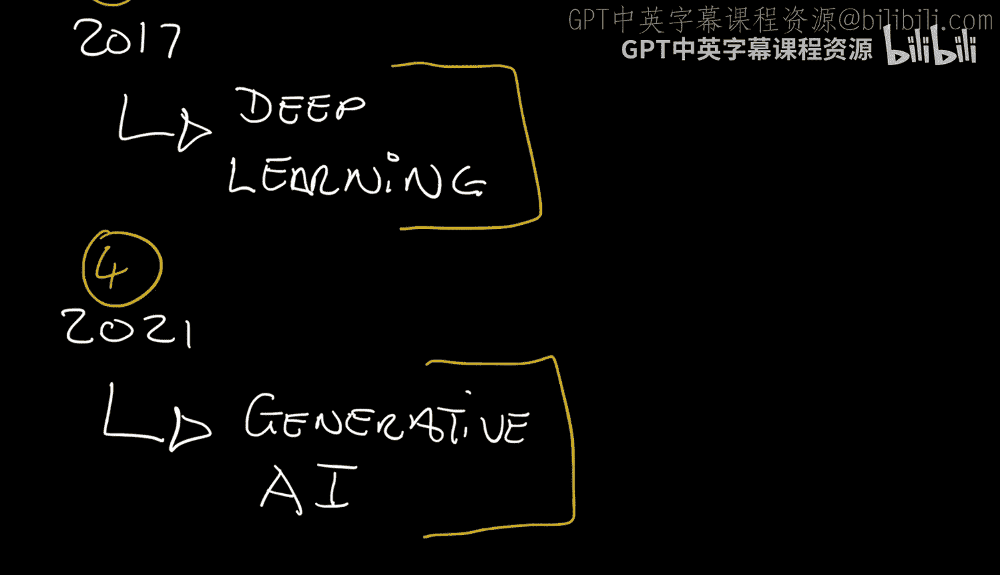
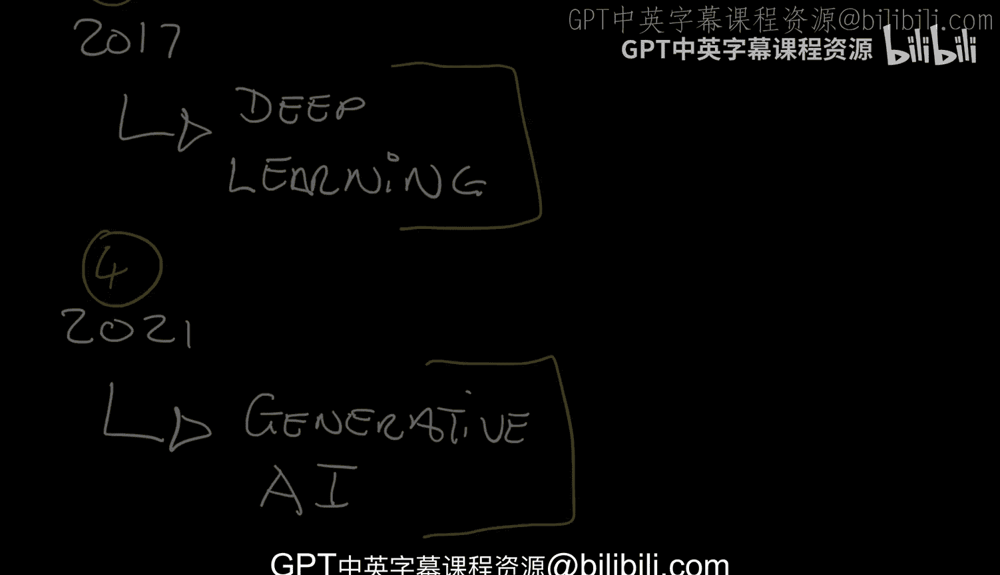

# 杜克大学《大型语言模型实践（生成式AI简介、Azure的LLMs（1、2课，共6课）｜Large Language Model Operations》 - P6：06_01_04_人工智能的简史与演进.zh_en - GPT中英字幕课程资源 - BV1Ef421m7zD

Let's do an overview of AI artificial intelligence， a brief history of artificial intelligence。

 and we're going to start right here with 1956 with Alan Turing Coin artificial intelligence at the Dartmouth Conference。

It is essentially mentioned that or said that Dar， the Dartmouth Conference was the AI。

 the field of AI research was essentially born and Ds were Alan Turing of one of the fathers of artificial intelligence。

Start this whole revolution with the idea that hey， let's get machines to think， let's try that。

 this is where the famous touring tests for a machine to try to determine if the entity that is providing the answers might be a machine or is a human。

Then we move on and you can see that there's a big gap here in years over to 1997。

 this is when IBM develops deep blue and deep blue was a whole supercomputer that actually beat Carrie Casper of the master。

 the chess master from Russia and it was a tremendous moment for AI because。

While machine learning was now a thing where we were able to instruct machines to learn from data in a structured way。

 it was essential because it was you know chess is one of those big。

 difficult problems that at every single movement， there many many。

 many different possibilities more， so this win demonstrated that an AI system was capable of be the best human player at the time。

 Carrie Kasparrov。

Also the long short term memory or LSTM used with neural networks was introduced， however。

 it wasn't until 2017 right here when more advances came into play Google created this other system similar to IBMs a deep blue called Alphago that also tackled a big problem with a multiple possibilities which is the game go。

 and the game was able to。

To actually be other players and also it was at this same time where transformers were introduced now we haven't touched transformers into detail of what those are。

 but it is an effective natural language processing mechanism， this mechanism allows to process text。

 process natural language， this can be written or spoken or even translations and try to determine characteristics of natural language。

This improvement was the foundation that happened later in 2021。

 where generative AI basically started having these massive initial points to give us the services that are now。

Pervasive nowadays with things like ChadGT， and it is here when GT3。

 the language model achieved enough performance that it could start being used as generative AI。

 so GPT3 is one of those models it was large enough that it could one could interact with it and in a way that could you know essentially revolutionize our interaction with AI models。

So that's it， that's a very， very quick overview of where we started in 1956。

 and you can see that there was definitely an acceleration of progress here with AI and even within the past year or year and a half with the advances in large language models。

 only by ChaGBT， but by other open source models as well。

 including several from big companies that have been shared you can tell that that we are going to continue to see not only more changes in advances。

 but at a more rapid pace。

