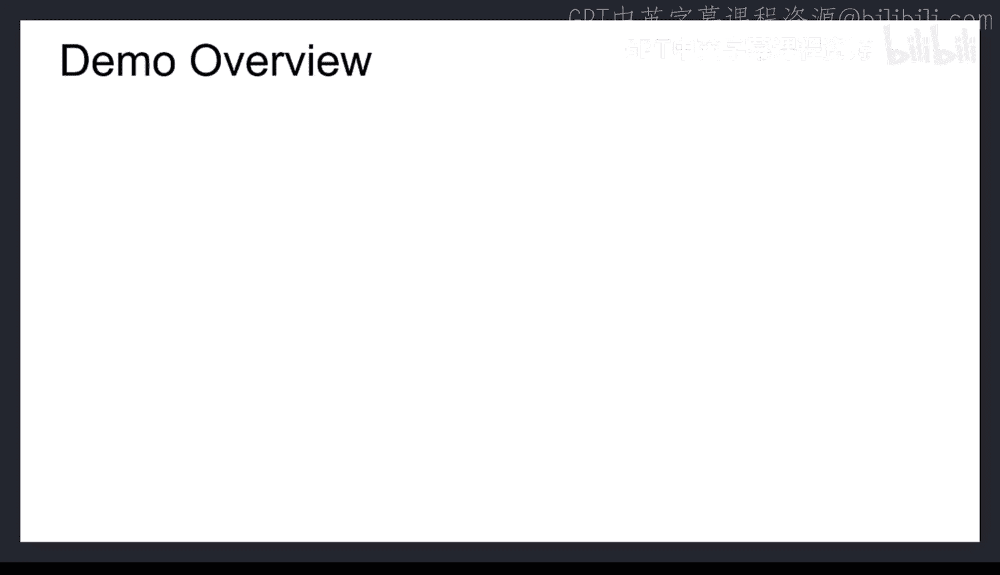
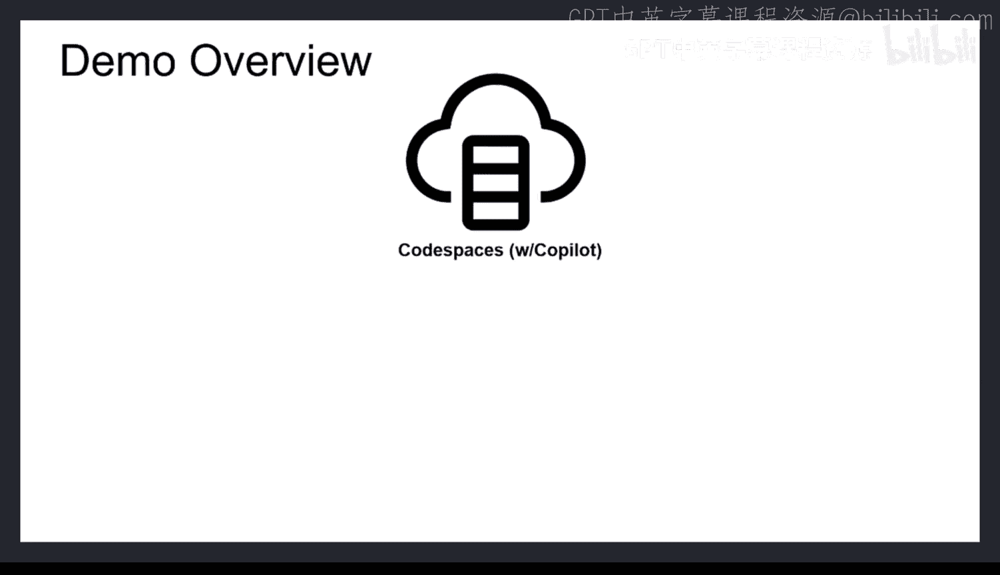
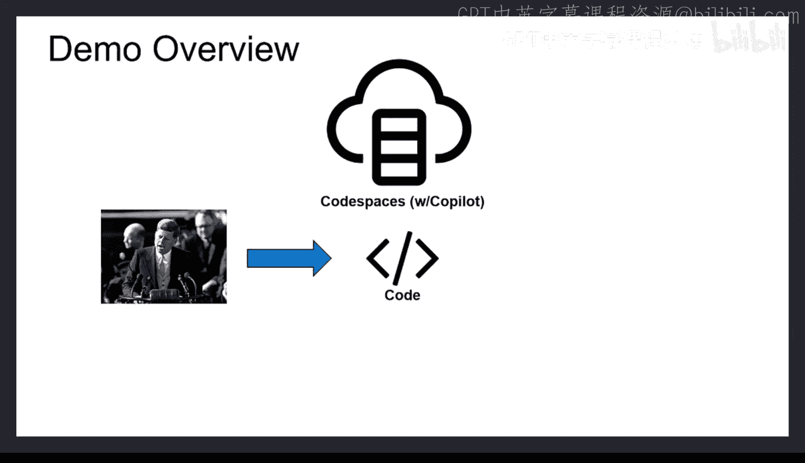
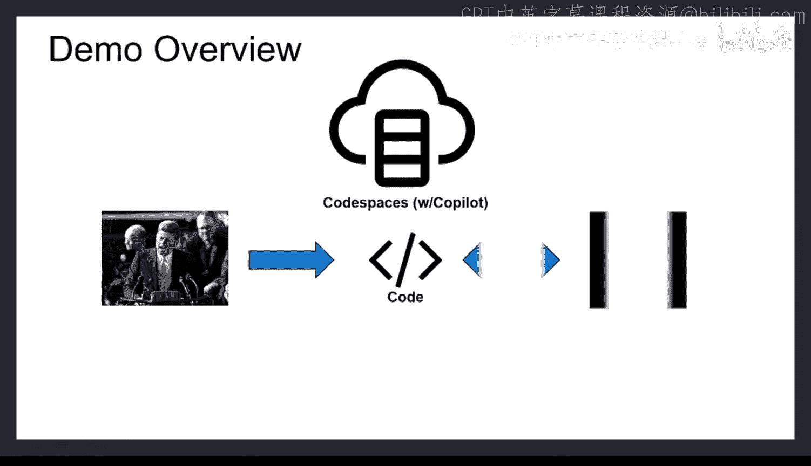
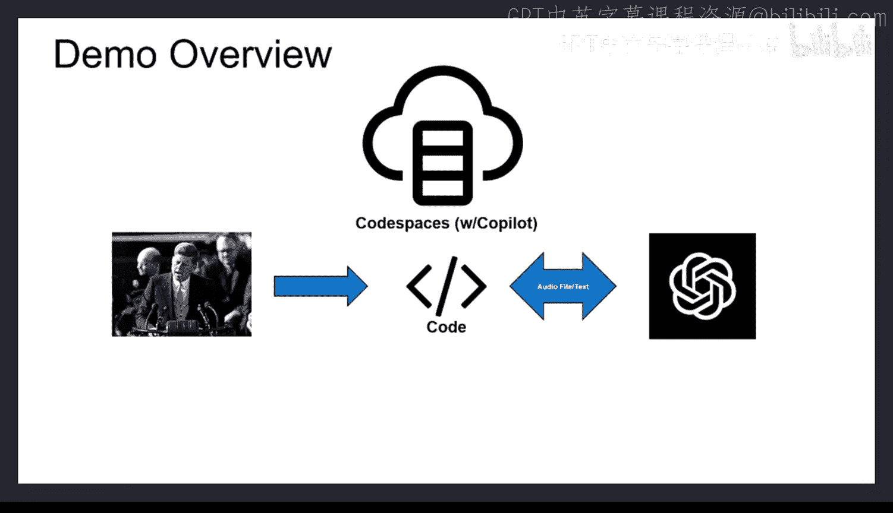
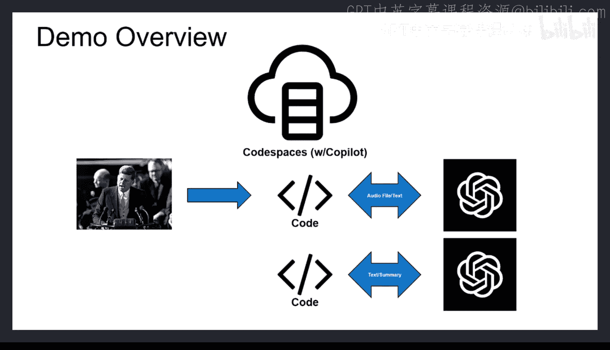

# 杜克大学《大型语言模型实践（生成式AI简介、Azure的LLMs（1、2课，共6课）｜Large Language Model Operations》 - P70：70_04_01_OpenAI Whisper模型项目概览.zh_en - GPT中英字幕课程资源 - BV1Ef421m7zD

All right， everyone， so we're gonna move on to the next section of the course。

 which is going to be the Whi API， so we're going to work through an example with that。

 Whisper is a done through Open AI。 It's a general speech recognition model change it on large data sets and it can do a number of things from ingesting audio and it'll even take MP4 formats so it can take video and it can even do translation so I'm going to go over the quick overview of a demo that we're going to do and then we're gonna to fire up the environment and get working on it。

Okay， so here we're going to go over the demo real quick that we're going to do with the whisperhisper API。

So we're going to start with code spaces and Copi again。

We're going to ingest a speech from Robert F。 Kennedy， his inaugural speech。

 we're going to bring it in to our environment。

Then we're going to pass that audio file over to Open AI， and then we're going to get text back。

Write some more code。And then we're going to send that text over and then get the summary back。

 So if you kind wrap your head around this， this is the beginnings of either a meeting sumr or a video summarizing app or something along those lines。

 So that's the intent of this And let's jump over the environment and get started。

