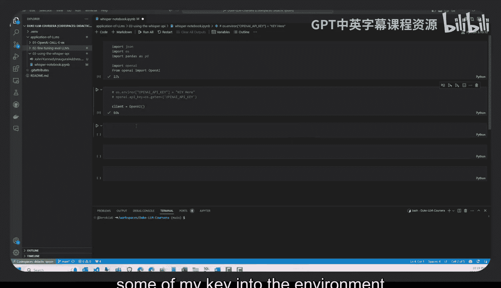
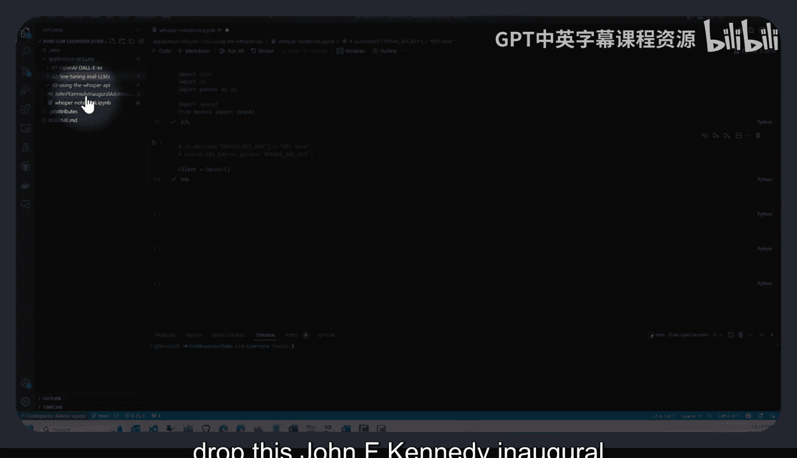
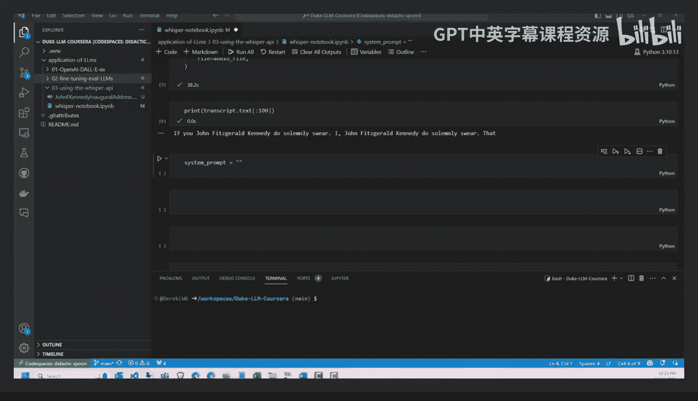
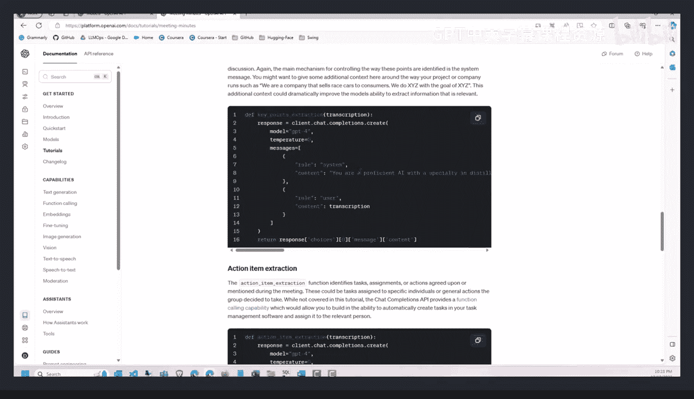
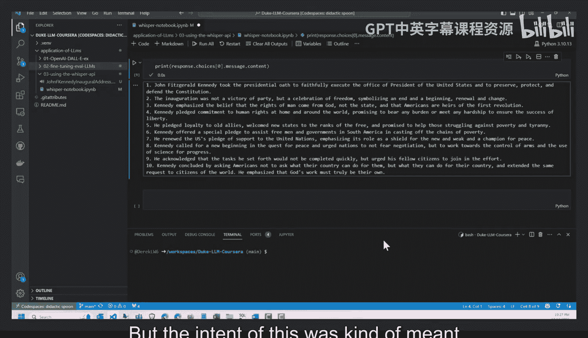

# 杜克大学《大型语言模型实践（生成式AI简介、Azure的LLMs（1、2课，共6课）｜Large Language Model Operations》 - P71：71_04_03_视频摘要生成器详解.zh_en - GPT中英字幕课程资源 - BV1Ef421m7zD

Okay， back to the environment here， so we're going to start with importing some of the necessary libraries that we're going to make。

So you remind me JO。Or。Or O。我。And does as PD。嗯。我。Open AI。And。AI。Inward。Okay。Here we go，'s run。This。

Okay， I'm going to import my key and a few other things and then we'll resume the video。Okay。

 so we've imported open AI， some of the my key into the environment and started a session with open AI。

 Al right， we're gonna and I have also dragged and dropped this John F。

 Kennedy inaugural address file into the environment。 So let's go ahead and read that in。

I will just call it E audio file for purposes of this。It first surrounded the way。你同学食都病啊。

She on gave me inaugural address。Chry。😔，That needs to be in quote。Let's see we got here。

Looks like it worked in a few more cells below this。Okay。

 so let's go ahead and pass this over to the whisper API and get the transcript back。

 And a lot of the cloud service providers can do similar services， but we're。

 we're just trying to keep this as a。As open AI asc centric as possible， so client got audio。

Got transcriptions。Yeah create。They use the whisper。Yes one。Come啊快哦。

Equals that eye offlow just passed in。Close breath And soon we get here。Looking pretty good。Okay。

 so let's see if we got the transcript back。Now when you try and print these。

 it's a little bit different。D textex。Is what you need to do to see and wrap this up print statement。

And we're just going to grab a smaller amount， just so this。

It's a little bit more manageable around the 100 characters and see if we。Got this。Yep。

 that's got to be him reading not the Bible there， all right。

So let's move on to what we're going to prompt the system with。Here we call this system prompt。

 and this will be set over to Open AI。 Let me scroll down a little bit。Zoom in just a little bit。

 And this will be sent over to open AI to kind of prime the model to。

K to understand the audio we're sending in。And where I'm actually going to grab this from is right off of the open AI。

Documentation， so they have a lot of different documentation。

 One of these is a key points extraction。 So this was I felt this is kind of the best way to。

Smarize a presidential， so you kind of want to get the candidates。Kind of key points。

 So this is largely what I grab。 So I'm just going to kind of copy and paste it。

Changed it slightly to meet our kind of use case。 But that's what it is。

 So proficient AI list the main points and discuss brown up。 And this is。Very。

 very similar to what's on the Open AI website。All right， so now that we have that， we can reach out。

Do the chat Comp API。G summary， Thank you very much。Spons。He floats quiet。cha。The shs not create。Bin。

 okay， first thing we want is the model。And we will go with。GP dash4 here。

And then you can change the parameters and a number of different things。

 let's go with and parameters basically how often repeats certain things。

Let's go with  point5 here and you can tune these， as you see appropriate here。Use case messages。

This。哦。早紧。咁。怎吗。Okay。Just imp。Yeah。Think that's。What。Okay。Sorry as the scroll did that breathing。Okay。

 close。Dictionary here and the role and that。Thank you， thank you， Coil， I guess that correctly。

So let's make sure I'm not missing any keep its a syntax here。Its like it's running。Let that run。

Okay， looks like it just finished， so we should have a response back。Open AI， so response。

 that choices， it's pretty close。Except we want that message。Got content。 right。

 let's see what we're looking at here。加。O。Took the presidential o faithfully to execute the option protecting and defend cuts。

 not a victory， but a celebration of freedom。Believes that rights of man come from God not see Americans。

areas of revolution carry。Okay， pledge loyalty， the old offer is special pledge to Freemans South America。

We pleasure sports， United Nations。Okay， well， kind of interesting。

 you could adjust the max tokens here， change the temperature， et cetera。

 and get more out of the speech， I believe this is the asnaut， which you can yeah， yeah。

 this is itny Kiney concluded by asking Americans not。To ask not what their country can do for them。

 but what they can do for their country and extend the same request citizens all around the world Yep。

 and I thought that was this speech and if you mess the temperature and max tokens。

 you might get a slightly different response， but the intent of this was kind of meant to be the basis of either a meeting summarizer or something along those lines。

你叫。