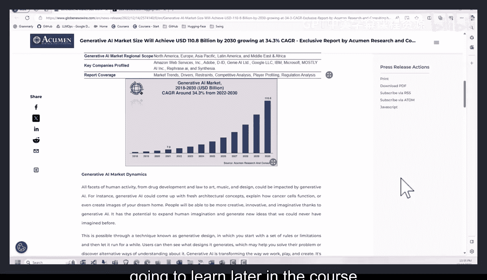
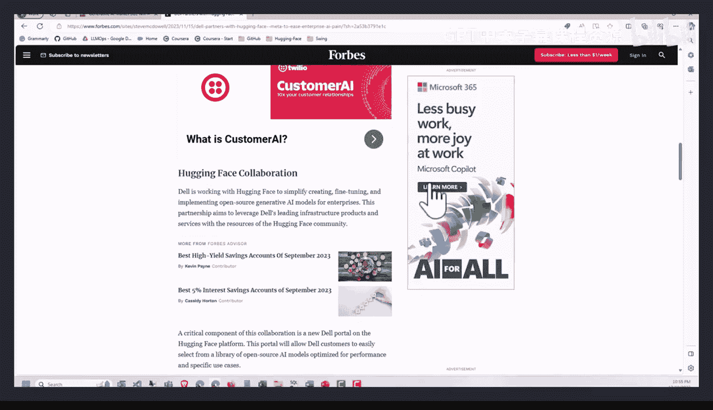

# 杜克大学《大型语言模型实践（生成式AI简介、Azure的LLMs（1、2课，共6课）｜Large Language Model Operations》 - P73：73_04_01_人工智能商业环境.zh_en - GPT中英字幕课程资源 - BV1Ef421m7zD

Okay， one thing I did want to mention and kind of point out before before we move on to the next module is this can be challenging。

 but the generative AI stuff is not going away and these articles will be included in your reading I recommend you go through them but I'll just kind of go to the punchline here and you can find a number of different things from the consulting market etc。

 so just for reference。

We're right here right now。 This is a generative AI spend in the billions and as you can see。

 it's only going to go up over the next several years， so you're in a good position with this course。

 you're doing the right things to continue going forward and I wanted to highlight some key kind of partnerships and acquisitions and not only learning the open AI tools。

 but some of the other tools that you're going to learn later in the course are're going to suit you or set you up for success。

So moving on to the next article here， Dell last month or November of 2023。

 if you're watching this a little bit later。

Announce a partnership with Huging Face， Huging Face is a open source model provider。

So hugging face and basically they give you the a lot of these。

 any machine learning model can be posted on there or it's machine learning models that have been open source。

 but they're starting to do more and more generative AI ones and the plan at least according to this article for Dell is they're looking to collaborate and basically simplify some of that fine tuning process that we were just looking at in some of the previous videos so this is growing a lot of businesses are adopting various strategies。

 whether they're using the open AI stuff or the open source stuff and this course is going to set you up。

Very well in a market that is going to explode over the next several years。

 So something definitely to be mindful of and keep a chin up gets a little tough。

