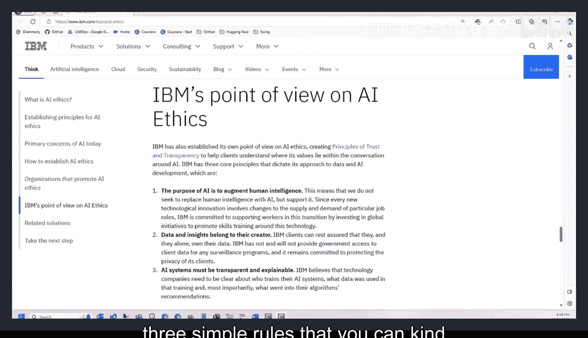
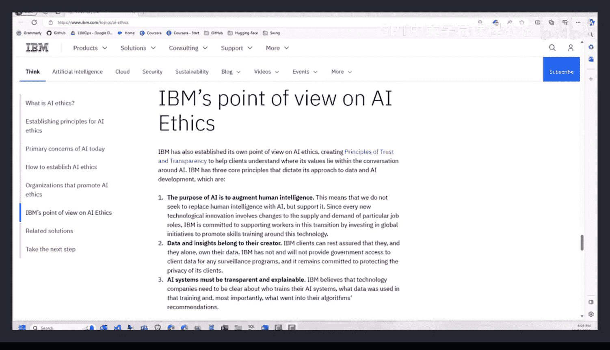
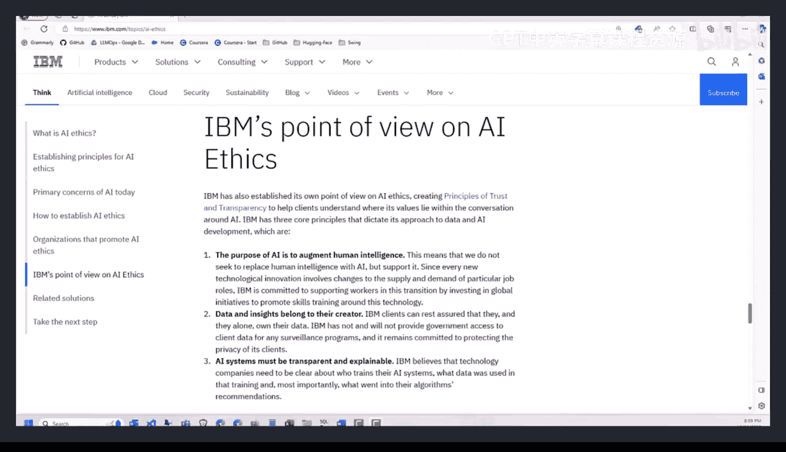
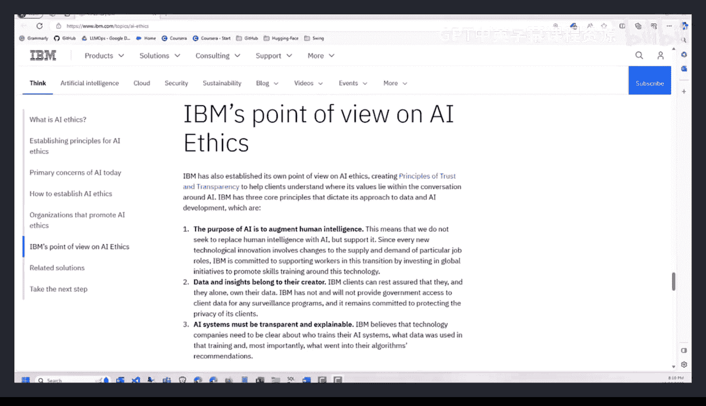

# 杜克大学《大型语言模型实践（生成式AI简介、Azure的LLMs（1、2课，共6课）｜Large Language Model Operations》 - P74：74_04_02_人工智能伦理原则.zh_en - GPT中英字幕课程资源 - BV1Ef421m7zD

Hi everyone， before continuing on to the next modules of the course。

 I also wanted to take a brief brief moment to focus on AI ethics and when I was kind of going through this。

 there's a lot of stuff you can find on the internet but what I found is most useful is actually from IBM so they have principles of trust and transparency and I thought these provided a really good and then I'll attach some additional readings on some of their other things on AI。

 but I thought these provided a really good kind of baseline of where to start from。

 especially if you start using some of those open source tools or as you deploy more customized models。

 I think these three are going to really set you straight from an AI ethics perspective。Okay。

 moving over to IBM's AI principles of trust and transparency。 I really like these。

 as I mentioned a moment ago， because they just provide a simple framework。

3 simple rules that you can kind of think of before you do anything with AI and that will generally set you straight。

 So the first one is the purpose of AI is to augment human intelligence。

 We're not here to replace jobs right we don't we don't want to just lay a bunch of people off。

 develop systems so we can lay a bunch of people off。 So we had to keep those things in mind。

 we wanted to make us more efficient， more productive， not replace us。

 The second one is data and insights belong to the creator So the best kind of example I could think of for this was if Mark Twain was still copyrighted and you trained the model extensively on Mark Twain's writings。

 the responses would be distinct right， they would be unique' very different from something that's completely public like Twitter。

The creator of those original writings is entitled to something that and I thought this this captured that pretty well。

 and then AI systems must be transparent and explainable。

That I totally agree， especially when you're starting to like approve people for loans or things of that that nature。

 I thought this one really captured that well， so more readings in in the course documentation。

 but these are the ones I want to highlight， Thank you。

