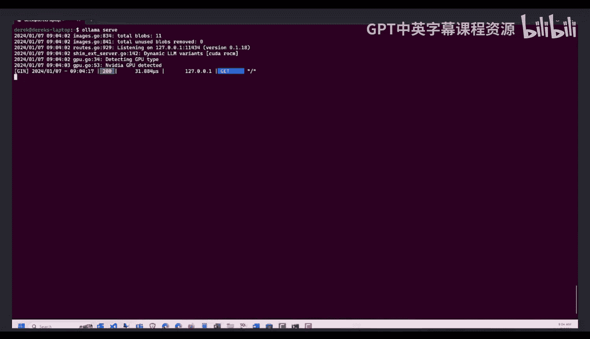
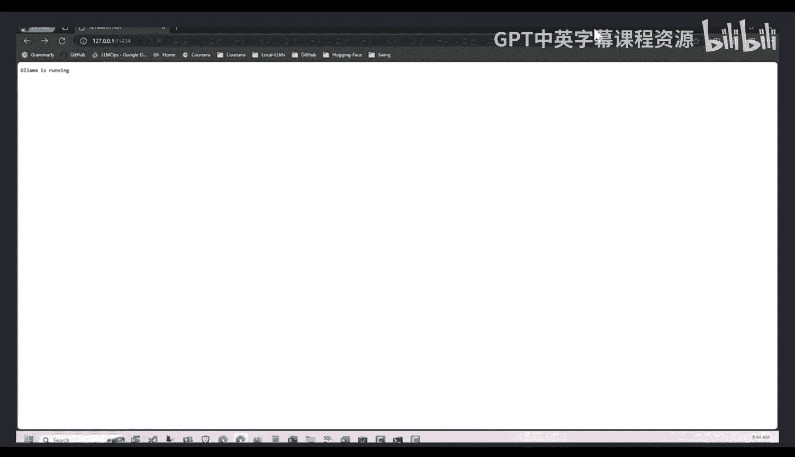
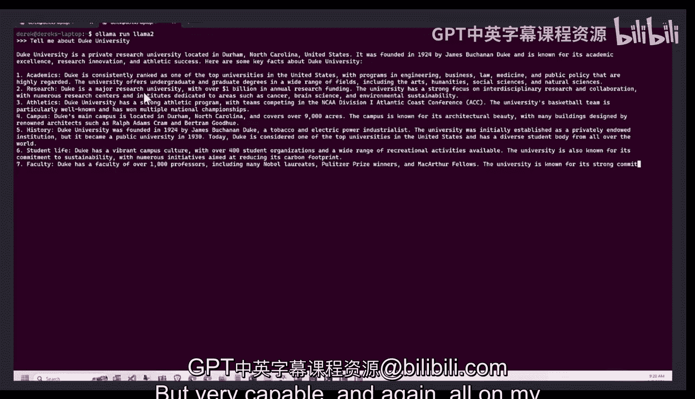

# 杜克大学《大型语言模型实践（生成式AI简介、Azure的LLMs（1、2课，共6课）｜Large Language Model Operations》 - P75：75_04_04_本地机器学习模型与下门课程预览.zh_en - GPT中英字幕课程资源 - BV1Ef421m7zD

Okay everyone while I was talking about the business environment。

 I did want to highlight one additional trend and that's local LLMs or local large language models。

 is this is becoming more and more popular one the models are just more available with things like hugging face2 it reduces business risk this is a very new space and you don't know if you're dependent on a third party if that how long that third party will be around and also you're subject to any change in service fees or anything associated like that So what's becoming more and more common is is people will run this on their own infrastructure I've included some links to some ways to run this on your local machine and we're gonna to pop over to what's called Windows subsystem for Linux Windows user and show what some of these local LLMs are capable of running entirely on my machine and this will be a preview for the next course I'm going to do so'm。

It is something more in depth that's entirely local on your machine， how to build out these models。

 applications， etcter， and doing that means you're not subject to any service fees or anything like that after you've downloaded the model object which is usually free if you get an open source All right。

 thank you and let's jump into Windows subsystem for Linux。All right， so here is the Microsoft store。

 This is the easiest way to install Windows subsystem for Linux。

And there will be a much more thorough course on this in the local LLMs course I'm going to do next。

 but I just kind of wanted to give you guys a preview。There it is， you search and it will pop up。

 you can install it， and since I already have it installed。

 we're going to jump over to the terminal here in second。All right。

 in Windows subsystem for Linux now and I'm going to run Oma。

 which is a cutting edge platform which is kind of designed to run local local language models。

 I already have it installed， so I'll skip some of the I'll just show you the commands and then skip the load time。

 So first thing we're going do is we're going get it。Curl HT。Sly。A呀哎。一度？Don as each。没。S age。Run that。

And it'll start downloading should take a few minutes to download and I'll again I'll include some resources here in the course notes so you can look at more of the commands and documentation。

 but it allows you to install local LLM， you start it with this command along the serve。

And it'll detect some of your computer's resources， notice this IP right here。

 so let's check out a browser。Okay let me bring the browser over。

Looks like aama is running， so let's start kind of a chat session。

Okayay open the other。吃毛些人。因为那个。在我们。Two， which is a famous large language model。

Looks like it just popped up。有。University。And there it goes。 And this is again。

 this is all running on my local machine so I'm not subject to any sort of service fees or anything like that。

 and also I'm running this on a laptop with a CPU right now， but if you had a more powerful machine。

 you're not subject to a lot of those rate limiting question a rate limiting like you could be with a cloud service or cloud cloudbased program。

 Yeah and as you can see it's it's pretty thorough we'll go more into this into the next course。

 but you can adjust these weights you can help tune some of the parameters， etc cea。

 but very capable and again， all on my laptop here generating generating text。

