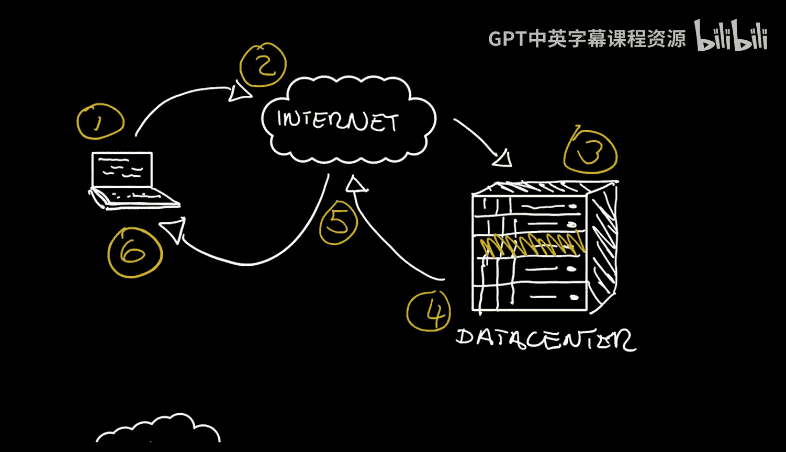
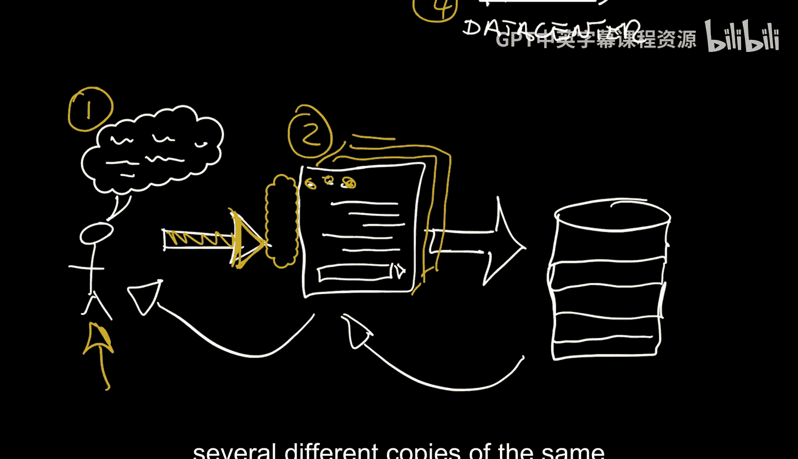
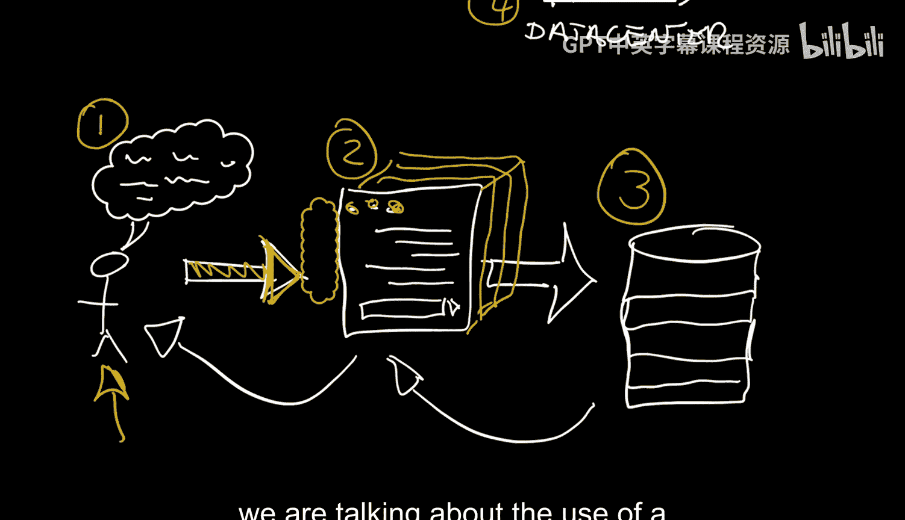
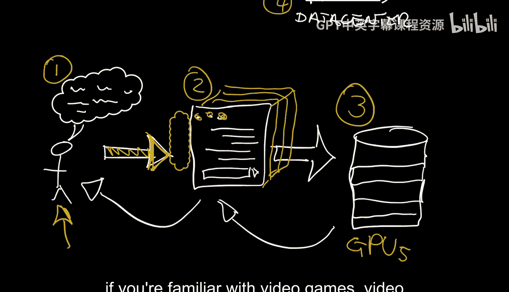
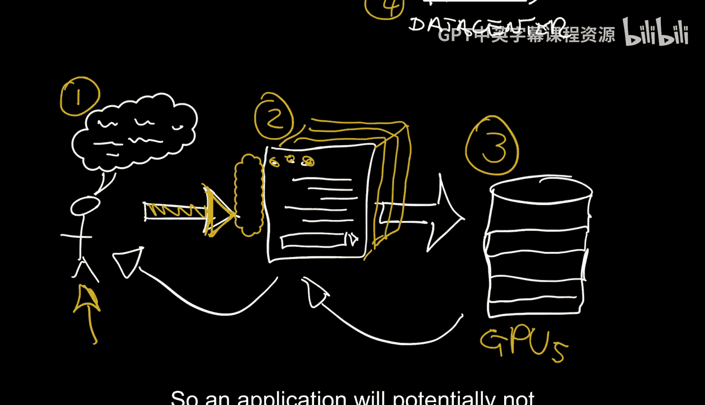
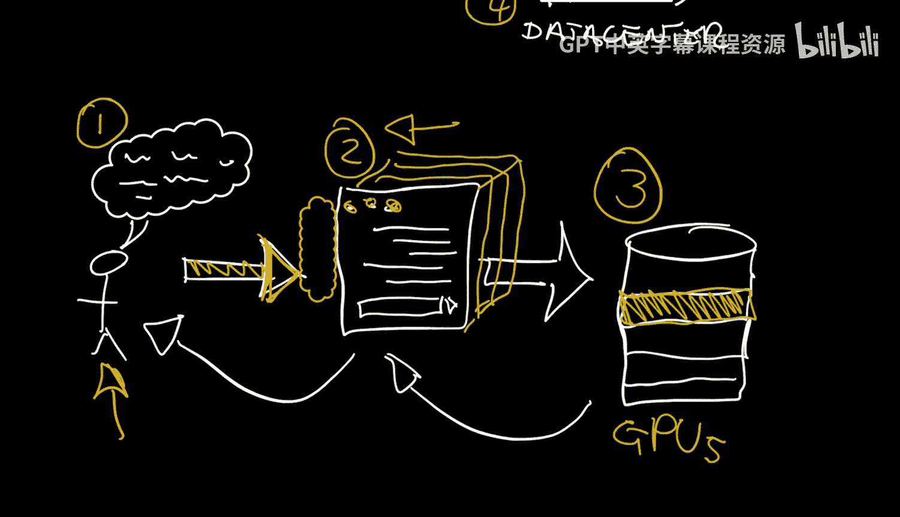
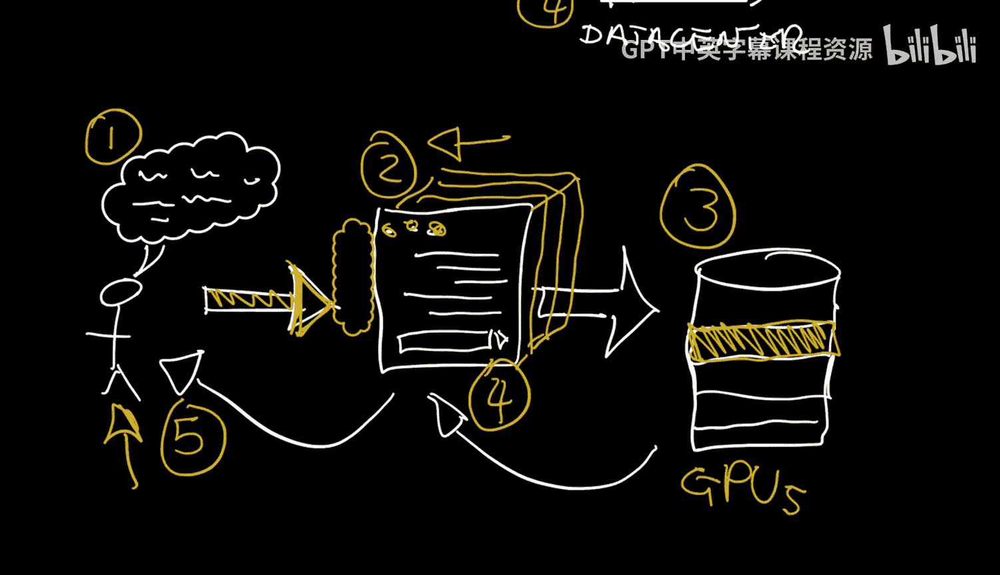
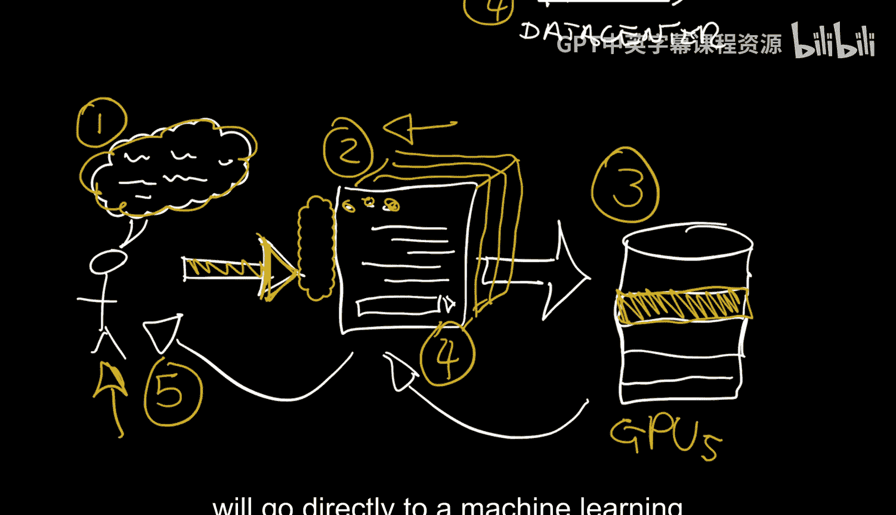
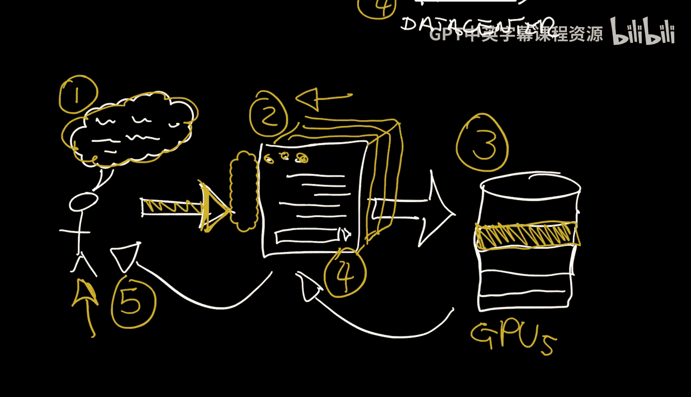
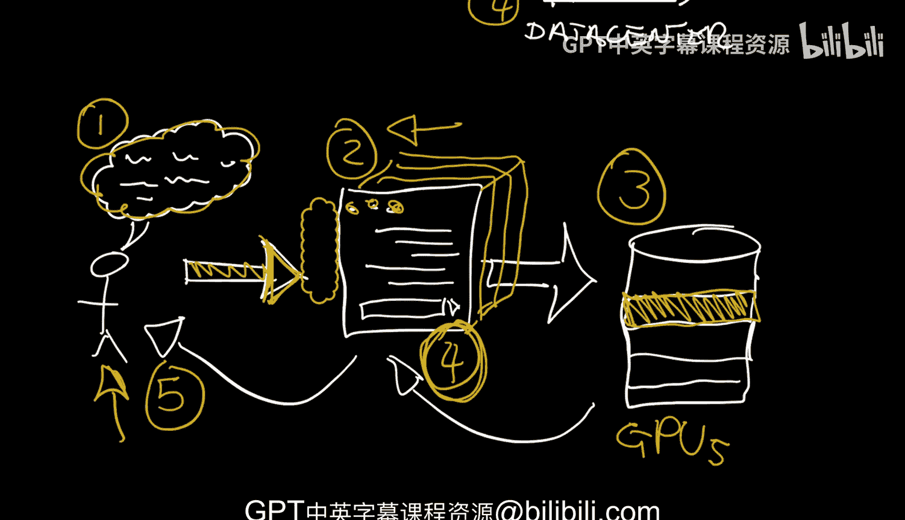

# 杜克大学《大型语言模型实践（生成式AI简介、Azure的LLMs（1、2课，共6课）｜Large Language Model Operations》 - P7：07_01_06_大型语言模型在应用中的工作原理.zh_en - GPT中英字幕课程资源 - BV1Ef421m7zD

Whenever we're talking about generative AI， mostly we're talking about the user facing applications。

 so how do these large language models， how do these applications， these AI applications work。

Work with a user interface， so let's start here on the very left here with a computer and you may have experienced this already even if you're not a software engineer or machine learning engineer or doing anything related to the specifics and foundationals of artificial intelligence and building models and such。

 you might be have tried already using your computer in some way connecting to the internet and through perhaps like a website。

 like chatGT when it started everything was connecting through there。

 the internet allows us to connect to these services。

 and these services usually live in a type of a data center。

 when we talk about the data center or we talk about the cloud。

 the cloud are big companies to have data centers in several different places and their applications are hosted somewhere in that data center。

One of those servers somewhere will be working to provide you the answers and the facilities that you're asking for so in essence in a very broad way and this is how most applications will work with applications on the internet is that it will connect through and get to a data center a computer somewhere and then that will produce some sort of an output then that output will go back through the internet and back all the way to the beginning right here to the user interface but applications are slightly more complex and here we have well something very basic we start at the very beginning with the user prompt in generate FAI or AI applications we are always talking about some sort of an input and then that input will get into the application code and the application code could be one or more servers depending on the scalability on the needs。

of the input that is being generated and all of that is being ingested usually most systems are going to some sort of a cloud environment。

 in that cloud environment allows applications to scale automatically and there's elasticity。

 some new terms that I'm throwing out there if you're not familiar with a cloud basically allowing applications to grow and shrink based on demand。

 so imagine that there's not not just one single person but all of a sudden we went from one person to a million。

 so how do this application right here would work well the way it works。

 the way the cloud makes it work is that it will create several different copies of the same application and replicate that and scale。

And well， that application might be separated into different parts into different segments。

 so one is the application for sure， but the other one is the actual data or sometimes a more intense compute system for most artificial intelligence workloads。

 we are talking about the use of a specific type of hardware called GPUs， so those GPUs。

Wwhich stand for graphic processing units were basically what allowed computers back when personal computers were started to process graphics。

 to process things that would make computer interactive。

 so sometimes when we're playing video games or if you're familiar with video games。

 video games are possible because of GPUs。

And GPPUs that those graphic processing and units are allow artificial intelligence to do tons of computations and allow us to do things like GeneFI。

 so an application will potentially not only the code here on step number two， do something here。

 but also try to use some sort of a GPU somewhere in the data center。

 somewhere in the cloud somewhere deployed somewhere in some machine， and that do the intense work。

Now there's different types of applications and we'll cover a few of those later。

 but in essence that is what we're looking at and that that processing will go back to the application。

 the application will be making some decisions based on the data that was generated and then finally it will go back to the user The one thing that I want to make sure you understand is that。

It is rare if not actually not happening at all， where the user input right here on step number one will go directly to a machine learning model to a large language model。

 it will usually go through an application layer， and many other layers。

 potentially many other layers， going to a GPU processing and then going back to the application。

 as I've mentioned here in step number four， well it will make some decisions and then back to the user。

