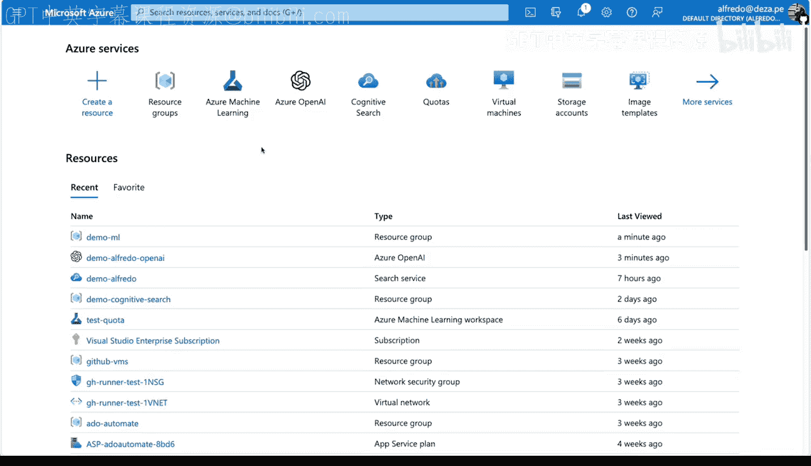
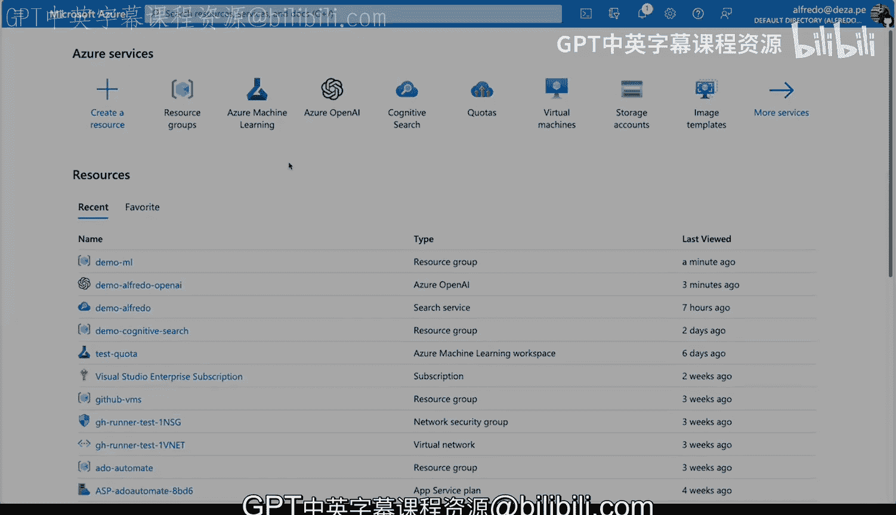

# 杜克大学《大型语言模型实践（生成式AI简介、Azure的LLMs（1、2课，共6课）｜Large Language Model Operations》 - P81：04_01_02_Azure门户介绍.zh_en - GPT中英字幕课程资源 - BV1Ef421m7zD

When interacting with Azure in any of its forms， you will want to be familiar or feel familiarized with the Azure portal。

 This is the front page of the Azure portal and you will have a section here where your most common services that have been recently accessed will be shown up and you'll have like in my case have storage accounts。

 things like resource groups and of course Azure OpenaiI as you can see here similarly you will have some specific resources with their names。

 these are more of like the services that you've accessed and these are the actual resources So a service could be something like Azure OpenaiI and in my case I have a demo Alfredo OpenaiI service that I have created a resource that I've created So let's take a quick look at how that would look So if I go to Azure Open。

I and I click that you will see that I have already created one over here and it's in this page that you will have certain aspects of Azure open AI specifically that you will be able to take a look like for example。

 some of the options that you have here like all of the other services that you can and if I click here specifically and we'll see in detail more of these later how like we can access the keys and endpoints and kind of like get some of that going。

And whenever nothing that you want is shown actually here on the Azure services or here on the resources。

 you have this section where you can actually start typing。

 So let's very quickly start typing something like Azure machine learning。

And if I do that you'll see that it's fussy searching what I just typed and my first option right here is azure machine learning So if I wanted to do something with ash machine learning and it's not showing up I would search for it and then click here and then you can see here well I already have an instance that Ive created one but you will be welcome with probably something that doesn't have any records if you haven't created anything and again we'll see this later on but we will be able to create here or in track with that well last' think I want to show you is the resource groups and it is something to take into account when you're working with Azure that this is a nice way of grouping everything that you've created all of the resources that you created so let's take a look at resource groups very quickly and let's take a look at say for example this demo ML。

So I have this resource group and what it is is that whenever I have a resource group I usually tend to prefix my resource groups with demo dashash that way I can quickly identify things that are well disposable and what does it mean well I have several things here that I've created like in a storage account a keyvolt application insights all of these services are categorized or part of these grouping called demo M so instead of trying to delete or clear my resources later when I'm done and leading every single one of these instances one by one what I can do is actually destroy or delete the resource group altogether so I can go and delete the resource group now I mean the portal but you can do it also with the Azure SK or the Azure CI but I can go click here to delete the resource group then type the resource group to confirm the deletion and then it would essentially。

desstroy everything in here so that is a couple of things that you need to keep in mind when you're working with Azure and especially with the Azure portal there's plenty of different ways usually you have several different ways one of those one of these is the Azure portal but you have several others like the Azure CI and the Azure SDK as well。

